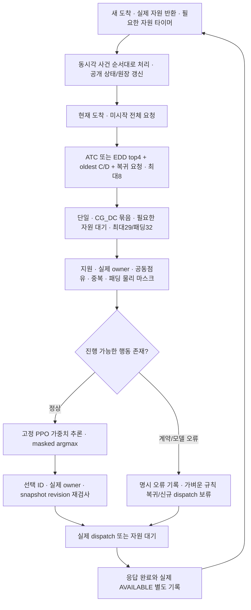

# D1Check: 전체 대기 큐 후보 + 물리 마스크 + 직접 PPO 설계


> **최신 유효 계약 — 2026-10-12:** 전체 현재 대기 큐 → ATC 후보 → 물리 행동 마스크 → ATC 점수＋PPO 보정 → 실행/필요 자원 대기 → 다음 사건에서 재판단. Greedy·RR·FIFO는 독립 비교군이며 제안 안에서 혼합하지 않는다. EFT는 새 정책·비교에서 제외한다. 현재 PC ABI는 **state218 / 행동별57 / 패딩32**이고, 상세 구현·오류 복귀는 [14절](#14-2026-10-12-최신-구현-계약-eft-제외greedy-독립-비교군atc-점수-보정)을 따른다.
>
> 08/09의24모델·6,144학습·10,416환경 실행은 완료했다. 가장 유망한 점수 보정 모델도 확인4/32조건 P95 손해로 **미채택**이며 원 기본 정책/experiment_ready=false를 유지한다. 기기·APK·S26·NPU 실행0은 이번 증분에 한정한다. 아래1~13절의198/49·최소 처리 경로·EFT 비교 및 과거 종료 결과는 당시 역사 기록이고 최신 계약으로 사용하지 않는다. 원20261011 출력은 SHA 그대로 보존한다. 최신 판정은 [통합 결과](ATC_PPO_ITERATIVE_RESULTS_20261012.md)를 따른다.

작성일 2026-10-11 KST. 설계 개정 2. 작업 ID `QUEUE-DIRECT-PPO-02`. 상태: **전체 큐 구현·3seed 학습·16정책 동조건 비교·전문가 최종 검토 완료, 새 PPO 채택 보류**. 실행 소비·선택 모델·확인 결과·판정은 [완료 보고서](results/queue_direct_ppo_20261011/README.md)와 원장이 우선한다. 이번 증분은 환경2,689(성공2,688·실패1), 새 학습1,536, 기기0이다. 세 모델 모두 strictV2 FAIL이다.

## 1. 추천 구조와 개정 경계

구현한 연구 구조는 **현재 도착·미시작 전체 큐 → EDD top4와 oldest·현재 복귀 후보 보충 → 최대8 요청의 현재 행동 → 물리 마스크 → 고정 PPO 추론 → 실제 dispatch 또는 기존 자원 대기 → 다음 사건에서 재판단**이다. ATC는 개발 동형 gate에서 중복으로 판정되어 별도 튜닝·학습을 중단했다. 기존 작업별 FIFO 선두 제약을 후보·마스크·묶음 두 번째 commit에서 제거했으며 지원 경로·현재 owner·실제 AVAILABLE은 유지한다.

결과에 따른 후속 추천은 **전체 큐 EDD + 현재 실행 가능 규칙(RuleEDD)**이다. 선정 PPO는 FIFO_READY보다 서비스 실패·J·AP가48조건마다 같고 긴급P95 평균이 더 높으며, RuleEDD보다 평균 P95·J·AP가 나빴다. 선두 차단 해소의 효과를 PPO 효과로 부르지 않는다. 새 기본을 채택한 것은 아니며 현재 앱 기본과 `experiment_ready=false`를 유지한다. 자세한 결과와 한계는 12절에 기록했다.

미래 구간의 일정과 비용을 최적화하지 않으므로 정확한 이름은 **사건 기반 온라인 스케줄링**이다. 여기서 롤링은 사건마다 미시작 요청을 다시 선택한다는 의미다. 전체 큐의 미래 실행을 반복 투영하는 정식 rolling horizon/MPC와 구분한다. 이미 시작한 요청은 재선택하지 않는다.

최신 사용자 지시는 모바일·산업공학·RL AI 전문가 3명의 협업, 선두 제한 제거, 추가 수정과 PC 학습·비교 실행까지 승인했다. 따라서 처음의 설계만 수행하던 작업 및 닫힌 선두 파일럿과 별도 실행 ID를 사용한다. 새 주 비교군은 FIFO-FIXED와 FIFO+EFT이며 Band/Triton은 제외한다. 현재 앱 기본을 자동 교체하거나 APK·기기·S26·NPU 작업을 승인한 것으로 확대하지 않는다.

### 조사 위치·원본 보존

| 항목 | 확인값 |
| --- | --- |
| 채팅 시작 위치 | `C:/Users/chomg/Documents/Codex/2026-10-11/dkfo` — projectless 작업 폴더 |
| 현재 checkout | 그 아래 `work/repo`, detached HEAD `12d64923be824ce4c88fca074fbe38820f5a7d25` |
| 적용 지침 | 저장소 루트 `AGENTS.md` |
| 시작 WIP | 이전 모바일 비교군 선정에 따른 STATUS/PLAN/DECISIONS 변경과 미추적 선정 문서가 존재했다. 사용자 변경으로 보존하며 통합 문서 작업자가 편집하지 않는다. |
| 현재 checkout의 같은 문서 | 작성 전 해당 파일 없음. 이 checkout에는 개정2를 새로 작성한다. |
| 원 개정1 | `outputs/ATC_DIRECT_PPO_DESIGN_20261011.md`에 71,890byte 문서가 있으며 SHA-256 `b5537e12fcde54f5fc450fbe07436b9ae4c87a89d1bb2e19b015df9114cc2e1c`로 확인했다. 원 파일과 다른 checkout의 사용자 WIP는 변경하지 않는다. |
| 등록 원본 | 로컬 `work/QUEUE-DIRECT-PPO-02/registration.json`·`inputs.json`·`budget.json` |
| 정책 schema | `f4346d8a0d9aaa49d38bc71b19c072501c41a517183170177725b4f2a9142d9e` |

원 개정1의 선두 권고는 초기 파일럿에서 구현됐지만 현재 개정에서 폐기하는 정책 제한이다. 이를 하드웨어의 필수 FIFO 계약으로 설명하지 않는다. 원 개정1의 학습0·실험0은 그 설계 작업의 기록이며 이후 파일럿이나 이번 승인된 실행을 프로젝트 전체0으로 덮어쓰지 않는다. 세 전문가의 검토·설계 작성 자체는 신규 학습/시뮬레이션/기기0이고, 주 담당자의 이번 실제 실행 증분2,689/1,536/기기0과 구분한다.

## 2. 기존 구조·기본·연구 결과와 차이

| 구분 | 기존 확인 내용 | 새 구조와 관계 |
| --- | --- | --- |
| 앱/runner 기본 | 기존 Android 경로 및 명시 정책 입력. 직접 PPO가 배포 기본으로 채택된 근거 없음 | 앱 기본 유지. 새 연구 정책은 `experiment_ready=false` |
| 연구용 JointList/CostList | 현재 도착 큐의 후속 배정·응답·J/AP 예측을 사용하는 SERVICE-ENVELOPE 정책 | 후보·encoder·mask·복귀에 직접 연결하지 않음 |
| 기존 rolling PPO | 창 계획/전체 큐 소진 예측으로 후보·행동 특징·성능 제한 mask 구성 | 새 bank/encoder/physical mask/fresh weights로 대체 |
| 선두 직접 PPO V1 | 작업별 C/D 선두 최대2, 90상태·7×23행동 | 전체 큐 top4+보충, 198상태·32×49행동으로 별도 ABI |
| 새 직접 PPO V2 | 전체 현재 큐의 요청 점수와 현재 행동만 계산 | 미래 도착·실현 미래 서비스·예측 미래 J/AP를 정책에 주지 않음 |
| 복귀 | 과거 연구 기본·선두 L0는 서로 다른 정책 | 새 복귀는 전체 큐 EDD 순서에서 현재 즉시 legal 요청 최대2를 배정하는 가벼운 규칙 |

기존 미래 계산 위치는 `d1_rolling_list_rl.py`의 `bank/predict/encode/admission`, `d1_rolling_execution_prefix.py`의 `choose_prefix`, `d1_rolling_prefix_opportunity.py`의 `project`, `d1_service_envelope_policy.py`의 `joint_jobs/encode`, `d1_empirical_request_policy.py`의 `rollout/score`다. 이미 도착한 큐만 예측해도 미래 응답·J/AP를 계산하는 구조다. 미래 도착을 미리 보는 누수와는 다른 차이이며 새 callback에서는 둘 다 제외한다.

### 과거 결과를 보존하는 해석

- `IE_PRIORITY_COMPARE_20261010.md`: 전체 도착 큐 ATC와 EDD는 개발24+확인24에서 원장·전이가 정확히 같았다. 원 기록의 일정 동일성이 전체 ordered rank 동일성까지 증명하지는 않는다. 당시 w=1/k=2·같은 ECT 배정이었다.
- `ATC_PPO_DESKTOP_PILOT_20261011.md`: 선두 직접 PPO 3seed×64, 새48조건 비교를 완료했으나 모두 원 strict FAIL, 채택0이다. 당시 25,352판단에서 ATC/EDD bank·legal action이 같았다. 그중 선두1명 23,176·선두2명 2,176·유효행동1개 19,844는 저장 자료의 정적 집계이며 독립 실험 횟수가 아니다.
- 선두 파일럿의 PPO11은 same-bank Rule, PPO23/37은 당시 Triton과 48조건 실행 일정이 같았다. 이 결과를 전체 큐 정책의 성능 결과로 확대하지 않는다.
- 과거 미래 예측 PPO의 512회 실험 및 서비스-envelope 실험에도 strict FAIL 기록이 있다. 이번 새 전체 큐/FIFO·EFT 조건과 동등한 비교는 별도 문제다.
- 기존 미래 예측 PPO와 원 선두 직접 PPO의 같은 새48조건 재생은 주 matrix와 별개인 `QUEUE-DIRECT-PPO-02-LEGACY-COMPARE`로 **최종 확인 시작 전에 추가 등록**했다. 구 선두3개와 구 미래예측 Future64 3개, 총6개 고정 모델을 재학습 없이 평가하여288행을 완료했다. 최신512 가중치는 여기 없으므로 Future64를512 모델이라고 이름 붙이지 않는다. 첫 adapter 실패1을 포함한 실제289환경·학습0을 기록했다. 과거 자체 JointList 비학습 기본과의 동조건 완전 비교는 이번에 추가하지 않았다.

ATC의 효과, 후보 확대의 효과, 미래 계산 제거의 효과, PPO 학습의 효과는 별도다. 전체 큐 점수 계산은 허용하지만 전체 큐 미래 실행은 허용하지 않는다는 구분을 유지한다.

## 3. 운영 흐름과 실행 불변조건



현재 engine은 공개 phase 변화에서도 callback이 생길 수 있다. 주요 운영 사건인 도착·AVAILABLE·자원 timer를 중심으로 재판단하며 phase 상태는 관측에 반영한다. HOLD 중에는 같거나 중복된 상태에서 새 dispatch를 반복하지 않는다.

| 계약 | 유지하는 의미 |
| --- | --- |
| 경로 | urgent classification CPU/GPU, normal detection CPU |
| 병행 | classification_GPU+detection_CPU만, 최대2건 |
| 실행 중 요청 | 선점·이동·취소·재실행 금지 |
| 응답 | urgent OUTPUT_READY(두 번째 경계), normal PERSISTED(세 번째 경계) |
| 점유 반환 | 실제 AVAILABLE(다섯 번째 경계)까지 owner 유지 |
| WAIT | 실제 owner 때문에 지원 경로가 막힌 자원 대기만. 냉각/임의 idle/미래 도착 예약 없음 |
| 미지원 | 탐지GPU·C_CPU+C_GPU·3건 동시 실행·NPU를 후보로 추가하지 않음 |
| 품질·서비스 | 기존 요청 기한·전체 도착 분모·strict 수치 유지. physical mask는 납기/서비스 보장을 의미하지 않음 |

현재 ticket에는 DAG 선행관계나 출력 순서 강제 필드가 없다. 엔진은 선택 request_id로 큐에서 제거하므로 뒤 요청 실행이 가능하다. 새 PPO는 작업 내부 FIFO를 강제하지 않는다. 두 FIFO 비교군은 정책 정의로 global FIFO를 유지한다. 미래 실제 앱에 프레임 순서·상호 의존성이 생기면 명시적인 dependency admission과 새로운 ABI가 필요하다.

## 4. ATC 후보 선정 명세

### 원형과 앱 수정식

원형은 높은 지수부터 검토한다.

\[
I_i(t)=\frac{w_i}{p_i}\exp\left[-\frac{\max(d_i-t-p_i,0)}{k\bar p}\right].
\]

근거는 [Vepsäläinen–Morton 원 연구](https://pubsonline.informs.org/doi/10.1287/mnsc.33.8.1035)다. 원 연구의 가중 지각 비용 문제와 앱의 urgent/normal 서비스 입력은 같은 것이 아니다. 아래는 점유 생산성과 응답 여유를 분리한 앱용 적용식이다.

\[
I_i^{app}(t)=\frac{w_i}{\hat p_i^{occ}}
\exp\left[-\frac{\max(d_i-t-\hat r_i,0)}{k\bar p_Q^{occ}}\right],
\qquad \bar p_Q^{occ}=\frac{1}{|Q_{known}|}\sum_{j\in Q_{known}}\hat p_j^{occ}.
\]

실제 코드는 음의 로그 `L_i=log(p_occ)−log(w)+max(d−t−r,0)/(k·mean_p)`를 최소화한다. 알려진 양수 추정치만 평균에 포함하며 미상 추정은 점수 미상으로 뒤에 둔다. 미상 값은 FIFO tie와 복귀/coverage로 처리하고 미래 실현값으로 채우지 않는다.

| 기호·설정 | 등록된 의미 |
| --- | --- |
| Q_t | 도착했고 아직 dispatch하지 않은 전체 요청. 실행 중/미래 도착 제외 |
| w | urgent2, normal1. 정책 중요도이며 실제 지연의 금전 비용 아님 |
| p_occ | dispatch~AVAILABLE의 측정 기반 5phase 추정 합 |
| r | 같은 대표 backend에서 urgent 앞2phase, normal 앞3phase 합 |
| d | arrival_ns+원 deadline_offset_ns, urgent1.5초·normal6초 |
| t | 현재 엔진 시각, 계산은 초 단위 |
| k | 2 고정. 개발/확인 중 사후 튜닝 없음 |
| 대표 경로 | 지원 경로 중 추정 p_occ 최소, CPU 동점 우선. 현재 owner를 점수에 넣지 않음 |
| 초기 추정 | 동결 A24 측정 service의 공통 초기 추정 |
| 관측 갱신 | 실제 AVAILABLE 뒤 완결된 5phase 관측의 EMA α=0.1 |

최소 점유 경로와 최소 응답 경로는 같다고 가정하지 않는다. 후보 점수는 위 대표 경로를 고정하고 실제 CPU/GPU 선택은 PPO나 EFT 단계에서 한다. 현재 owner 잔여는 lane 상태 입력과 EFT 비교에 사용한다. 전체 미시작 큐의 향후 배정·응답·J/AP를 ATC 점수에 넣지 않는다.

### 후보 생성·동점·상한

1. Q_t 전체의 ATC 또는 EDD 순위를 계산한다. EDD는 절대 d 순서다. 모든 동점은 arrival_ns/ordinal/id.
2. top4, 각 작업 oldest C/D, 현재 fullqueue EDD 복귀가 선택할 최대2 요청을 합친다.
3. ID 중복을 제거한다. 합집합 최대8이며 초과하면 계약 오류다. 점수로 고른 후 슬롯은 arrival/ordinal/id 순서로 정렬해 canonical encoding을 유지한다.
4. 후보별 지원 single, C_GPU×D_CPU pair, 실제 막힌 경로가 있는 경우 resource wait 한 개를 만든다. WAIT target은 이유이며 예약이 아니다.

현재 작업별 지원/공동점유 가능성이 요청마다 같으므로 oldest C/D가 현재 실행 가능한 작업 패턴도 대표한다. 모든 실행 가능한 ID를 무제한 보충하지 않는다. 요청별 지원·의존성이 달라지는 미래 버전에서는 이 coverage 근거를 다시 검증한다.

C개 분류,D개 탐지이고 C+D≤8이면 행동 수는 `2C+D+C×D+wait≤29`; 최대는 C=4 또는5일 때다. 행동 padding32는 이 상한에서 도출했으며 기존7행동 숫자를 유지한 것이 아니다. 후보8·행동32는 전체 큐 크기를 제한한다는 의미가 아니다.

oldest 보충은 starvation 방지 기회를 주지만 강제 실행 보장은 아니다. 뒤 요청을 골라 앞 요청의 기한/꼬리 지연이 악화될 수 있다. 전체 요청 완료·실패와 nonhead 선택·최대 대기를 함께 평가한다. 공정성이나 납기 점수를 물리 불가능 마스크로 넣지 않는다.

### ATC/EDD 차이를 기대할 수 있는 조건과 중단

같은 task의 p/w/r/상대 납기가 같으면 먼저 도착한 요청의 절대 납기가 작아 `L_old≤L_new`다. 모든 여유가0이면 FIFO tie다. 따라서 ATC에서도 작업 내부 FIFO 순위가 자연스럽게 나온다. 전체 큐를 허용해도 순위가 달라지지 않을 수 있다. 전체 큐 mean p가 C/D backlog 구성에 따라 변하면 task 간 순위가 바뀔 가능성은 있지만 성능 이득을 전제하지 않는다.

등록된 gate는 학습 전 개발24의 RuleATC가 방문한 같은 snapshot에서 ATC/EDD raw rank, raw top4, canonical bank, legal action set, Rule 선택을 따로 비교한다. bank·legal action 차이가0이면 **EDD bank만 fresh 3seed를 학습하고 ATC 튜닝·중복 학습은 중단**한다. 차이가 있으면 ATC와 EDD 각각3seed를 학습한다. 방문한 개발 상태에서의 관측 gate이며 모든 가능한 상태의 동형성 증명이 아니다.

`bank_gate.json`은 개발 판단3,075에서 bank·유효행동의 차이0, raw rank/top4/Rule 선택 차이0으로 EDD 단일 bank를 선택했다. 확인의 직접-policy5군×48조건에서도31,100/31,100 bank·legal·rank·Rule선택이 같았다. ATC3seed 중복학습을 추가하지 않았다. 이 동일성은 실제 방문 상태의 관측이며 모든 가능한 이질 요청에서의 동일성 증명은 아니다.

encoder는 ATC 점수·raw rank를 직접 입력하지 않는다. canonical bank·mask·base가 같으면 request/state/action의 입력 특징도 같게 구성된다. 현재 gate 집계는 action/mask 동일성을 직접 검사하며 encoder 동형성은 이 구성에서 도출된다. 최종 보고는 raw rank 동일, 후보 동일, 유효 행동 동일, 실제 Rule/PPO 선택 동일을 구분한다.

실제 이질 입력 크기·가변 납기·가변 중요도가 있다면 ATC/EDD 차이가 생길 수 있으나 이번 measured workload에 임의로 추가하지 않는다. 별도 측정 계약 또는 사전 등록된 합성 가정 평가로만 다룬다.

## 5. PPO 상태·행동·마스크 ABI

schema가 같은 후보·mask·encoder를 학습/개발/확인/운영에서 공유한다. 원 선두 PPO 가중치·Adam을 재사용하지 않는다. 현재 ABI는 state float32[198], actions float32[32,49], mask bool[32]다.

### 상태 198

| offset | 필드 | 차원·정규화 |
| --- | --- | --- |
| 0..2 | 현재시각, C/D 대기 수 | 3; t/120초, log1p(n)/log97 |
| 3..6 | C/D oldest age, 두 번째 요청 slack | 4; 각 task 기한1.5/6초 |
| 7..9 | C_CPU/C_GPU/D_CPU 현재 큐 작업량 | 3; 요청수×추정 p_occ/6초 |
| 10..13 | 최근 도착 간격/valid, 과거 normal CPU 작업량률/valid | 4; 관측된 최근8ticket만 |
| 14..19 | 현재 AP/valid/예비0, 과거 AP 기울기/valid, 관측 최고 AP | 6; (AP−30)/10°C, 기울기/0.1°C/s |
| 20..23 | 이미 응답한 urgent P95/valid, urgent/normal 응답 수 | 4; P95/1500ms, 수/96 |
| 24..167 | 후보8×18 | 아래 요청 특징 |
| 168..197 | CPU/GPU 각15 | 아래 lane 특징 |

후보 요청18은 valid1, task2, priority2, age/Δ1, slack/Δ1, w/2 1, CPU/GPU support2, 각 backend의 p_occ/6초·r/Δ·estimate-valid3×2, 같은 대표 경로 관측 수·최근 관측 age2다. lane15는 owner1, owner task2, responded1, phase one-hot6, dispatch/phase 경과2(각6초), 추정AVAILABLE 잔여/6초·known·unknown3다. 실제 현재 owner를 보여주며 예측상 해제가 실제 owner를 지우지 않는다.

현재 AP는 PC frozen model-plant 관측값이다. 표면 온도/기기 센서 실측으로 표현하지 않는다. 숨은 H/slow는 state에 넣지 않는다. 향후 Android는 실제 센서 채널·valid·history 계약부터 고정해야 한다.

### 행동 49와 물리 mask

| 구성 | 차원 | 의미 |
| --- | ---: | --- |
| present와 종류 | 4 | present1, single/bundle/resource_wait one-hot3 |
| job1 | 22 | 아래 특징. single/wait target 또는 bundle 첫 요청 |
| job2 | 22 | bundle 두 번째 요청. 나머지는0 |
| fallback 표시 | 1 | 이 action이 현재 가벼운 복귀 선택인지 |

job22는 valid1+task2+priority2+CPU/GPU2+후보slot one-hot8+age/slack2+Δ/6초1+w/2 1+p_occ/6초1+r/Δ1+estimate-valid1이다. pair는 GPU 분류가 job1, CPU 탐지가 job2다. 두 요청의 ID→slot→특징 왕복 연결을 검사하며 첫 요청 값을 둘째 요청에 복사하지 않는다.

| 마스크 조건 | single | bundle | resource wait |
| --- | --- | --- | --- |
| ID 존재·미시작 | 요청이 현재 queue에 있음 | 두 ID 모두 존재·서로 다름 | target ID 존재 |
| 지원 | p.backends에서 CPU/GPU 허용 | C_GPU+D_CPU만 | target 지원 경로 |
| 실제 owner | 선택 lane idle | 둘 모두 idle, 순차 virtual state 검사 | 실제 owner가 최소1명 있고 target이 지금 막힘 |
| 공동 점유 | 현재 owner와 supported state | 서로 다른 lane, 총2건 제한 | 현재 실제 자원 때문에 막힌 경우만 |
| 중복/패딩 | 패딩 false | 요청·lane 중복 false | alias 한 개, 패딩 false |

시간·수치 입력은 고정 단위로 정규화하고 clip[-10,10], finite 검사한다. 결측은0+별도valid다. 후보·행동 padding은0, 행동 mask=false다. unsupported 경로 추정은0+valid=false지만 알려진 물리 지원까지 제거하지 않는다. 관측 overrun 잔여0은 확정 해제 시각이 아니며 known=false/unknown=true다.

### PPO 입력·출력·재사용

state MLP198→64→64, action MLP49→32→32, 결합96→64→1의 shared actor를 사용한다. critic은 state64→6(AP return와 E/I/U/N/Q 비용)이다. masked Categorical 확률과 critic 값을 출력한다. actor 마지막 층을0으로 초기화한다.

학습은 categorical sample, 독립 action generator를 사용한다. 확인/운영은 masked argmax이며 최대 logit 동점에 fallback이 있으면 fallback, 아니면 canonical 최저slot을 선택한다. 운영에서는 가중치·optimizer·승수를 업데이트하지 않는다. 추정치 EMA와 현재 관측 갱신은 학습과 별개다.

native `ppo_losses/minibatch_losses`, clipped ratio·episode aggregation·Adam·원자 checkpoint·난수 복원을 재사용한다. 새 shape/frame validator와 ActorCritic은 별도 작성한다. 실제 Controller의 encoder가 dtype/finite를 보장하고 actor forward는 shape·all-masked를 검사한다. 학습 frame validator는 shape/dtype/finite/선택 유효성과 sampled likelihood를 검사한다.

## 6. 이벤트 루프·동시각·오류 복귀

### 같은 시각 순서

현재 engine의 순서는 CPU phase/실제 반환 → GPU phase/실제 반환 → ordinal 도착 → 자원 timer → 이전 pending dispatch 완료 → fresh 판단이다. 길이0 phase는 fresh 판단 전에 모두 처리한다. 도착 자료는 arrival/ordinal/id로 정렬한다. timer는 owner를 반환하지 않는다.

묶음은 C_GPU를 먼저 실제 dispatch하고 두 번째 callback에서 같은 시각·첫 dispatch 영수증·GPU 실제 owner·D의 큐 존재·CPU 실제 idle·CG_DC 지원을 다시 검사한다. 실패한 D는 큐에 남겨 다음 사건에서 판단한다. 비선두 D도 허용한다.

중복 판단 revision은 `(now,event_seq,queue_ids,lane_owners)`다. 진행 중 요청은 큐에서 제거되고 실제 dispatch 원장 ID는 유일해야 한다. HOLD는 큐/owner signature와 가장 이른 알려진 owner 예상 반환 timer를 저장하며 새 도착·실제 AVAILABLE에서 취소한다. 이미 추정 반환이 지나 미상일 때는 실제 사건을 기다린다.

```text
on_event_batch(now):
    process CPU phases and actual AVAILABLE, then GPU
    record OUTPUT_READY/PERSISTED responses separately
    admit same-time arrivals in ordinal order; update public journals
    process resource timer; complete previous pending dispatch
    exhaust zero-duration stages before deciding

    if queue empty: return IDLE
    if guarded pair second exists:
        recheck first receipt/owner/time and second physical legality
        if valid: dispatch second; return
        keep second queued; record cancellation
    if unchanged HOLD before timer: return WAIT
    if duplicate decision revision: return NO_NEW_DISPATCH

    waiting = arrived and unstarted queue
    score = ATC(waiting, public estimates) or EDD(waiting)
    base = current fullqueue EDD legal-placement rule(max two)
    candidates = unique(top4 + oldest C/D + base IDs), bound 8
    actions = supported singles + CG_DC pairs + one needed resource wait
    physical_mask = owner/support/joint-state/ID/padding checks
    if no legal action: record contract error; wait for actual event/fail closed
    encode state198, actions32x49, mask32
    if one valid action: choose it
    else if valid fixed model: infer masked argmax (training only samples)
    else: choose base; record model error/fallback
    recheck physical legality and revision before dispatch
    dispatch first job or HOLD on required owner
    record selected snapshot and measured decision time
```

| 상황 | 구현 계약·처리 |
| --- | --- |
| 빈 큐 | idle, 학습 frame 없음 |
| 전부 mask false | `no_legal_progress_contract_error`, 새 dispatch 보류. 실제 owner가 있으면 실제 사건까지 기다림. 현재 지원에서 idle+유효 요청인데 전부 false는 계약 결함으로 평가 실패 |
| 모델 없음·schema/shape/nonfinite logits/value·잘못된 index | 가벼운 현재 fullqueue 복귀 선택, error/fallback 기록 |
| 반복 모델 오류 | 연속3회 뒤 해당 controller의 모델 disable, 이후 복귀 |
| encoder nonfinite·불법 공개 정보·원장/phase 불일치 | 믿을 수 있는 입력이 아니므로 실행 오류로 기록하고 신규 dispatch 보류/환경 실패. 미래 정답으로 대체하지 않음 |
| 선택 후 owner/ID 변화 | 재검사 실패. pair 두 번째는 취소하고 미시작 요청 유지; stale action은 계약 오류 |
| 추정/관측 결측 | 점수/잔여 미상 표시, physical mask와 분리, 현재 legal 복귀/실제 사건 대기 |
| 학습 오류·체크포인트 불일치 | optimizer update 이전 snapshot 복원, source/ABI/dependency mismatch는 거절. 오류 환경 소비는 원장에 유지 |

복귀 `head_l0`라는 함수명은 역사적으로 남았지만 실제 새 함수는 전체 큐를 EDD로 훑고 현재 legal 경로의 추정 점유 최소를 선택한다. 현재 virtual owner에만 최대2건 추가하며 미래 종료시간이나 큐 소진 계획을 만들지 않는다. JointList/rolling forecast 복귀를 호출하지 않는다.

## 7. 학습·개발·확인·운영 계약

| 단계 | 후보·상태·mask | 가중치 | 자료·목적 |
| --- | --- | --- | --- |
| 학습 | 같은 fullqueue8 schema | complete episode8 묶음으로 PPO update | 행동과 실현 결과를 수집. episode 뒤 label 작성 |
| 개발 | 동일 schema | 경계128/256/512 actor 추론 | bank 중복 gate, 확대/중단, checkpoint·대표 bank/seed 선택 |
| 최종 확인 | 동일 schema·고정 설정 | freeze된 actor 추론만 | 별도 새 도착4seed×4family×3context=48조건, 전량 대응 비교 |
| 운영 | 동일 계약의 현재 관측 | 고정 actor 추론만 | 실제 사건마다 미시작 요청 재판단. 운영 학습 없음 |

과거 가중치 또는 상태·행동 정의가 다른 가중치는 재사용하지 않는다. 현재 설정 k2/w2:1/top4/EMA0.1은 고정이며 그 밖의 custom 설정은 새 dependency/schema 계약이 필요하다.

### 보상·비용과 단위

objective는 `QUEUE_DIRECT_CAUSAL_AP_INTERVAL_J_ABSOLUTE_SERVICE_P95_V2`, γ=1/no GAE다. AP는 행동 시각부터 다음 행동 시각까지 실현된 running peak 증가의 음수, 마지막 행동은 terminal까지 귀속한다. 같은 시각의 결정은 AP증분0일 수 있다. 미래 peak를 행동 당시 입력으로 읽지 않고 episode 종료 뒤 학습 label로만 쓴다.

| 채널 | 학습 label·정규화 | 최종 평가 |
| --- | --- | --- |
| AP reward | −실현 running peak 증가/1°C; suffix return | 공통 AP35..180 최고°C·조건별 차이 |
| E cost | (공통J120−알려진 상주 baseline120J)/1J, 대기 구간 포함 | 전체 공통J120 원단위, baseline 미차감 |
| I cost | incomplete/planned | 전체 도착 완료·미완료 건수/율 |
| U cost | 응답 미완료/긴급 기한 실패를 urgent planned로 나눔 | urgent 실패·전체 분모와 완료 응답 P95 |
| N cost | 응답 미완료/일반 기한 실패를 normal planned로 나눔 | normal 기한 내 완료율·실패·미완료 |
| Q cost | urgent P95/1500ms | urgent P95 ms, U/I와 같이 해석 |

I/U/N 승수 초기10, target0, eta0.01/cap100의 dual을 사용한다. E/Q 가중치는1 고정이다. 학습 승수0목표는 유한 학습에서 hard SLA 보장이 아니다. 일반 요청의 기한 내 성공과 미완료는 N/I로 학습하며 normal P95·최대대기는 보조 평가다. 서로 다른 단위의 critic loss/advantage·λ 변화를 기록한다.

AP/J 미완결이나 urgent 응답표본 부재는 해당 label valid=false로 두며 비용0을 성공으로 해석하지 않는다. 전체 episode E/I/U/N/Q 비용을 각 frame의 target에 주는 방식은 credit assignment가 거칠다는 한계가 있다. AP interval telescope·최종 원단위 지표는 따로 검증한다.

clipped PPO는 update당 episode8, epoch≤4, minibatch256frame, lr0.0003/Adam eps1e−5, ratio clip0.2, value0.5/entropy0.01, gradient clip0.5, target KL0.03이다. stochastic 선택 가능 frame만 actor likelihood/entropy 대상이며 forced action은 critic만 사용한다. 모델 오류 fallback frame은 actor 경험에서 제외한다. informative의 구현 기준은 mask 수>1이며 ID만 다른 행동과 task/backend/pair/wait 종류가 다른 행동을 진단에서 구분해야 한다.

### 자료·난수·선택·재개

- actor init seed41/53/67, action generator seed+10000, shuffle seed+20000를 분리한다.
- train arrival `872110101..872110228`, dev `872210101/102`, confirm `872310101..104`, realization seed `872000201`을 등록했다. 사용 registry와 충돌 검사를 수행하는 구조다.
- train512 episode는128 도착seed×4family이며 context는 등록 순환으로 선택한다. 개발/확인은 각 도착seed×4family×3context다.
- 같은 request_id/backend의 실현 벡터는 keyed RNG로 선택하므로 정책의 dispatch 순서가 이후 환경 난수를 바꾸지 않는다. 정책은 그 벡터를 미리 읽지 않는다. 이번 벡터4개는 같은 frozen context를 사용하므로 독립 실측 반복4회로 해석하지 않는다.
- checkpoint는 weights/Adam/λ/부분8episode 경험/cursor/소비/action RNG/shuffle RNG/source/schema/objective를 원자 저장한다. UPDATE 실패는 이전 learner snapshot으로 복원한다. 환경 중간 상태 복원과 episode 경계 재개는 구분한다.
- 개발 checkpoint 선택은 합계 I→U→N→조건별 urgent P95 평균→J 평균→AP 평균의 lexicographic 순서이며 exact tie는 적은 episode다. 대표 bank/seed도 개발 key와 role tie로 결정한다. 이 개발 기준은 최종 strict와 다르며 평균 선정이 조건별 비악화를 보장하지 않는다.
- `freeze.json`에 선택한 각 bank/seed epoch·PT SHA·등록 SHA·대표 role·stop 이유를 **최종48을 읽기 전에** 고정한다. 전 seed의 선택 모델을 최종 확인하고 좋은 seed만 보고하지 않는다.
- 등록 sources에 policy/learner/budget/mobile/test와 frozen model SHA가 있다. `d1_queue_direct_study.py` 자체 hash 누락을 발견해 원등록을 바꾸지 않고 `driver_freeze_receipt.json`을 보충했다. driver 변경0을 기록하고 **491환경/323학습 시점,128단계 개발선택·최종 확인 전** SHA `2d46b7f4b59b9011409c2b8921cc913a410c8801ddb888fb68d20e9283fcc531`를 잠갔다. 원 run 재개 자동검사는 보충 SHA를 포함하지 않았다. 종료 후 별도 guarded CLI와 변조 거부 검사를 추가하고 최종 source/input/model SHA를 검산했다. 처음부터 전체학습에 이 guard가 적용된 것으로 표현하지 않는다.

## 8. 비교군과 strict V2

| 등록 역할 | 요청 선택·자원 배정 | 효과 분리 |
| --- | --- | --- |
| FIFO_FIXED | global arrival/ordinal/id; C_GPU/D_CPU 고정; 막힌 선두에서 대기 | 단순 고정 baseline |
| FIFO_EFT | 같은 global head; 현재 owner+이 요청1건의 예상 AVAILABLE 종료 최소 | 동적 경로 배정 효과 |
| FIFO_READY | 같은 고정 경로, arrival순 현재 실행 가능한 요청으로 건너뜀 | head-of-line 차단 해소 효과 |
| EDD_EFT | 전체 큐 절대 기한순 선두, 같은 단일 요청 EFT | FIFO→납기순 효과 |
| ATC_EFT | 전체 큐 ATC순 선두, 같은 EFT | 같은 배정하의 ATC 순위 효과 |
| RuleEDD/RuleATC | 같은 bounded bank/physical mask에서 해당 순위의 현재 실행 가능한 요청, 최소 점유 경로·허용pair | 직접 선택 구조·후보와 학습의 효과 분리 |
| EDD_41/53/67 | EDD bank의 fresh PPO | same-bank Rule 대비 학습 효과·시드 변동 |
| ATC_41/53/67 | gate에서 bank 차이가 있는 경우만 별도 fresh PPO | ATC 후보와 EDD 후보의 차이 |
| HeadDirect_11/23/37 | 원 선두 bank·원 개발에서 선정된32/64 checkpoint, 추가 학습0 | 선두 제한 당시 직접 PPO와 새 전체큐 정책의 대응 |
| Future64_11/23/37 | 공개 묶음의 원 terminal64 미래예측 PPO, 추가 학습0 | 미래 계산을 포함한 기존 정책과의 성능/판단시간 대응 |

FIFO_FIXED/EFT는 선두가 막히면 후속 요청을 건너뛰지 않는다. 첫 요청이 dispatch한 뒤 같은 시각 다음 FIFO 요청이 legal이면 CG_DC로 병행할 수 있으므로 FIFO에만 강제직렬을 붙이지 않는다. READY는 별도 정책이며 일반 FIFO로 이름을 합치지 않는다. PPO가 FIFO만 이기고 READY를 못 이기면 head blocking 제거의 효과와 학습 효과를 구분해야 한다.

EFT의 식은 `F_occ(i,b)=S(i,b)+p_occ(i,b)`이며 S는 같은 lane 또는 미지원 joint state의 실제 owner 추정 반환 중 최댓값이다. 추정이 유효한 지원 경로의 F를 먼저 비교하고, 미상 경로는0 종료로 채우지 않는다. 동점은 즉시 가능한 경로·CPU 순서다. 모든 blocked owner 반환이 미상이면 실제 사건까지 기다린다. EFT는 OS CPU scheduler/EAS 또는 CEDR 전체 시스템을 재현한 것이 아니라 기본 요청 단위 이종 자원 배정 적용이다.

모든 비교군에 동일 도착·작업량·기한·지원·실현 duration·초기 AP·관측창을 준다. PC 제어 overhead는 기존 plant의0 가정을 유지하며 실측 판단시간은 별도 계측한다. 동일 입력에서의 case별 paired delta와 일정 동일성·선택 분포를 보고한다. 평균 이득으로 서비스 악화를 감추지 않는다.

HeadDirect/Future64는 별도 보조 budget·원장으로 주 비교 종료 후 순차 평가한다. 등록에48조건×6=288행, 고정 weights SHA, main 등록SHA와 같은 realization seed를 잠갔다. 이 보조군을 새 strict의 adoption reference로 추가하거나 결과를 보고 좋은 옛 seed만 고르지 않는다. 기존 정책 내부의 미래 forecast는 명시적으로 Future64에서만 허용되며 새 직접 정책의 인과성 계약과 분리된다.

보조 비교도 후보·상태·보상·학습량이 함께 다르므로 미래 계산 제거 한 요소의 순수 인과 효과라고 주장하지 않는다. 특히 Future64 원64와 새 최대512의 비교는 학습량 효과도 섞여 있다. 원 지표 대응과 실제 PC 판단부담을 관측하고 최종 보고에 이 제한을 명시한다.

새 참조 계약은 `FIFO_EFT_QUEUE_STRICT_V2`다. 변경한 것은 주 참조 집합이며 기존 물리·기한·전체 분모·epsilon0 조건을 완화한 것이 아니다. 과거 Band/Triton 기반 FAIL을 새 기준의 PASS로 소급 변경하지 않는다.

1. 모든 조건에서 예정 전량 완료. incomplete·urgent failure·normal failure·urgent P95·J120·AP peak가 FIFO_FIXED/FIFO_EFT/같은 bank Rule 각각보다 비악화여야 한다.
2. low/sustained에서는 원래처럼 incomplete·urgent·normal failure의 절대0을 요구한다.
3. 전체 유지 조건을 통과하고, low 또는 sustained 한 family의 **모든** paired condition에서 FIFO 두 참조 각각보다 J 또는 AP가 엄격히 작으면 채택 후보다.
4. 서비스 손실·미완료로 비용을 줄인 결과, 평균만 좋은 결과는 탈락한다. PPO와 Rule이 동률이면 복잡한 학습의 추가 근거가 없으므로 단순 Rule을 우선한다.
5. PC의 유망 후보도 자동 배포/기본 교체는 아니다. Android 독립 검증 전 `automatic_adoption=false`, `experiment_ready=false`다.

## 9. 구현 파일·재사용·검증

| 파일 | 새 책임·재사용 범위 |
| --- | --- |
| `tools/d1_queue_direct_policy.py` | 전체큐 점수/bank/physical mask/198·49 encoder/사건 controller/가벼운 fallback |
| `tools/d1_queue_direct_ppo.py` | fresh shared ActorCritic/causal interval target/dynamic frame/PPO learner/checkpoint |
| `tools/d1_queue_mobile_rules.py` | global FIFO fixed/EFT/READY, EDD·ATC EFT. 현재 owner+선택 요청1건만 계산 |
| `tools/d1_queue_direct_study.py` | 등록/source 검산/대응 환경/중복bank gate/단계학습·개발/사전freeze/최종strict |
| `tools/d1_queue_direct_budget.py` | immutable cap/active clock/start-counted append 원장/stop·중복ID 방지 |
| `tools/d1_queue_legacy_compare.py`·`d1_queue_legacy_budget.py` | 고정 HeadDirect/Future64의 같은 새48 재생·별도 cap/원장. 새 learner 업데이트 없음 |
| `tools/test_d1_queue_direct.py` | 뒤 요청 선택/shape·패딩/owner·wait·지원/오류복귀/인과성/loss·RNG·Adam/pair binding |
| `tools/d1_queue_direct_cli.py`·`test_d1_queue_transport_guard.py` | 종료 후 추가한 보충 driver SHA guard·향후 imported driver 등록·옛 hook 전송 계약 회귀검사. 기존 학습 source 변경0 |
| `tools/d1_queue_direct_report.py` | 저장 결과 SHA/원장 감사·CSV/PNG/HTML·계산 벤치 및 재보고. 학습/환경 실행 없음 |
| `d1_list_candidate_rl_engine.py` | 기존 실제5phase/공개events/응답/AVAILABLE/request-keyed realization 재사용 |
| `d1_list_candidate_rl_training.py`·`d1_list_candidate_rl.py` | native clipped PPO 수학·mini-batch loss/Settings/순위P95 등 재사용 |
| `d1_empirical_request_policy.py` | backends/state/profile만. rollout/score는 새 online 판단에서 금지 |
| `d1_rolling_hybrid_model.py` | frozen AP model-plant 관측·실현 accounting. online 미래 costs는 금지 |

등록의 source 경계는 단순 import 목록과 실제 판단 call graph를 구분한다. 모듈에 과거 forecast 코드가 import되어 있다고 사용했다고 단정하지 않는다. 반대로 Controller의 후보·mask·encoder·fallback에서 호출되면 금지 위반이다.

검증 기준은 (a) 같은 작업의 뒤 요청 single 및 nonhead D pair-second가 실제 선택 가능, (b) 응답·AVAILABLE 분리, (c) 지원/중복/phase 전량 감사, (d) zero-duration·timer·unknown overrun·HOLD cancellation, (e) 새 ABI 및 old-schema fallback, (f) native full/partition loss parity, Adam·partial·다음 action/shuffle exact restore, (g) AP interval telescope, (h) 미래 호출 trap이다. 단위 테스트 통과와 native 환경 통과·정책 우위·기기 통과를 각각 구분한다.

단위검사는 학습 전 계약9개와 종료 후 transport/driver guard3개로 **총12 PASS**다. 앞9개는 Adam 실제1update 뒤 partial2·난수 소비 후 next action/shuffle·digest 복원, 새 ABI loss partition,2frame AP 귀속, nonhead D pair commit, 모바일 미래 호출trap/overrun을 포함한다. 뒤3개는 과거 hook 없음/기존 hook 보존과 보충 driver SHA 변조 거부다. 종료 후 검사로 과거 학습 전 보호 범위를 소급 확대하지 않는다.

이벤트→dispatch 경로에 전체 미래 queue rollout이 없는지 확인하는 기준:

- 입력 queue에 미래 ticket/engine left/durations가 없고 공개 필드만 허용한다.
- old `rollout/place`와 future `hybrid.costs`를 callback 실행 중 trap한다. EFT도 old place 대신 새 단일 요청 함수만 사용한다.
- ATC는 요청별 추정·현재 t·현재 큐 mean만 사용한다. fallback은 현재 virtual owner에 최대2건 추가하며 가상 시각을 앞으로 진행시키지 않는다.
- online diagnostic shadow ATC/EDD bank도 동일한 현재 스냅샷 계산이다. 그 비용을 실제 callback에서 숨기지 않는다.
- 환경에서 전체 trajectory를 실행해 결과를 수집하는 것은 학습/평가 plant이며 정책 내부 미래 계획과 구분한다. 실현 후 accounting/targets는 episode label 작성에만 사용한다.

## 10. 작업 순서·계산 예산·확대 및 중단

등록 cap은 **새 환경4,800, A24 학습3,072, S26 학습0, active7,200초, 마지막600초 저장 reserve**다. 원 닫힌 파일럿 잔여를 재개하거나 과거 소비를 초기화하지 않는다. 실패 환경도 시작 시 cap에 포함하고 재시도는 새 ID로 남긴다.

| 순서 | 실행 계약 | 최대 예상 환경(두 bank) |
| --- | --- | ---: |
| 1 | 전문가 검토·새 ABI/물리·인과성 단위검사·native gate | 별도 gate 원장 소비 |
| 2 | 개발24×비학습7군, ATC/EDD 동형 gate | 168 |
| 3 | bank별3seed128→256→512, 각각 최대512 | 3,072 |
| 4 | 각 경계 개발24×learner6 | 432 |
| 5 | 개발 선정 모델 PT/SHA/argmax freeze | 환경0 |
| 6 | 새 확인48×(비학습7+learner6) | 624 |
| 7 | 전량 감사·보고·시간/조건별 판정·저장 | 환경0 |
| 합계 | 학습최대까지 갔을 때, gate/실패 제외 | 4,296 |

bank 하나면 최대 학습1,536, 개발 stage216, 확인480, 비학습 개발168로 합계2,400환경(gate/실패 제외)다. 실제 중복gate·중단에 따라 사용량은 줄며 cap을 끝까지 쓸 의무는 없다. 총4,800−4,296의 여유는 실패/gate 예비이며 새로운 탐색 권한이 아니다. active7,200−600=6,600초 뒤 새 환경을 시작하지 않는다. 같은 task clock과 소비·원장은 재개해도 유지한다.

추가 보조 legacy 등록은 주 cap과 분리된 **320환경/학습0/active1,800초/reserve120초, 예정288환경**이다. 주 cap을 늘리거나 종료된 과거 학습을 재개한 것이 아니다. 총 소비는 주 task와 보조 task의 실제 증분을 따로 보고하고, 등록 시점은 최종 자료를 보기 전임을 영수증으로 확인한다.

128→256의 실제 자동 gate는 모든 learner update의 finite/positive actor gradient·actor 변경·학습 fallback0이다. 물리/원장 조건은 수집 시 전량 감사한다. 등록에 적은 informative physical signatures 문구와 달리, 서로 다른 물리 template 수를 확대 gate에서 별도 assert하지 않았다. 학습의 informative frame은 mask 수>1이며 ID만 다른 선택을 포함한다. 저장 raw와 확인 진단에서 template 다양성을 따로 감사했으므로 자동 gate가 이를 검사했다고 주장하지 않는다. 단순 gradient 존재를 성능 이득으로 부르지 않는다.

256→512 확대는 위 mechanics 통과와 함께 적어도 한 bank/seed의 개발 lexicographic key가128보다 개선된 경우만이다. 없으면256에서 중단한다.512는 절대 상한이다. 서비스·목적·mask를 도중에 바꿔 좋은 결과가 나올 때까지 계속하지 않는다. 전체 큐 미래계산 누수·중복 dispatch·미지원 상태·ABI/등록 mismatch·학습 선택 없음은 오류 중단 사유다. 최종48 뒤 재학습·재선택은 이번 작업에 없다.

PC 계산 예산은 ATC 점수, 후보/행동 생성, mask, encoder, 순수 PPO forward, 선택/기록, 실제 callback, 사건 처리 포함 event→dispatch의 평균/P95/최댓값과 Q_t 크기별로 측정한다. HOLD/empty/pair-second 등 early return도 study Proxy의 전체 callback 모집단에 포함하고, 새 policy decision만의 stage timing과 분모를 구분한다. shadow 비교 비용은 별도 열로 남기며 `actual_total_seconds`를 실제 판단시간으로 보고한다.

초기 작성 중 fallback의 반복 ID 선형 탐색으로 최악 O(Q²)인 문제를 발견했다. 등록된 소스는 by_id map을 `head_l0`·bank·physical 검사에 공유하고2jobs 뒤 break해 이 반복 탐색을 제거했다. 현재 주요 bank 비용은 score/map O(Q), 정렬 O(QlogQ), 후보/행동 O(K²)다. 전체 encoder·journal·diagnostic·guarded callback 비용은 별도 존재하므로 실제 Q와 관측 이력별 growth를 측정한다. PC 시간을 phone 시간/제어 에너지로 환산하지 않는다.

## 11. 사실·가정·미확인·다음 경계

| 분류 | 내용 | 근거 |
| --- | --- | --- |
| 확인 | 선두 제한은 정책 선택이며 엔진 request_id dispatch는 뒤 요청을 허용 | old/new direct policy, engine, 모바일 전문가 검토 |
| 확인 | 새 지원은 C_CPU/C_GPU/D_CPU/CG_DC, 실제AVAILABLE·기한 유지 | `backends/state`, 공개 phase 처리, 등록 physical |
| 확인 | ATC 원 비교와 선두 파일럿에서 동일 일정/bank와 기존 FAIL이 있었다 | IE 문서·선두 파일럿·기존 보고 |
| 확인 | 새 ABI198/32×49, top4+보충max8, 상한29는 구현·등록에 있음 | 새 policy/ppo·등록 schema |
| 확정 설계 | FIFO/EFT primary 참조, READY·EDD/ATC 규칙 진단, 조건부 양 bank학습, strictV2 | registration·mobile/study |
| 가정 | wholequeue 허용·요청연결·자원선택이 학습 기회를 넓힐 수 있음 | 새 측정/개발에서 검증할 가설, 우위 전제 없음 |
| 가정 | 동결 service/J/AP가 새 CPU/GPU 배정에 전이 가능 | 기존 측정 모형의 PC 적용 범위. 새 물리fit0 |
| 확인 | 전체2689환경/1536학습, 선정EDD_67@512, 세seed strictV2 FAIL·새채택0 | 완료 cursor/verdict/freeze/consumption, 결과 README |
| 확인 | 원 HeadDirect/Future64 고정6모델의 같은 새48 비교288 성공행·실패1 | 보조 registration/completion/원장/transport repair, 학습0·주참조 추가0 |
| 미확인 | 새로운 정책의 Android 통합·A24 실제 절감·판단비용 | 이번 PC 작업 범위 밖 |
| 미확인 | S26 mixed CPU1/exact 모델 품질·시각·비용 profile 적격성 | S26 인계/자료·게이트 문서. 학습0 유지 |

세 전문가 검토는 `docs/results/queue_direct_ppo_20261011/mobile_review.md`, `ie_review.md`, `rl_review.md`에 남긴다. 각 검토의 예산·후보·선정 제안과 최종 채택된 등록을 구분하며 등록과 실제 코드가 이 문서의 수치·동작 근거다. 진행 문서의 실제 실행 수는 주 담당자가 원장으로 갱신하고 이 문서 작성자가 프로젝트 전체 이력을0으로 바꾸지 않는다.

사용자가 지금 결정해야 해서 구현을 막는 항목은 없다. 향후 PC 유망 후보가 나온 뒤 Android 이식·기기 독립 평가와 S26 gate 해소의 범위/예산은 별도 확정한다. 결과가 나쁘면 학습 실패·서비스 상충·모형 한계·작은 선택 공간을 근거와 함께 보고하고 기본 정책을 유지한다. 비교 완료와 개선 입증은 서로 다른 완료 조건이다.

## 12. 실제 완료 결과와 다음 권고

### 소비·개발 선택·최종 확인

| 구분 | 실제 환경 시작 | 신규 학습 | 실패 | 누적 활성 초 |
| --- | ---: | ---: | ---: | ---: |
| 새 전체 큐 PPO 본과제 | 2,400 | 1,536 | 0 | 651.547 |
| 옛 정책 고정 보조 비교 | 289 | 0 | 1 | 62.798 |
| 이번 증분 합계 | 2,689 | 1,536 | 1 | 714.345 |

3seed41/53/67 각각512episode·64update, Adam step1,260/1,244/1,248이다. 실제29학습 중지 시 partial2/2/1과 Adam·난수·cursor·clock을 정확히 복원했다.256개발에서 seed67의 lexicographic 서비스key 개선으로512까지 확대했으며 이후 자동 연장은 없었다. 개발선택 checkpoint는41@512/53@128/67@512이고 대표67@512를 최종 자료 전 freeze했다. holdout 도착4seed×4family×3문맥=48은 새 합성 도착 조건이며 같은 동결 실측 모형을 사용한다.

확인16군×48조건=768행, 각군3,168/3,168완료·미완료0이다. 아래 P95/J/AP는 조건별 KPI의 평균이며 pooled P95가 아니다. 옛 모델6개를 포함한 전768행은 완료 보고서의 comparison.csv에 있다.

| 정책 | 긴급 기한 실패 | 일반 기한 실패 | 긴급P95 평균 ms | J120 평균 | AP peak 평균 °C |
| --- | ---: | ---: | ---: | ---: | ---: |
| FIFO_FIXED | 122 | 51 | 2600.998 | 152.767849 | 30.496329 |
| FIFO_EFT | 122 | 55 | 2589.591 | 152.318579 | 30.474293 |
| FIFO_READY | 0 | 51 | 435.200 | 152.747238 | 30.489866 |
| EDD_EFT / ATC_EFT | 0 | 70 | 349.302 | 152.397935 | 30.461596 |
| RuleEDD / RuleATC | 0 | 51 | 400.378 | 152.307191 | 30.474446 |
| EDD_41 | 0 | 54 | 435.200 | 152.749175 | 30.489274 |
| EDD_53 | 0 | 54 | 426.583 | 152.751954 | 30.488087 |
| 선정 EDD_67 | 0 | 51 | 459.880 | 152.747238 | 30.489866 |

선정 PPO는 FIFO_EFT 대비 긴급 실패122→0·일반55→51이나 평균J +0.428659/AP +0.015572°C이며40/48조건에서 모든 지표 비악화를 충족하지 못했다. **세 seed 모두 strictV2 FAIL, 새 채택0**이다. low/sustained의 절대 서비스 실패는0이었으나 이 사실만으로 조건별 비용/응답 비교 gate를 통과하지 않는다.

PPO와 FIFO_READY는48조건 각각 완료·미완료·긴급/일반 실패·J·AP가 정확히 같았다. PPO 긴급P95 평균은 READY보다24.680ms 높다. 따라서 긴급122→0은 선두 차단 제거만으로도 달성됐고 PPO 학습의 추가 이득으로 귀속하지 않는다. RuleEDD는 PPO와 긴급0/일반51 실패가 같고 평균 P95가59.502ms, J가0.440047, AP가0.015420°C 더 낮다. RuleEDD 자체를 strict PASS 또는 실기기 절감 입증으로 승격하지 않는다.

### 후보·계산 비용·감사

직접-policy5군×48의31,100 판단에서 ATC/EDD raw rank·bank·legal·Rule선택이 모두 같았다. 이 수는 독립 실험31,100회가 아니다. 후보 수1/2/3/4는17,269/5,225/1,890/6,716회이며 현재 자료의 실제 최대는4(설정상8)다. ID가 다른 다중 행동10,148, 물리 template가 다른 다중 행동6,920, 비선두 선택15(41=3/53=0/67=12)를 분리했다. 전체 큐 허용이 필요했지만 이 동질 부하에서 ATC의 추가 역할은 관측하지 못했다.

ATC/후보/mask/encode/forward/전체 판단의 평균·P95·최댓값, early return 포함 callback, 모델 관측/공개 사건 포함 event→dispatch와 Q별 분포를 timing CSV로 남겼다. 현재큐 계산 전용Q512에서 전체평균3.735/P95 4.046/max4.564ms였다. 이는 PC의 인공 큐50표본이며 휴대폰 시간·정책소비J가 아니다. plant에 PC overhead를 가산하지 않아 기존 모형 J는 실제 scheduler 소비전력을 포함하지 않는다.

성공 raw2,688 SHA와 최종768 물리원장·짝도착·mask, 신규선정3/기존6 weights/source SHA를 검산했다. 보조1실패는 과거 controller의 public-event hook 유무 전송 adapter 결함이었다. hook없는 과거 observe 경로를 보존하는 transport만 수정하고 원/수정 SHA·실패 소비를 공개했다. 정책/가중치/plant 변경0이다. driver 보충등록 시점과 물리template 자동gate 문구 차이는 위7·10절 및 검증 JSON에 남겼다.

### 후속 경계

이번 구현·학습·비교는 완료다. ATC튜닝·holdout 재선택·추가학습은 중단하며 기본 정책과 experiment_ready=false를 유지한다. 후속 후보는 전체 큐 EDD 물리규칙이다. 본 자료에서의 작은 J/AP 차이로 실기기 절감을 예고하지 않는다.

S26 진행에는 기존 담당자에게 요청해 둔 **실제 APK/source와 exact mixed CPU1 경로 연결, Q20 CPU/GPU 원자료·품질/정밀도·delegate 증거, 같은 시계의 요청7경계와 AP/전력 센서·혼합 비용 profile 연결**이 필요하다. 첨부 대응표·계수표·구모형 재현 문서만으로 이 gate가 완료되지는 않는다. 기존 S26 자료·실패를 보존하고 기기 계수를 A24와 섞지 않는다. 담당자의 회수 자료를 먼저 정적 감사하며 미해결 J는 에너지 보상/strict PASS로 대체하지 않는다. 현재 새 S26학습/fit/기기0이다.


## 13. 2026-10-12 후속218 스키마·모바일 기본군과 현재 판정

위198/49 설계는 당시QUEUE-DIRECT-PPO-02 계약이며 그대로 보존한다. 이후[실측변동/가변납기/묶음](QUEUE_HETERO_PPO_DESIGN_20261011.md)의214/53, [ATC teacher/보상 수리](ATC_PPO_REPAIR_20261012.md)의218/53 새스키마를 각각 등록했다. 현재ATC 수리정책은실제RuleATC flag52/복귀·forwardprior0.9·관측past4,기존학습weights를새입력에전용하지않는다. 학습768뒤CP0선정이라ATC규칙과같으며추가학습이득0이다.

[동일SLA비교](SERVICE_EQUAL_COMPARE_20261012.md)와[RR/Greedy추가11군](MOBILE_BASIC_BASELINES_20261012.md)은원U1.5/N6·전량3456건·모든군실패0조건에서비용을짝비교했다. Greedy를주모바일기본군, 자원RR과FIFO_READY_EFT를보조로추가하고원FIFO/EFT·과거Band/Triton이력을보존한다. 원strict/P95보호를완화하지않아채택0이다. 실제사건loop의arrival/AVAILABLE/timer마다미시작요청재판단·비선점/실제소유권/물리mask/중복/짝commit계약과futurequeueforecast trap을확인했다. ‘rolling’은반복재판단이고rollinghorizon계획없다.

## 14. 2026-10-12 최신 구현 계약: EFT 제외·Greedy 독립 비교군·ATC 점수 보정

원1~13절은당시계약/결과이며보존한다. 최신사용자지시로새제안·비교에서EFT를제외했고Greedy는독립비교군전용이다. 현행PC실험은ATC 전체arrived/unstarted큐→후보→물리mask→fresh PPO→현재single/pair/resourceWAIT→다음사건반복이며, 미래큐실행/응답/J/AP rollout은호출금지다. 운영weight는동결masked argmax이고사후교사future는학습레이블전용이다.

### 현재 ATC 수식·경로

원형 `I=w/p × exp(−max(d−t−p,0)/(k·pbar))`에대해응답과점유를나눠 `Iapp=w/pocc × exp(−max(d−t−r,0)/(k·mean(pocc)))`를쓴다. 구현은 `s=log(pocc)−log(w)+max(d−t−r,0)/(k·mean(pocc))` 오름차순이다. pocc/r는고정CPU기준의5phase실측초기추정과현재AVAILABLE 후EMA0.1에서구한다. fastest경로/Greedy/EFT/전체큐미래계산을사용하지않는다. wurgent2/wnormal1은정책중요도입력이며실제지연비용이라는주장없음,k2고정이다. CPU분류4표본약점을공개한다.

### 218/57 입력·후보와 선택

| 요소 | 현행 구현 |
|---|---|
| 상태 |218 float32: 현재집계28 +8요청×20 +CPU/GPU×15.요청유효/작업/중요도·나이/납기·지원·관측점유/응답/EMA이력·현재자원phase/경과·공개AP/완료응답/실패과거|
| 요청 후보 |전대기top4＋각작업oldest＋현재EDD의합법복귀요청(최대2),ID중복제거·도착/ordinal/ID정렬·상한8.큐선두제약없음|
| 행동 |single(C_CPU/C_GPU/D_CPU),허용CG_DC pair,필요자원WAIT1(alias중복제거).각job지시·슬롯onehot·관측추정·기준행동flag＋현재ATC rank/gap|
| 차원 |32패딩×57,실제행동≤29(8요청의지원single＋C×D pair＋WAIT).패딩mask=false.기존49/53입력weights재사용0|
| 정규화 |고정시간/기한/6초·원1.5/6초·120초·30°C/AP10°C·log1p(queue)/log97·현재rank/(Q−1),유효bit와zero padding,signedclip10|
| 마스크 |실제AVAILABLE까지owner·미지원·중복req/backend·검증병행≤2.서비스보장아님.08ROUTE의연결제약은별도selectionmask이며09는fullphysical|
| 출력/복귀 |학습biased categorical와logprob일치,운영고정argmax/안정동점.빈큐idle·모두불가자원사건대기,비유한/shape/schema/연결불일치마다현재RuleATC복귀,누적3오류시모델비활성;미래예측복귀없음|

ATC 점수 보정은single gap, pair 두job gap의min,WAIT는현재합법startgapmax+1(없으면0)를사용한다. `logits = NN − beta·gap`, beta1이다. pair급격한자원변경위험을기계적마스크안전과혼동하지않는다.

### 사건 루프/롤링

```text
같은시각의phase/실제AVAILABLE·도착 사건을안정순서로반영
응답완료와소유권종료를각각갱신; wait취소/재판단revision 증가
(시각,event_seq,현재queue/owner) 중복callback이면dispatch하지않음
현재arrived/unstarted큐에서ATC점수·후보·single/pair/WAIT 구성
실제owner/지원으로physical mask; encode finite/schema 검증
동결PPO masked argmax(오류시현재RuleATC)
시작직전합법성재검사,request 1회receipt 기록
pair는첫commit 뒤같은시각/receipt/owner를확인하고두번째commit
WAIT는원자원추정timer/새도착/실제AVAILABLE에서취소·다시판단
실행중요청중단/이동없이다음사건을기다림
```

이반복은사건기반온라인스케줄링이며formal rolling horizon이아니다. estimator의현재점유종료추정은물리AVAILABLE통지대체가아니다. 전체큐현재점수/총량집계와미래일정시뮬레이션을구분한다. 학습/dev/final/운영의bank/state/mask/schema는같고각회차새weights를쓴다.

### 구현 파일·완료 판정

08 `tools/d1_atc_coupling_{policy,engine,controls,budget,ppo,study}.py`,09 `tools/d1_atc_delta_{policy,engine,controls,budget,ppo,targets,study}.py`와각pure test가PC구현이다. nativecandidate scorer/PPO clipped loss·critic/Adam·phase/event기반engine를재사용하되구futurecandidate/rollout/place/전체큐cost는재사용하지않는다.09teacher대조는별도실행의완료궤적사후suffix레이블이다. 새로운Androidruntime/APK integration은수행하지않았다.

08/09 실제24모델·6,144학습/10,416환경/최종1,824행/환경실패0.09대표점수보정은10병행변경·작은J/AP모형이득이나paired가변납기4/32조건P95퇴행으로미채택,all24strictFAIL이다. ATC/EDD고유차이는여전히입증되지않아k추가튜닝중단·EDD후보+직접PPO를독립대안으로유지한다. 다음설계는새개발분포의P95위험/credit보호가선행하며같은확인을튜닝하지않는다. 최신세부계약/결과는 ATC_PPO_COUPLING_STUDY_20261012.md, ATC_PPO_DELTA_REFINEMENT_20261012.md, ATC_PPO_ITERATIVE_RESULTS_20261012.md 및 docs/results의원장검토다. 원등록메타의09seed/n1설명은ERRATA만보충해원SHA보존.기본/experiment_ready=false·기기/S26/NPU0·기존모든실행이력보존.
