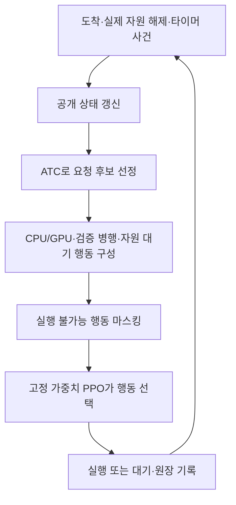

# ATC 후보 선정 + PPO 실행 선택: 사건 기반 온라인 스케줄링

작업 ID: ATC-PPO-DESIGN-01 / 2026-10-11. 사용자가 제시한 새 방향을 데스크톱 구현의 출발점으로 기록한다. **설계 이관이며 새 정책 구현·학습·실측 완료가 아니다.** 기존 EDD/리스트/롤링/PPO 코드·체크포인트·FAIL 판정은 보존한다.

## 목표와 담당

분류·탐지의 전체 완료량과 기한·긴급 응답을 지키면서 열·에너지 부담을 줄인다. A24와 S26 모두 사용자가 담당한다. 담당자 통합이 기기별 계수·모델·런타임·품질·지원 조합의 통합을 뜻하지 않는다. 새 행동은 검증된 CPU/GPU에 한정하며 기존 NPU 자료는 보존한다. A24 AP 예측을 표면온도라고 부르지 않는다. 현재 서비스 계약은 공학적 평가 조건이며 새 사용자 SLA를 만들지 않는다.

## 사용자가 정한 구조

ATC는 후보를 추리며 최종 순서를 고정하지 않는다. PPO가 요청·자원·허용 병행·대기를 선택한다. 실행 중 요청은 중단·이동하지 않는다. 다음 사건에서 아직 시작하지 않은 요청을 다시 검토한다. 운영 중 정책 가중치는 고정하며 PC 학습과 분리한다.

전체 미래 일정을 매 사건마다 탐색하지 않는다. 롤링은 사건마다 반복 판단한다는 의미이며 **MPC/CP-SAT의 유한 전망창 최적화와 구분한다.** 공개 정보로 계산한 국소 예상 완료시간·비용 특징과 전체 미래 스케줄 탐색도 구분한다.

## 구현 전에 고정할 계약

| 항목 | 확인·고정할 내용 |
|---|---|
| ATC | 원 논문과 기존 구현의 대응, 처리시간 경계, 중요도·k·후보 수·동점·평균 처리시간 모집단. 임의 상수를 문헌 기본값으로 표시하지 않는다. |
| 후보 보존 | CPU-only 탐지·긴급·자원 호환성·가능한 병행·누적 대기. shortlist가 좋은 선택을 누락하는지 뒤 요청 기한 C2 반례 등으로 검사한다. |
| 행동/마스크 | 지원 단독 CPU/GPU·검증 최대2병행·자원 대기만. 빈 슬롯·busy lane·미지원 조합·실행 중 작업 변경은 금지한다. 물리 mask와 예측 서비스 보호를 분리한다. |
| 대기 | 자원 반환 대기와 선택적 냉각 유예를 구분한다. 다음 도착/실제 반환/등록 timer의 재판단·취소를 고정하고, 냉각 유예를 조용히 추가하지 않는다. |
| 사건/완료 | output·persist·worker_release·AVAILABLE을 구분한다. AVAILABLE 전 lane 재사용 금지. 같은시각 순서·유한 dispatch·대기 timer/phase callback·PAIR 둘째 실패의 요청 보존을 검사한다. |
| 관측 | 도착한 요청의 납기·예상 서비스·점유/경과시간·과거 이력·실제 관측 온도. 미래 도착·실현 잔여시간·정답 비용·숨은 열 상태 금지. 필요한 공개 tail 특징을 대조군과 공유한다. |
| 보상 | 원 서비스/출력/완료 요구와 열·J 목적을 별도 버전으로 명시. 경과시간·대기 전력·할인/GAE·행동 이후 비용·종료 꼬리를 결과 전에 고정한다. 원단위 최종 KPI와 분리한다. |
| 학습 상태 | 새 schema/정책 ID로 fresh actor·critic·Adam·독립 seed별 RNG. learner terminal/승수/normalizer/설정/cursor/소비/시간을 보존한다. best-validation과 terminal actor를 구분한다. |
| 평가 | 같은 trace/seed/도착/기한/초기 상태/지원/실현 비용/관측창. 전체 예정 분모·실패·미완료를 유지한다. |

기존 V1에는 예측 비용 개선후보가 물리적으로 가능해도 서비스 mask에서 허용0인 진단이 있다. 이 mask를 새 물리 mask로 조용히 복사하지 않는다. 예측 기반 보호가 미래 기한·온도를 보장하는 것은 아니다. 현재 자체 PPO는 이미 masked categorical 선택을 사용하므로 마스킹을 다시 붙인 것만을 새 알고리즘으로 주장하지 않는다.

## 기기별 출발점과 비교

- A24: 동결 원 서비스/에너지 + v3 thermal-only hybrid. CPU 분류·GPU 분류·CPU 탐지, 검증 CG_DC만 최대2병행. 온도에 따른 처리속도 회복은 현재 표현하지 않는다.
- S26: `d1sim`·최신 mixed·quality가 다른 세 브랜치에 있다. MobileNet/CPU4/FG-BG chunk와 exact 모델/CPU1/mixed7경계를 같은 profile로 취급하지 않는다. [통합 계획](S26_SIMULATION_PLAN_20261011.md)의 품질·센서·시각·coverage·상태 식별 감사 후 CPU/GPU profile/adapter를 별도로 연결한다. 근거 부족은 성능 판정과 후보 승격을 보류할 이유이며 A24 구현 중단 이유는 아니다.

비교군은 실제 프로젝트 Band·Triton 제한적 재현, EDD+ECT, **같은 ATC shortlist·행동·입력·물리 mask의 비학습 선택기**, 새 PPO다. 기존 Joint/Cost/PPO512는 역사적 참조이며 다른 schema/seed의 성적을 알고리즘 우열로 합치지 않는다.

원64→512 데스크톱은 추가1,344학습·2,200환경을 완료했으나 세 PPO 모두 strict 기준 미달이다. [완료 기록](results/desktop_amount512_20261011/README.md)을 확인하고 같은 task를 재실행하지 않는다. 새 구조는 기존 학습량 연장이 아니다.

전체 완료·서비스·지원 손실을 비용 감소로 상쇄하지 않는다. 서비스 유지 아래 열 개선/에너지 개선/공동 개선/상충/동률을 분리한다. 임의 유지 허용폭을 만들지 않으며 수치 오차와 실측 모형 불확실성도 구분한다. 작은 AP/J 차이는 실제 폰 절감으로 확정하지 않는다. 기본/strict/`experiment_ready=false`는 유지한다.

실행 범위는 [데스크톱 프롬프트](DESKTOP_ATC_PPO_PROMPT_20261011.md)와 [공유 명세](results/desktop_atc_handoff_20261011/README.md)를 따른다. 이번 이관에서 새 정책 학습·실기기 작업은0이다.

## 출처

- Vepsäläinen·Morton, [Priority Rules for Job Shops with Weighted Tardiness Costs](https://pubsonline.informs.org/doi/abs/10.1287/mnsc.33.8.1035). 원 weighted tardiness와 우리 서비스·열·에너지 목적은 다르다.
- Schulman 외, [Proximal Policy Optimization Algorithms](https://arxiv.org/abs/1707.06347).
- Huang·Ontañón, [A Closer Look at Invalid Action Masking in Policy Gradient Algorithms](https://arxiv.org/abs/2006.14171). 물리 불가능 제거의 근거이며 서비스 보장의 근거가 아니다.
