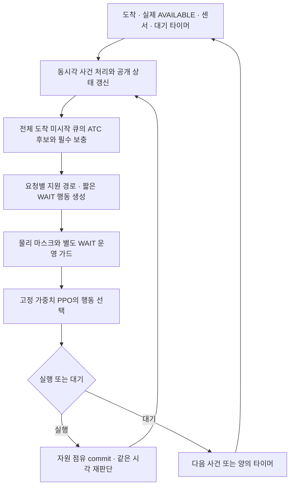

# 롤링＋ATC＋RL 완성 계획 — 에너지 10%·평균 AP 0.5℃ 공동 감소

2026-10-14. 상태 **PLAN_READY / 구현·학습·새 시뮬레이션 미착수**. 실행 ID 제안은 `ROLLING-ATC-RL-37`이다. 이번 산출물은 현재 구현과 결과를 검토한 후 작성한 실행 계획이다. 사용자는 방법의 폭넓은 변경을 허용했고, 서비스 수준별 비교와 정량 목표를 직접 선택했다.

## 1. 확정 목표와 완료의 의미

- 비용 목표: 같은 요청·작업량·물리 모형에서 비교군보다 **전체 에너지 10% 이상 감소, 평균 AP 0.5℃ 이상 감소를 동시에** 달성한다. 0.5는 ℃ 차이이며 섭씨 온도의 퍼센트가 아니다.
- 서비스 목표: 납기 성공률 **70·80·90·95·100%**별로 비용과 서비스의 상충을 비교한다. 주표에서는 긴급·일반 각각 목표 α 이상을 요구하고, 일반만 α 이상인 표는 별도 보조표로 제공한다. 한 종류만 있는 부하는 다른 종류 성공률을 null로 두고 단일 작업 부하로 표시한다.
- 전량 완료를 유지한다. 늦은 요청을 버리거나 실행을 생략한 절감을 동일 작업량 절감으로 판정하지 않는다.
- 충분한 개발 이득이 있으면 개선을 계속한다. 개발·최종 확인의 경계와 동결 버전은 유지한다. 최종 확인을 보고 고친 모델은 새 버전과 새 확인 자료로 평가한다.
- 시뮬레이터에는 물리·측정의 논리, 스케줄러에는 행동·목적의 논리, 비교에는 같은 정보·제약·서비스의 논리가 있어야 한다. 정책 이름에 따른 소비 보너스, 정책 승률을 목적으로 한 물리 계수 적합은 사용하지 않는다.

완료 산출물은 재현 가능한 시뮬레이터·학습기·고정 추론 스케줄러·전수 원장·비교표·영역 지도다. 소프트웨어 완성과 목표 달성은 별도로 판정한다. 결과 등급은 `목표 달성 / 공동 개선이나 목표 미달 / 서비스와 비용 상충 / 개선 없음 / 평가 부적격`이다. 큰 차이를 만드는 환경의 발견만으로 RL의 추가 효과나 실제 휴대폰 절감을 주장하지 않는다.

## 2. 현재 상태와 기존 시도의 교훈

| 항목 | 확인한 사실 | 새 계획에 반영할 내용 |
|---|---|---|
| 작업 위치 | 채팅 `C:/Users/chomg/Documents/Codex/2026-10-11/dkfo`, checkout `work/repo` | 새 코드·원장을 독립 경로에 구성 |
| Git | detached HEAD `12d64923be824ce4c88fca074fbe38820f5a7d25`; 진행 문서 수정 및 다수 미추적 파일 존재 | 사용자 WIP·원자료·기존 가중치 보존; reset/clean/기존 실행 덮어쓰기 없음 |
| 지침 | checkout 루트 `AGENTS.md` | 최신 사용자 목표 우선, 실측·가정·기기 검증 구분 |
| 현재 온라인 정책 | `tools/d1_sched_dynamics_policy.py` V17: 전체 도착 큐, 64×22 요청, 1455 상태, 193×32 행동; ATC는 특징이고 전체 지원 단일 배정을 구성 | 새 ATC는 실제 후보 축소에 사용; 큐 전체를 64개로 제한하지 않음; 새 ABI·가중치 |
| 현재 행동 | 같은 시각에 단일 요청 배정을 반복해 병행 구성; non-delay가 의도 WAIT를 제외 | non-delay 대조와 의도 WAIT 학습을 분리 |
| 기존 24회차 | 사용자 설명과 기존 계획상, 납기 무위반일 때만 비용 보너스; 전용/공통 모델 비교 | 원본 유지. 비용 신호가 사라지는 문제를 새 학습에서 변경 |
| 다른 dynamics PPO | `d1_sched_dynamics_ppo.py`에는 이미 증분 J/열 보상이 있지만 원·선언 기한 이중 검사, 응답시간·지각 항, 120초 열 비용이 포함 | 모든 기존 PPO가 같은 보상이라고 묶지 않음; 목표 창·서비스 비용을 새로 명시 |
| 규칙/PPO 26 | 공통 배정 비교 및 3seed 후속 완료; ATC 추가 효과·공동 비용 우위 확정 못함 | EDD와 직접 RL 대조를 동일 학습량으로 실시 |
| 실측 보정35 | A24 전력35/AP39 세션, S26 M6 P12/K4·1200요청; 서비스·전력 새 후보 미채택, 온도 개발 후보 채택 | M0의 재현 기준으로 보존 |
| 탐색36 | 64요청 평균 정책 격차 M0 A24 0.26J/0.003℃, S26 1.56J/0.016℃ | 쉬운 부하만 늘려 학습하지 않음; 선택 기회·절감 가능 범위부터 확인 |
| 큰 입력36 | S26 M0 분류252건의 FIFO−고정 PPO 약40J/평균 AP 약0.15~0.17℃; A24 일부 탐색에서는 FIFO가 비용 규칙보다 유리 | 가능성이 있는 조건의 근거지만 10%·0.5℃ 달성 또는 RL 보편 우위의 증거는 아님 |
| 기존 SLO70 탐색 | 별도 채팅의 구현·실행·확인 계보 보완 작업 있음 | 현재 상태는 STATUS 및 그 원장 기준; 이 계획으로 중단·재학습·재선정하지 않음 |

과거 ATC/EDD가 같았던 이유에는 작은 후보 집합, 작업별 유사한 처리시간·납기, 실행 가능한 요청이 하나뿐인 판단, 같은 자원 배정이 있다. 새 부하에서 점수·순위·후보·행동·원장 각각의 동일률을 측정한다. 후보/행동이 개발 조건 전반에서 계속 같으면 ATC 파라미터 탐색을 종료하고 ATC의 추가 효과를 미입증으로 보고한다. ATC 구성 자체는 연구군으로 유지할 수 있지만 EDD/직접 RL보다 우수하다고 결론내리지 않는다.

## 3. 절감이 가능한 이유부터 검증

고정 실행시간·고정 경로별 에너지에 초기 상태와 총 작업량이 같으면, 순서를 바꾸는 것만으로 전체 작업 에너지가 달라지지 않을 수 있다. 대기 중 기저 전력이 있으면 단순 냉각 WAIT는 에너지를 늘릴 수도 있다. 이 불변성과 반례를 시뮬레이터의 필수 검사로 둔다.

검증할 절감 기제는 다음과 같다.

1. **경로 선택:** 빠른 경로와 저에너지 경로가 다르면 납기 여유를 이용해 배정을 달리한다.
2. **병행 선택:** 병행의 시간 절약과 공유 자원 감속·전력 잔차 사이의 상충을 판단한다. 무조건 병행이 유리하다고 가정하지 않는다.
3. **시간 분산:** 실행 집중도를 줄여 최고·평균 AP와 이후 감속을 바꾼다. 총 J가 같아도 온도 궤적은 달라질 수 있다.
4. **열·성능·전력 피드백:** 이전 선택이 현재 속도와 단위 작업 에너지를 바꾸는 경우 RL이 누적 결과를 학습한다. 감속이 전력을 낮춰도 실행 연장으로 총 J가 증가할 수 있다.
5. **의도 WAIT:** 여유가 있는 요청을 짧게 늦춰 열·성능 회복의 이득을 얻을 수 있는지 확인한다. 기저·재활성 비용을 함께 계산한다.

각 기제를 끈 대조와 순서만/배정만/병행만/WAIT만 바꾼 대조를 둔다. 측정이 없는 기제의 수치는 가정으로 표시한다. 새 부하는 절감 기제를 조사하는 합성 연구 조건이며 실제 앱 사용자 도착 분포라는 주장은 하지 않는다.

## 4. 시뮬레이터: 실측 재현층과 불확실성 탐색층

| 층 | 내용 | 용도·해석 |
|---|---|---|
| M0 | 동결35의 서비스풀·전력·AP·초기화 재현 | 현재 자료로 보정한 기준; 새 독립 실기기 확인 아님 |
| M1 | 기존 시간 표본과 양수 전체 전력, 수동 열 저장·방출을 연결한 모형 | 기존 실측의 적합 오차·식별 한계와 함께 제시 |
| M2 | M1의 미측정 감속/전력 탄력성/병행/냉각/활성화 범위 | 가정에서의 강건성과 실패 영역; 기기 실측 효과로 승격하지 않음 |

M0→M1의 모형 변경 효과와, **같은 M1 안**에서 정책을 바꾼 효과를 별도 표로 낸다. 계수는 기존 자료 재생 오차·코호트 제외 오차·물리 경계로 정하며 RL 또는 ATC가 이기는 값으로 선정하지 않는다. 미식별 자원별 전력을 하나의 확정 칩 W로 만들지 않는다. 모든 정책에 같은 계수·센서·초기 조건·지원 계약을 적용한다.

실행은 기존 dispatch부터 AVAILABLE까지 다섯 구간과 여섯 단계 시각을 유지한다. EXECUTING 중 남은 일량을 적분하며 열에 따른 상대속도 `r∈[r_min,1]`를 적용한다. 시작한 요청은 선점하거나 이동하지 않는다.

전력 후보의 구조는 다음과 같다. 음의 잔차를 이용해 소비를 무리하게 낮추지 않고 총전력 양수·에너지 적분 일치를 검사한다.

`P = P_resident + Σ(P_static,b + P_dynamic,b*r_b^n + P_leak,b(T)) + P_shared + P_activation`.

`r_b = clip(1-k_b*max(T_hat_internal-T_on,b,0), r_min,b,1)`.

단계별 유효 계수와 병행 잔차를 분리하되 기존 성분을 중복 추가하지 않는다. `T_hat_internal`은 엔진의 잠재 상태이며 AP와 같은 물리 온도라고 단정하지 않는다. 누설·시동·꼬리 계수가 식별되지 않으면 M0/M1에서는 기존 값을 보존하고 M2 범위에서만 비교한다.

열은 양의 R/C를 갖는 수동 두 절점 또는 기존36의 수동 열모드로 구현한다. 두 형태 중 기존 자료 재생·수치 안정성·식별 가능성을 만족하는 간단한 형태를 개발에서 선택하고 동결한다. 두 절점의 예시는 다음과 같다.

`C_h*dT_h/dt = f*P - (T_h-T_s)/R_hs`

`C_s*dT_s/dt = (1-f)*P + (T_h-T_s)/R_hs - (T_s-T_b)/R_sa`.

저장열 변화＋외부 방출열＝전기적 열 입력을 확인한다. AP는 이 상태의 보정된 관측 함수다. 같은 P가 J 적분에도 들어간다. 두 기기의 계수·관측식은 따로 둔다. A24 미보정 SKIN을 결과 지표로 사용하지 않는다.

센서는 실제 읽기 간격·양자화·지연의 관측 범위와 미확인 부분을 분리한다. 정책에는 읽기가 끝난 과거 AP/전력과 이력만 공개한다. 참 열 상태·참 계수·현재 작업의 실제 미래 완료 시각은 엔진에만 둔다. future arrivals·미래 실현 처리시간·미래 J/AP를 actor/critic의 온라인 입력으로 제공하지 않는다.

필수 모형 검증: M0 재현, 에너지 적분, 열 수지, step 50→25ms 수렴, 중립 환경의 순서 에너지 불변성, WAIT의 기저 소비, 지원·AVAILABLE 소유권, 센서 age, 요청별 공통 난수, 참 상태 비공개. 수렴 허용치는 `ΔJ≤max(0.1J,0.05%*J)` 및 `Δ평균AP≤0.01℃`를 초기 개발 수치 기준으로 제안하며 실측 오차 기준과 구분한다.

## 5. 롤링＋ATC＋RL 운영 구조

여기서 롤링은 **사건마다 아직 시작하지 않은 요청을 재판단**한다는 뜻이다. 주 운영 구조는 사건 기반 온라인 스케줄링이며, 미래 계획 구간 전체를 푸는 정식 rolling horizon 최적화는 아니다. 필요하면 후속 개발에서 짧은 계획 구간 대조를 별도 알고리즘으로 등록한다.



ATC는 요청 후보를, 마스크는 물리 가능성을, RL은 후보의 요청·경로·병행 구성·허용 대기를 결정한다. 목표 서비스 비율은 학습·평가 제약이며 물리 마스크가 납기를 보장하지 않는다.

### ATC 원형과 앱 수정

원형: `I_i(t) = (w_i/p_i) * exp[-max(d_i-t-p_i,0)/(k*p_bar)]`.

앱 수정: `log I_i(t) = log(w_i/p_i^occ) - max(d_i-t-p_i^resp,0)/(k*p_bar^occ)`.

- w: 긴급2/일반1로 시작하는 정책 중요도. 실제 금전적 지연 비용으로 해석하지 않는다. 개발 후보는 긴급 비중1/2/4다.
- t: 현재 사건 시각, d: 도착＋선언 납기, k: 개발 후보1/2/4 중 선정한 양수; 기본2.
- p^occ: 실제 AVAILABLE까지 예상 점유시간, p^resp: 해당 요청 계약의 OUTPUT_READY 또는 PERSISTED까지 예상시간. 분모는 자원 생산성, 지수는 서비스 여유를 표현한다.
- 대표 경로: 지원 경로 중 예상 응답시간 최소→점유시간 최소→CPU/GPU/NPU 고정 순서. 임시 점유로 대표 경로를 바꾸지 않고 보충 후보로 실행 가능한 경로를 확보한다. 저에너지 대표 경로는 별도 개발 대조다.
- 추정치는 기기별 측정 분포·알려진 작업량·현재 관측 상태에 기반한다. 미래 실제 표본이나 전체 큐 소진 시뮬레이션은 사용하지 않는다. 기본 주부하는 unit1이며 2/3배 작업량은 미측정 확대 가정으로 별도 평가한다.
- p_bar는 현재 도착·미시작 요청 대표 점유시간의 평균이다. 전체 큐를 읽는 O(Q) 통계 계산은 허용하고 전체 큐의 미래 실행은 제외한다.

### 후보와 행동 상한

전체 대기 큐를 대상으로 ATC top12를 뽑는다. 작업별 선두만 보는 제한은 사용하지 않는다. 동점은 도착 시각→ordinal→request ID다.

필수 보충은 현재 빈 자원별 즉시 합법인 최고 ATC 요청 최대3, 같은 자원별 최소 국소 에너지 요청 최대3, 가장 오래 기다린 긴급/일반 최대2, 비학습 EDD 규칙의 실행 요청 최대1, 최소 응답 여유 요청 최대1이다. request ID로 중복 제거하므로 **최대22개, 24슬롯 패딩**이다. K의 개발 대조는8/12/14로 제한해 보충10개를 포함해도24를 넘지 않는다. 필수 보충을 먼저 보존하고 ATC core를 채운다.

각 후보에 기기 지원 경로를 생성한다. 단일 배정 최대24×3=72, 의도 WAIT 50/200/1000ms의3개, 필요한 자원 대기의1개로 **실제 상한76·80슬롯 패딩**이다. A24는 NPU 슬롯을 미지원 처리한다. 요청 두 건 조합을 O(K²)로 나열하지 않고 한 건 commit 후 같은 시각에 다시 판단해 기존 최대2병행을 구성한다.

이미 시작한 요청의 중단/이동, 탐지 GPU/NPU, 분류 두 건 병행, 세 건 동시 실행은 이번 주 경로에 추가하지 않는다. 방법 자유화는 새 제어의 검토를 허용하지만 실제 지원이 생겼다는 증거를 대신하지 않는다. 지원 확장을 연구하려면 별도 모델·자원 계약과 자료를 마련한다.

### WAIT 계약

의도 WAIT는 실행 가능한 행동이 있어도 선택할 수 있는 새 연구 행동이다. 모든 대조에 동일한 WAIT 운영 가드를 적용한다. 초기 가드는 대기 요청별 현재 예상 응답 여유에서 추정 오차 여유를 뺀 값보다 WAIT가 짧을 때이며, 전체 미래 큐를 계산하지 않는다. 이미 지각한 요청도 큐에 유지하고 oldest 보충·대기 총량 상한으로 추가 방치를 제한한다.

누적 의도 WAIT는 120초 창의 최대12초로 시작한다. 실제 경과시간으로 세고 도착·자원 해제·새 관측이 먼저 오면 재판단한다. 대기 중 실행 중 자원은 계속 실행하며 기저·tail 소비도 계속된다. 가드가 서비스 달성을 보장하지 않으므로 WAIT 횟수·실제 대기·비용·납기 손해를 보고한다. non-delay 대조에서는 의도 WAIT만 운영 마스크로 제외한다.

## 6. 새 입력·마스크·신경망 계약

| 입력 | 새 정의 | 크기 |
|---|---|---:|
| 후보 요청 | C/D 2, 긴급, age, 선언/legacy 여유2, units, 지원3, 경로별 점유/응답6, logATC, EDD/ATC/SPT rank3, 추정 오차 여유, w, 응답 끝점 종류, present | 24×24 |
| 자원 | 지원·점유·C/D·긴급·현재 단계·경과시간·남은 점유/응답·마지막 반환 후 시간·최근 duty·present | 3×12 |
| 전역 | 시각·전체큐/U/N/C/D 개수6, 최소 U/N 여유2, 최고 age, AP/W, AP/W age2, AP/W slope2, CPU/GPU/NPU duty3, 누적 WAIT, 남은 창, αU/αN2, 열 선호, 기기 지시자 | 24 |
| 상태 scalar 합계 | 576＋36＋24 | **636** |
| 행동 | backend onehot3, WAIT, 경로 점유/응답/여유3, 국소 J/AP proxy2, 병행 여부, 대기 길이, 추정 age, physical feasible, 신뢰도, ATC rank, present | **80×16** |

요청·자원·행동 padding 값은0, present/support와 boolean mask를 별도 검산한다. 시간/슬랙은6초, 큐 개수/순위는64, duty/α는0~1, AP는(T−30)/10, W는W/10으로 시작한다. 범위 밖 입력의 clipping 비율을 기록한다. 전체큐가64를 넘어도 후보 바깥 요청은 통계·재선정 대상에 유지한다. 시나리오 안전 상한은 대기512로 시작하고 초과 시 부적격을 남기며 요청을 몰래 자르지 않는다.

네트워크는 후보 공유 encoder 24→64, masked mean/max pooling128＋자원36＋전역24=188→128→64의 상태 표현을 사용한다. 자원 encoder12→32를 두고 행동은 요청 표현64＋자원32＋상태64＋행동16=176→64→1로 점수를 낸다. WAIT에는 요청/자원 표현0과 WAIT 특징을 쓴다. Critic은 상태64에서 에너지·열·긴급 위반·일반 위반·미완료의5값을 추정한다. 숫자는 새 설계에서 유도한 것이며 기존1455/193을 계승하지 않는다.

마스크 조건은 미지원 경로, 자원 점유, 같은 request 중복, 비선점/허용 병행 제한, padding이다. 의도 WAIT 가드는 별도 필드로 기록한다. same-time commit 전에 지원·소유권·version을 재검사한다. 기대 처리시간·국소 비용 proxy는 단일 현재 행동에 대한 추정이고 납기/전체 열 결과를 보장하지 않는다.

기존 native PPO의 masked logits·clip objective·Adam·KL/gradient guard·checkpoint/RNG 저장 구현을 검토해 재사용한다. ABI, 후보, mask, WAIT, reward, critic이 달라져 **기존 가중치·Adam을 그대로 이어 쓰지 않는다**. ATC 정답을 복제하는 사전학습은 주설계에 포함하지 않는다. 필요하면 별도 warm-start 대조로 표시한다.

## 7. 비용 중심의 학습: 조건부 Lagrange PPO

한 에피소드는 요청열 전체와 후속 관측 창이다. αU=αN∈{.70,.80,.90,.95,1.00}을 입력하는 기기별 조건부 정책을 각3seed 학습한다. 에너지/열 선호는 .25/.5/.75의 사전 균형 추출로 훈련하고 주평가는 .5로 고정한다. 다른 선호의 Pareto 결과는 개발에서 동결한 보조값으로만 낸다.

비용 신호는 서비스 위반이 있는 에피소드에서도 유지한다. 서비스 손해는 별도 위반 비용과 개발/최종 적격 판정으로 다룬다. 기한 안 응답시간·P95·대기시간 자체는 벌점으로 넣지 않는다. 연구 주기한과 legacy 기한을 보고에서 분리하고 같은 위반을 이중 벌점으로 세지 않는다.

`E180 = ∫_0^180 P(t)dt`, `A = ∫_35^180 AP(t)dt`, `meanAP=A/145`.

학습에서 AP의 행동 독립 참조값과 resident 기저를 빼는 것은 분산 감소용 상수 조정이다. 보고 지표는 전체 J와 실제 온도다. 목표 평균 AP와 다른 running peak/max(AP−ref,0)를 주 보상으로 대체하지 않는다.

사건 사이 시간구간의 보상은 다음과 같다.

`r_j = -wE*ΔE180/Eref - wT*ΔA/(145*0.5℃) - λU*ΔmU/NU - λN*ΔmN/NN - λI*Δincomplete/N`.

Eref는 기기별 고정 개발 기준 부하의 기준정책 E180으로 학습 전 정한 양수다. 위반은 납기 시각에 한 번 기록한다. 역할 요청0이면 해당 비용은 제외한다. 완료 실패/미완료는 끝에 기록하며 요청·작업단위 완료율을 모두 평가한다. 마지막 dispatch 뒤180초까지의 열·전력 보상도 마지막 결정으로 연결해 꼬리를 빠뜨리지 않는다. 각 항의 합계가 episode 비용과 일치하는 telescope 검사를 둔다.

λ는 목표 α별로 학습 episode의 `mean(miss rate)−(1−α)`를 사용해 비음수 범위에서 업데이트한다. 이는 기대 위반률을 억제하는 **PPO의 Lagrange 근사**이고 CPO 구현이나 각 실행 납기의 수학적 보장이 아니다. 미완료 목표는0이다. 초기 λ/상한/step은 개발 설정이며 FINAL 전에 동결한다.

초기 PPO 설정은8episode/update,4epochs,256frame minibatch,lr3e−4,clip.2,value.5,entropy.01,gradient.5,KL.03을 재사용 후보로 둔다. 시간 discount γ=1을 사용해 WAIT로 비용을 뒤로 미루는 할인 이득을 없앤다. GAE는 실제 Δt에 따른 `λ_j=exp(-Δt_j/20s)`로 시작하고 동일시각 commit에서는 λ=1이다. MC(λ=1)와 개발에서 대조한다. 이 값은 새 설계이고 기존 코드가 GAE를 사용한다고 표현하지 않는다.

Actor는 합법 선택이 복수인 결정만 업데이트한다. Critic은 모든 결정에 학습한다. 요청이 많고 결정이 긴 episode가 목적을 압도하지 않도록 episode 균등 가중 평균을 사용한다. 업데이트 전 원래 mask/action/logprob를 재사용하며 새 후보 순서로 과거 행동 의미를 바꾸지 않는다.

TRAIN은 행동 샘플링, DEV/FINAL/운영은 masked argmax와 고정 tie를 사용한다. learner seed는37001/37003/37007을 제안한다. 초기 network·action RNG·shuffle RNG·도착 RNG·환경 RNG는 독립 stream이며 source/inputs 등록 때 seed와 상태를 고정한다. 같은 seed의 군간 초기 조건과 기기별 노출량을 맞춘다. 학습 환경의 참 정보는 reward label 계산에만 사용한다.

## 8. 이벤트 루프와 오류 처리

```text
while world has pending events:
    t = next_event_time                 # 엔진만 다음 사건을 알고 있음
    integrate_execution_power_heat_to(t)
    handle_due_events(t):
        response/persist phase records
        AVAILABLE and actual owner release
        new arrivals
        completed sensor reads
        deadline expiry after same-time completions
        WAIT expiry / generation cancellation
    publish_only_observed_state(t)
    while an immediate decision is required:
        C = atc_topK_and_mandatory_supplements(arrived_unstarted_queue)
        A, physical_mask, operational_mask = encode_actions(C, observed)
        if no request: break            # 엔진은 필요하면 180초까지 냉각 관측
        if no executable action:
            wait_for_real_event_or_positive_timer(); break
        chosen = fixed_argmax_or_training_sample(PPO, A, mask)
        if invalid/ABI mismatch/NaN:
            chosen = deterministic_ATC_ready_fallback()
            record_fallback_reason()
        recheck_version_request_resource_mask(chosen)
        if chosen is WAIT:
            register_positive_timer_and_actual_wait_budget(); break
        commit_once(chosen.request_id, backend)
        record_dispatch_and_rebuild_current_state()
```

같은 시각에 길이0 단계가 발생하면 기존 phase 순서를 보존한다. 완료 시각이 납기와 같으면 on-time이다. request ID·status·resource owner·state version·wait generation으로 중복 dispatch와 오래된 타이머를 방지한다. 이미 commit한 요청을 후보로 되돌리지 않는다.

빈 후보는 다음 도착을 기다린다. 전부 마스킹됐으면 필요한 자원을 기다리거나 계약 불일치를 기록한다. 실행 중 자원을 강제로 해제하지 않는다. 모델 오류는 ATC 순위→최소 국소 에너지→응답시간→고정 backend 동점 순서의 현재 합법 행동으로 복귀한다. 복귀한 학습 episode는 정상 PPO 표본에 섞지 않는다. FINAL의 복귀·실패는 삭제하지 않고 전체 분모에 남긴다.

구현 감사에서는 callback이 world/private_theta/actual_duration/future_arrivals/simulate_queue/rollout에 접근하지 못하게 한다. 공개 estimate는 현재 단일 경로 추정에 한정한다. 미래 실현값만 바꾸고 현재 공개 관측을 동일하게 만든 fixture에서 후보·mask·logits·선택이 같음을 확인한다. 이는 필드 이름 검색보다 강한 비선견성 검사다.

## 9. 비교군과 효과 분리

| 군 | 역할 |
|---|---|
| FIFO_READY | 도착순 기본 비교. 선두가 busy면 현재 합법인 다음 요청을 검토하는 계약을 명시 |
| RR_READY / GREEDY_READY_V17 | 모바일의 단순 자원 순환·정적 우선 배정 비교. OS 시분할 RR나 특정 논문의 완전 재현이라고 부르지 않음 |
| SPT/WSPT/EDD/LST/ATC | 공통 자원 배정 아래 요청 순서 효과. w·대표 p·납기를 통일 |
| ENERGY_EDD/THERMAL_EDD | 현재 단일 경로 비용을 사용하는 강한 비학습 비교. FIFO만 넘어 승리로 판정하지 않음 |
| FIFO_WAIT/ATC_WAIT/THERMAL_EDD_WAIT | 같은 WAIT 공간에서 학습 효과와 행동 공간 확장 효과를 분리 |
| ATC 후보＋신규 PPO non-delay | 신규 reward와 WAIT의 효과를 분리 |
| ATC 후보＋신규 PPO WAIT | 주 방식. 사건마다 재판단하고 ATC를 실제 shortlist에 사용 |
| EDD 후보＋동일 PPO WAIT | ATC 후보의 추가 효과 |
| 전체 도착 큐＋동일 PPO WAIT | 후보 축소의 정확도·계산 효과. 가변 masked pooling으로 요청을 자르지 않음 |
| 기존 고정 PPO | adapter가 호환되는 기존21/24 등을 최대3모델 고정 재생. 기존 환경 학습과 새 학습을 구분 |

전체 큐 대조는 최대512요청·최대1540행동(512×3＋WAIT4)을 가변 축으로 받으며 같은 공유 encoder와 파라미터 수를 쓴다. sequence 상한이 다른 ABI를 등록한다. 후보 개수와 탐색 난도는 방식 차이로 보고한다. ATC/EDD/전체 큐/non-delay의 주 인과 비교는 같은 새 PPO 목적·훈련 자료·각 seed·노출량 B에 맞춘다. 짧게 학습한 기존 gate 진단군을 학습량이 다른 채로 주 인과 비교에 넣지 않는다.

Band/Triton은 이번 주 비교에서 제외한다. EFT 자체는 먼저 끝나는 경로의 배정 규칙이므로 필요하면 FIFO/EDD＋같은 EFT 배정의 진단으로 이름을 명시한다. 자원 배정을 고정한 순서 비교와 방식 전체의 비교는 별도 표로 낸다.

## 10. 자료 분리·부하·평가

TRAIN/DEV/FINAL은 독립 도착 namespace와 입력 SHA를 가진다. 환경 seed만 바꾼 같은 요청열을 새 도착 확인이라고 부르지 않는다. 세 분할 사이 요청열 hash·도착 seed 중복0을 실행 전에 검산한다. 이미 본 M6-B는 물리 개발에 쓰는 기존 자료다. 새 시뮬레이션 seed는 새 기기 측정이 아니다.

초기12조건은 unit1, 64/128/256요청, 분류 비율25/50/75%와 분류 단일 작업 대조, steady/microburst/phased/burst8~32, 상대부하 .4/.7/.9/1.1을 층화해 등록한다. 전체 직적 대신12조건의 값·이유를 P1 전에 JSON으로 고정한다. 선택 기회0인 가벼운 부하, 과부하, 단일 종류, 작은 차이를 유지한다. 최종 확인은 같은 부하군의 새 도착과 미학습 초기 상태·인접 M2를 포함한다. 실제 이용 분포의 빈도 가중치로 해석하지 않는다.

주 선언 납기는 기존 연구안 A24 긴급2.2/일반5초, S26 긴급.8/일반2초에서 시작한다. legacy 긴급1.5/일반6초는 별도 열에 유지한다. α를 바꿀 때 같은 요청의 납기를 늘리지 않는다. 대표 처리시간으로 만든 tight/wide는 개발 전에 등록한 별도 부하군이다. 모두 연구 조건이며 제품 SLA나 안전 한도가 아니다.

평가 지표는 다음과 같다.

- 주 에너지 E0~180, 기존 비교와 연결하는 J0~120. 120초에서만 줄고180초에서 늘면 창 밖으로 비용이 이동한 결과로 판정한다.
- 평균 AP35~180, 최고 AP·고온 지속시간·끝 시점 잔열. 열은 AP 온도 응답으로 평가하고 J와 같은 별도의 소비량으로 해석하지 않는다.
- 긴급/일반 응답 성공률 각각 전체 도착 분모, 늦음·실패·미완료 포함. α는 on_time≥ceil(α×arrived)의 정수로 판정한다.
- 전체 요청·작업단위의 실제 AVAILABLE≤120초를 같은 작업량의 주 비용 비교 조건으로 둔다. 부적격 행을 삭제하지 않고 관측 소비·미완료·비교 부적격을 남긴다. 장기600초 부하는 별도 창과 같은 배출 기준으로 새 등록한다.
- 대응 에너지 절감률 (E_baseline−E_policy)/E_baseline, 온도 차이 meanAP_baseline−meanAP_policy. 기기·부하·모형 층·α별 결과와 사전 정의한 전체 조건 평균을 함께 낸다.

각 α에서 같은 서비스 하한을 만족하는 정책끼리 비용과 Pareto를 비교한다. 다만95% 정책과100% 기준정책이 둘 다 하한을 넘더라도 성공률이 떨어진 절감은 **서비스 저하와 비용 절감의 상충**이다. 서비스 비악화의 엄격한 승리는 긴급/일반 성공률이 각각 기준정책 이상일 때다. 기존 strict는 원래 조건 그대로 별도 열에 유지한다. 전체 등록 조건에 대한 적격률·완료율도 함께 보고해 적격 행만 평균한 비용이 전체 범위의 달성으로 읽히지 않게 한다. 특정 부하/모형 층에서만 달성하면 그 범위에 한정해 표시한다.

목표는 각 기준정책과의 대응 차이에서 에너지≥10%·AP≥.5℃ 공동 감소로 판정한다. FIFO만 이겼다면 FIFO에 대한 달성이라고 쓴다. DEV에서 규칙군 중 고정 선정한 강한 기준과 전체 규칙에 대한 결과를 공개한다. 비용 규칙이 더 좋으면 RL의 추가 효과 없음으로 판정한다. 최저 에너지 규칙과 최저 온도 규칙이 다르면 둘을 합친 존재하지 않는 정책을 기준으로 만들지 않는다.

학습3seed를 개별 공개하고 부하/도착을 단위로 대응 bootstrap95% 구간을 구한다. 같은 도착의 환경 난수는 중첩 군집으로 처리하며 요청별 표본을 독립 반복으로 늘리지 않는다. 구간은 시뮬레이션 변동이고 물리 계수의 불확실성은 M0/M1/M2 민감도로 별도 평가한다. 평균 달성, seed·조건별 달성 수, 반전·실패·최악 손실을 모두 보고한다. 엄격한 목표 달성 표시는 두 지표 구간의 하한이 각각10%/.5℃를 넘는 경우다.

## 11. 구현 파일·단계·계산 예산

새 코드는 work/ROLLING-ATC-RL-37/code/, 결과는 outputs/ROLLING-ATC-RL-37/에 둔다. 진행 중 SLO70나 기존 실행의 WIP를 수정하지 않고 재사용은 SHA 고정 vendor copy로 한다.

| 새 파일안 | 역할·재사용 |
|---|---|
| d1_ratr37_profiles.py | 기존35/36 JSON, M1/M2 값·근거·불확실성, 실측/가정 태그 |
| d1_ratr37_plant.py | 기존 dynamics plant와36의 AVAILABLE·단계·공통 난수·열 수지 |
| d1_ratr37_candidates.py | 전체 큐 ATC/EDD/전체 큐 대조, 필수 보충, schema/encoder |
| d1_ratr37_controller.py | 물리 mask·WAIT 가드·argmax·복귀·타이머 세대 |
| d1_ratr37_ppo.py | native PPO 골격, 다중 비용 Critic·시간 GAE·Lagrange |
| d1_ratr37_cases.py | 분할·부하·서비스 목표·seed·hash 등록 |
| d1_ratr37_train.py | 단계 학습, DEV만 사용하는 선정, 재개·동결 |
| d1_ratr37_compare.py | 규칙·효과 분리·모든 seed FINAL1회 평가 |
| d1_ratr37_audit.py | 비선견성·소스 hash·NN 입력/mask/logprob·보상·원장·자료 분리 |
| d1_ratr37_report.py | 서비스 수준별 표·Pareto·전력/온도/행동 timeline·CSV·재현 CLI |

단계별 초기 상한은 다음과 같다. 상한은 소진 의무가 아니며 작은 학습의 중단 기준이 충족되면 확대하지 않는다.

| 단계 | 내용 | 새 환경 상한 |
|---|---|---:|
| P0 | 자료/소스 고정·구현·의미 있는 엔진/학습/재개 검증 | 128 |
| P1 | 2기기×12조건×3층×10규칙×2seed=1440, WAIT432, 작은 사례 진단128 | 2000 |
| P2 | 기존 gate 진단/새 non-delay/새 WAIT의3군×2기기×3seed×256episode=4608, DEV1856 | 6464 |
| P3 | 새2군을1024까지 같은 양으로 확대9216, DEV1856 | 11072 |
| P4 | 주군을4096까지 확대18432, DEV1856 | 20288 |
| P5 | EDD/전체 큐 각2기기×3seed×4096=49152, non-delay1024→4096의18432, DEV2816 | 70400 |
| P6 | 주4군×3seed×5α=60＋규칙/WAIT13＋기존 고정PPO최대3=76, 2기기×12조건×3층×5환경seed | 27360 |
| 합계 상한 | TRAIN99840, DEV8384, P0/P1 2128, FINAL27360 | **137712** |

DEV1856은 2기기×4조건×2프로필×2환경seed×(9모델×5α＋13규칙)이다. DEV2816은 같은32기준조건×(15모델×5α＋13규칙)이다. 조건부 정책은 α별로 실제 선택을 다시 실행하고, α에 독립인 규칙은 한번 실행한 결과를5서비스 수준으로 판독한다. gate 진단군은 non-delay로 두어 gate→새 non-delay로 보상 효과를, 새 non-delay→새 WAIT로 대기 행동 효과를 분리한다. FINAL의 기존 PPO3개가 없거나 호환되지 않으면 숫자와 이유를 줄이고 등록한다.

주 모델을 B<4096에서 DEV로 동결하면 P5도 같은 B로 비교해 예산을 줄인다. frame/optimizer step도 공개하고 episode 수만 같은 비교의 한계를 남긴다. P1 작은 사례 진단에서 미래 도착을 아는 offline 최적/열거를 한계 참고로 쓸 수 있지만 온라인 정책에 전달하지 않는다. 내부 반복 재생도 환경 소비에 모두 센다.

P0 대표 환경에서 환경당 시간, NN/optimizer 시간, 원장 bytes를 먼저 측정하고 실행 wall-clock·저장 예산을 등록한다. 환경1초/10초 가정의137712환경은 이상적2worker에서 약19/191시간이며 실제로는 학습·I/O·감사를 더해야 한다. 이는 가상 계산이며 측정 속도가 아니다. 전체 상한을 한 번에 무조건 실행하지 않는다.

기존 다른 실행이2worker를 쓰면 새 무거운 worker를 추가하지 않고 준비와 저장 자료 검토를 진행한다. 보통2worker·BLAS1·낮은 우선순위, 500episode마다 소비·공간 검사, weights/Adam/별도 RNG/pending 경험/source SHA를 저장한다. 실패와 시작된 episode도 각각 센다. 이번 계획 작성에서는 기기 실행·APK 조작·외부 전송을 하지 않았다.

ATC 계산, 후보/보충·mask, PPO, 사건 처리→dispatch 전체의 평균/P95/최대와 Q=1/8/32/64/128/512의 증가를 측정한다. PC 시간을 휴대폰 판단시간·소비J로 바꾸지 않는다. 휴대폰 구현 overhead는 실제 측정할 단계에서 따로 평가한다.

## 12. 확대·개선·중단 기준

1. P0: 원장·물리·비선견성·보상 합계·정확한 재개 검사를 통과시킨다. 실패 소비와 수정 SHA를 보존한다.
2. P1: 선택 기회·경로 차이·비학습 Pareto·작은 offline 사례로 개선 가능 폭을 조사한다. 선택 기회0이나 순서에 대한 J 불변이면 RL 대량 학습 전에 정보·행동·부하의 부족을 설명한다. 물리 계수를 승리 목적으로 바꾸지 않는다.
3. P2→P3: 여러 seed의 선택·loss·KL·비용 학습과 복수 DEV 조건의 서비스 적격·공동 비용 개선 방향이 있어야 확대한다. 256→1024에서 강한 비용 규칙에 못 미치고 개선 곡선이 멈추면 장기 학습보다 credit/WAIT/추정/행동 설계를 진단한다.
4. P3→P4: 95/100% 서비스 상태의 비용 개선 또는70~90%에서 반복되는 공동 개선을 DEV 사전 규칙으로 판단한다. 에너지만·AP만 개선된 결과도 Pareto에 남긴다.
5. P5: ATC·WAIT·학습 효과를 동일 노출량으로 확인한다. ATC/EDD가 개발 전반에서 계속 같으면 k/w 탐색을 종료한다. ATC 구조 유지와 추가 효과 주장은 분리한다.
6. P6: 소스·모형·설정·정규화·보상·선정·지표·SHA를 동결하고 새 FINAL을 한 번 평가한다. 5서비스 수준·3모형 층·모든 seed·불리한 조건을 공개한다.

목표 달성 후 발전 후보는 추정 불확실성 활용, 조건부 K, WAIT 길이, 현재 도착 요청만 사용하는 짧은 계획 대조, 다른 masked 이산 RL이다. 변경 이유와 DEV 개선을 새 버전에 기록한다. 주파수 제어·batch·선점을 추가한다면 실행/물리 근거를 별도 계약에 두고 강한 비학습 기준에도 같은 제어를 준다.

현재 근거 안에서10%/.5℃가 안 되면 가능한 폭·이유·미식별 계수를 결론에 남긴다. M2 조건부 달성을 M0 달성으로 전용하지 않는다. 추가 측정은 유망 정책과 기준의 동일 조건 반복 및 창 끝까지의 온도 기록부터 요구하며, DVFS/cache 모든 상태를 일괄 측정하도록 요구하지 않는다.

## 13. 근거·가정·미확인 사항

로컬 근거:

- [현황](PROJECT_STATUS.md), [전체 계획 계보](PROJECT_PLAN.md), [결정](DECISIONS.md), [기존 ATC 설계](ATC_DIRECT_PPO_DESIGN_20261011.md).
- [규칙/PPO26](D1_IE_RULES_PPO_RESULTS_20261013.md), [실측 보정35](EXISTING_DATA_DYNAMICS_REFINEMENT_20261013.md), [탐색36](GROUNDED_SCHEDULING_EXPLORATION_20261014.md), ../../../outputs/GROUNDED-EXPLORATION-36/SUMMARY.json.
- [S26 M6-A](S26_M6_INTAKE_RESULTS_20261013.md), [M6-B](S26_M6_CONFIRMATION_RESULTS_20261013.md), [A24 실측](ENERGY_THERMAL_OVERNIGHT_RESULTS_20261004.md), [회복 시간 검토](RECOVERY_SERVICE_RESULTS_20261010.md).
- [현재 후보/마스크](../tools/d1_sched_dynamics_policy.py), [native PPO](../tools/d1_sched_dynamics_ppo.py), [plant](../tools/d1_sched_dynamics_plant.py), 36repro의 SHA 고정 소스.

일차 문헌과 구조 근거:

- ATC의 weighted tardiness 우선순위 식과 k: [ATC lookahead parameter 연구](https://www.sciencedirect.com/science/article/abs/pii/S0925527306002118). 앱의 점유/응답 분리는 이번 설계 수정이다.
- PPO clip 업데이트: [Schulman 등의 PPO](https://arxiv.org/abs/1707.06347). [GAE](https://arxiv.org/abs/1506.02438)는 advantage의 분산/편향 조정 근거이며 가변 시간 λ는 이번 설계다.
- [Huang·Ontañón의 action masking](https://arxiv.org/abs/2006.14171)은 선택과 학습 모두에 mask를 적용하는 근거이며 서비스 보장 근거는 아니다.
- [Achiam 등의 CPO](https://proceedings.mlr.press/v70/achiam17a.html)는 제약 목적 참고다. 이번 방식은 Lagrange PPO이며 CPO의 이론 보장을 전용하지 않는다.
- [Android Thermal API](https://developer.android.com/games/optimize/adpf/thermal)는 열과 성능 제한의 질적 관계 근거이고 A24/S26 수치를 제공하는 사양은 아니다.

설계 선택은24후보/80행동, 조건부 α, Lagrange/시간 GAE, WAIT 총량, 12조건, 단계 예산이다. 측정 사실과 구분해 구현·DEV에서 검사한 뒤 FINAL 전에 고정한다.

미확인은 개별 칩 전력, 현재 APK의 장시간 열 감속, idle wakeup과 메모리 경쟁의 분리, AP 잠재 상태의 유일 식별, 휴대폰 PPO overhead, 실제 도착 분포, 절대J의 독립 인증이다. S26 M6의35~180 끝부분 결측은 정확한 실측 평균 null로 보존한다.

사용자 확정 사항은 서비스70/80/90/95/100, 에너지10%/AP.5℃, 방법 개선 허용과 논리의 필요성이다. 현재 계획 작성에 필요한 추가 필수 답변은 없다. A24를 주 기기로 두고 S26은 별도 계수·결과로 평가한다.

**이번 계획 작성의 실제 소비: 신규 학습0, 신규 시뮬레이션 환경0, 신규 계수fit0, APK 조작0, 기기 실행0, 외부 전송0. 과거와 다른 실행의 소비는 덮어쓰지 않는다.**
