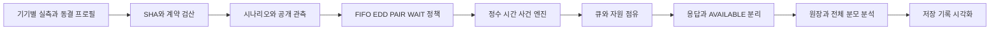

# 통합 스케줄링 시뮬레이터 설계와 S26 측정 축소

2026-10-16 사용자 지시로 S26 추가 확인을95세션에서 **7조건3블록21슬롯**으로 줄였다. 받은 DEV 자료로 개발을 진행하고 확인 자료는 별도로 판독한다. 통합 **SCHEDULER-INTEGRATED/INT001 설계 계약은 완성**했으며 새 엔진 구현·모형 적합·실측 확인 완료와 구분한다.

## 남긴 실측과 분석 범위

M128_BASE, M128_ORDER, M128_PAIR_G, M128_WAIT200x16, M128_NPU_SERIAL, SMOOTH128_BASE, SMOOTH128_PAIR_G를 남겼다. 같은 블록에서 순서/CG병행/한WAIT/GPU대NPU직렬경로/버스트와병행 효과를 비교한다.3회는 운영상 시간 절감이며 통계적 최소 표본 수가 아니다. 전체 계획 분모, 세 블록 값과 paired차이·중앙값·범위·실패·미완료를 보고한다. CPU분류/열이력/NPU병행/최적WAIT/에너지AP/ATCPPO의 독립 확인은 이번 범위에서 보류한다.

이미 시작한 원95계획이 있으면 원1~3블록 해당군을 결과와 무관하게 연결하고 원순서를 유지한다. 소비된 실패를 성공으로 대체하지 않고21회를 추가로 중복 시작하지 않는다. 기존 제외군 소비도 총계에 보존한다. fresh ID/순서는 원CONFIRM START0일 때만 적용한다. 원동결 파일을 덮지 않고 별도 개정과SHA로 연결한다. 실제driver·입력·session binding은 수신 전null이며 측정을 실행한 것으로 표시하지 않는다.

## 엔진 설계

기기별 응답 계약, AVAILABLE 전 점유, 예정 도착 기준 strict head, 동시각 stop/state/timer/decision, legacy PAIR와 새 atomicPAIR 구분, WAIT중도착, 불법행동·결측·실패·저장복구를 고정했다. 숨은 미래 서비스벡터와 확인 결과는 정책 관측에 제공하지 않는다. 원단계벡터의 상관을 보존하고 admission/redispatch/tail은 DEV근거의 별도 신규모형 후보로 다룬다. J/AP 플러그인은 미식별 null로 비활성이다.

## 정본 산출물

- [엔진 설계](C:/Users/chomg/Documents/Codex/2026-10-11/dkfo/outputs/SCHEDULER-DESIGN-20261016/ENGINE_BLUEPRINT.md)
- [모듈과 타입 인터페이스](C:/Users/chomg/Documents/Codex/2026-10-11/dkfo/outputs/SCHEDULER-DESIGN-20261016/INTERFACES.json)
- [30항목 수용검사](C:/Users/chomg/Documents/Codex/2026-10-11/dkfo/outputs/SCHEDULER-DESIGN-20261016/ACCEPTANCE_MATRIX.md)
- [21슬롯 계획](C:/Users/chomg/Documents/Codex/2026-10-11/dkfo/outputs/SCHEDULER-DESIGN-20261016/REDUCED_CONFIRM_PLAN.json)
- [측정 개정 설명](C:/Users/chomg/Documents/Codex/2026-10-11/dkfo/outputs/SCHEDULER-DESIGN-20261016/MEASUREMENT_REVISION.md)
- [담당자 전달문](C:/Users/chomg/Documents/Codex/2026-10-11/dkfo/outputs/SCHEDULER-DESIGN-20261016/S26_전달문.txt)
- [완료 영수증](C:/Users/chomg/Documents/Codex/2026-10-11/dkfo/outputs/SCHEDULER-DESIGN-20261016/COMPLETION_RECEIPT.json)

## 다음 구현

계약과 입력adapter→등록된 새 사건엔진→정책·전체분모→trace 연결→새 확인 판독 순으로 구현한다. 상세 수용검사30개는 현재 새엔진에 대해 NOT_RUN이며, 순수 파일/계약 검사16 PASS를 엔진 PASS로 전용하지 않는다. 실측 전예측은 실제START 전SHA봉인 증거가 있을 때만 인정한다. 원 V2 EP814와CAUSAL/NODGPU gate 및 사용자중지 PAUSED는 그대로다. 이번 새환경/fit/NN/optimizer/기기/자동재개/외부송신0이다.
