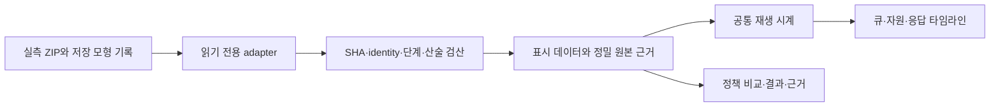

# 스케줄러 기록 재생과 시뮬레이터 화면 구성

사용자 요청은 처음 보는 사람도 스케줄링을 이해할 수 있는 시각화와 향후 시뮬레이터 화면 구성을 함께 준비하는 것이다. 작업 계보는 `work/SCHEDULER-VISUAL-20261015`, 검산·브라우저 증거는 `outputs/SCHEDULER-VISUAL-20261015`다. 대화 문맥이 압축돼도 해당 `CONTINUE.md`와 실제 완료 영수증·SHA부터 재개한다.

현재 화면은 A24·S26 각각의 M128 실측 DEV 네 정책과 이미 저장된 GEN001 시간모형 네 정책, 합계4사례·16기록·2,048요청을 재생한다. 기기·실측/저장모형을 선택하고 FIFO와 EDD/PAIR/WAIT를 같은 시각에 비교한다. 요청→큐→배정→CPU/GPU 실행→응답→AVAILABLE, 실제 WAIT, 긴급/일반 기한 준수와 손해를 연결해 보여 준다.

- **처음 보기:** 처리 흐름과 C 분류/D 탐지·긴급/일반을 풀어 쓴다.
- **움직여 보기:** 재생·정지·시간 탐색·다음 사건·결과까지 이동하면 두 정책의 큐와 자원 점유·응답 수가 함께 바뀐다.
- **한 요청 살펴보기:** 예정/실제 도착, 큐, 배정, 실행, 출력·저장·readback, 응답, release와 AVAILABLE을 구분한다. 기록이 없는 경계는 미기록으로 둔다.
- **결과와 근거:** 전체 완료와 기한 내 완료, 긴급/일반 분모, P95, 겹침과 명목/실제 WAIT, 원자료·세대·SHA와 조건 차이를 보여 준다.

화면 자료는 현재 S26 DEV 블록1과 A24 DEV 대표 시도이며 선택 규칙은 원 동결물과 같다. 최근 S26 블록2는 [별도 전수 검산](S26_M8_DEV2_FREEZE_REVIEW_20261015.md)에 보존했다. 과거 화면 자료를 새 블록으로 조용히 교체하거나 결과가 유리한 시도로 재선정하지 않는다.

S26은 긴급 output_ready/일반 실제 readback, A24는 C output_ready/D persist가 응답 계약이다. 기한도 S26 0.8/2초, A24 2.2/5초로 다르다. 상대 초는 첫 예정 요청을0으로 잡으며 common 기준 J/AP 창과 원점이 다르다. 납기는 원 정수 ns에서 계산한 bool을 보존해 화면 반올림으로 재판정하지 않는다. AP·에너지 예측은 null이고 절감량을 표시하지 않는다.

재생은 표시 시계를 움직이며 새 학습·시뮬레이터 환경·정책 선정·휴대전화 실행은 생성하지 않는다. 실제 기기·학습 worker·원장에 쓰는 버튼과 네트워크 연결도 없다. 자료의 운영 편차·한 DEV 반복·서로 다른 시작 조건을 그대로 보존한다.

## 연결 구성

상세 화면·컴포넌트·이벤트·응답 계약은 `work/SCHEDULER-VISUAL-20261015/VISUALIZATION_SPEC.md`, 연결 순서와 향후 읽기 GET/SSE API는 `INTEGRATION_PLAN.md`, 실제17열 스키마와 미래 event envelope는 `outputs/SCHEDULER-VISUAL-20261015/DATA_CONTRACT.json`을 따른다. API와 PPO/CAUSAL/NODGPU 표시 확장은 계획 단계이며 실제 감사된 결과가 있을 때 별도 adapter로 연결한다.

다음 확장은 전체 조건·서비스70/80/90/95/100·모든 seed·긴급/일반·J0~180/AP35~180·peak/잔열·납기 손해/미완료·문맥/M0·M1·M2를 해당 증거 수준에 맞게 연결하는 것이다. 실제 NN 입력·마스크·logprob·critic이 기록된 경우에만 그 패널을 제공한다. 임의 수치나 가짜 추론으로 채우지 않는다.

자동 확인은 PAUSED를 유지한다. 원 V2 미저장 EP814와 후속 생산 gate를 이 화면 완성으로 해결 처리하지 않는다. 화면 검증·모바일/밝고 어두운 화면·상호작용 및 보호 SHA의 최종 판정은 BROWSER_QA와 COMPLETION_RECEIPT를 확인한다.

검증 완료: QA_V3의 23개 구조·상호작용 확인과 QA_V4의 16개 최종 표시·회귀 확인을 통과했다. 저장 상태 echo로 재생이 멈추던 v2 결함은 v3에서 수정했고 기존 실패 기록도 보존했다. v4는 A24 D 응답을 정확히 persist로 표시하고 초보자용 정책 설명을 다듬었다. 자동 재생 시작0, 클릭 재생·정지·끝 도달·외부 상태 복원, 밝고 어두운 화면과320/360/736/1024폭을 확인했다.
