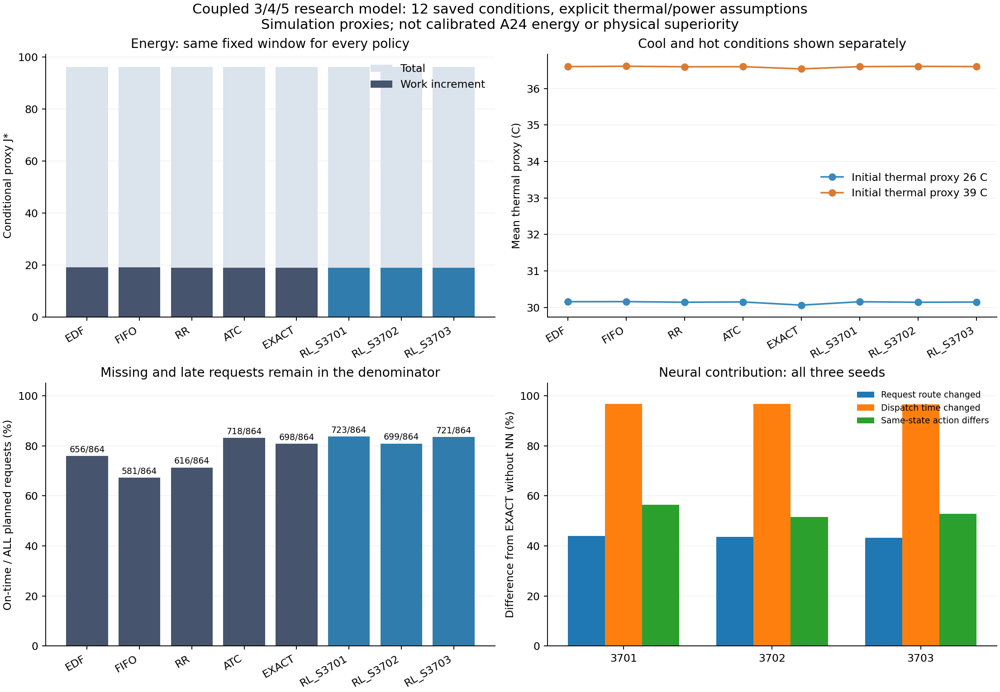
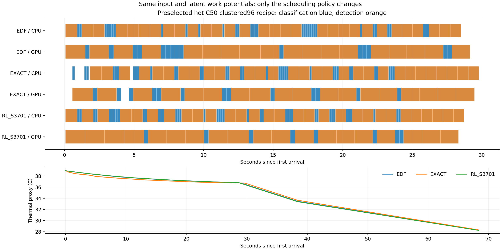

# 3·4·5 통합 보완 결과 — 가설 모형·학습·독립 검산 완료

새640예약 중 **602 START=602 COMPLETE/FAIL0**, 3seed×128학습·seed별64 PPO갱신을 마쳤다. DEV에서 seed3701/EP64를 선정했고,3seed 모두 새12조건에서 평가했다. 아래 수치는 **새 열·전력 가설 안의 PC 계산**이며 A24 실측 에너지나 실기기 성능 우위가 아니다. 옛 모형과 평가창이 달라 예전0.2%와 새 정책 범위의 차이를 직접적인 개선율로 계산하지 않는다.

## 무엇을 보완했나

3번은 전력→RC온도→실행 중 남은 작업 진행률/전력의 닫힌 고리다. SERIAL 작업 벡터와 완료된 단계 시각은 바꾸지 않는다.4번은 고정ATC 행동 logit0, NN 전체 행동 logit, 현재 온도·공유 활성 이력·명목 후속 비용 입력,3seed 새학습이다.5번은 실제/명목/보상/최종평가의 같은 dynamics.advance_jobs와 목표식이다. CPU/GPU 각1·최대2·비선점AVAILABLE 해제를 유지했다.

명목 예측은 현재 ready후보/관측owner와 과거 pool의 명목 벡터만 쓰며 미래 실제 작업량·도착은 보지 않는다. 같은 식이 미래 예측의 정확함을 보장하지는 않는다. 실제 샘플 변동·명목 overrun·후보 밖 큐·미래 도착은 오차로 남는다.

## 모든 정책 결과

12조건은 분류 비율25/50/75%·두 도착 패턴·초기 열 proxy26/39℃를 사용한다. 각 정책의 같은 조건·입력·잠재 작업량 키를 맞췄다. 비용과 AP는 조건별 평균, 정시·미응답은 전체 예정 요청을 분모로 합산했다. 에너지 창은35초부터 공통 drain끝, 평균AP 창은35초부터 공통 service끝이다. 모든 정책에 같은50ms admission 모음을 적용했다.

| 정책 | 평균 총 J* | 작업 증분 J* | 평균 열 proxy ℃ | 정시/전체 | 긴급 정시/전체 | 미응답/미완료 |
|---|---:|---:|---:|---:|---:|---:|
| EDF | 96.2566 | 19.0713 | 33.3780 | 656/864 | 158/216 | 0/0 |
| FIFO | 96.2677 | 19.0824 | 33.3846 | 581/864 | 127/216 | 0/0 |
| RR | 96.1819 | 18.9966 | 33.3685 | 616/864 | 144/216 | 0/0 |
| ATC | 96.2277 | 19.0424 | 33.3735 | 718/864 | 189/216 | 0/0 |
| EXACT | 96.1952 | 19.0099 | 33.3001 | 698/864 | 188/216 | 0/0 |
| **RL_S3701 (DEV선정)** | 96.2345 | 19.0492 | 33.3771 | 723/864 | 182/216 | 0/0 |
| RL_S3702 | 96.2302 | 19.0449 | 33.3741 | 699/864 | 195/216 | 0/0 |
| RL_S3703 | 96.2233 | 19.0380 | 33.3734 | 721/864 | 194/216 | 0/0 |

비학습5정책의 평균 총비용 범위는96.1819~96.2677J*(0.0892%)다. NN3seed를 포함한8정책 범위는96.1819~96.2677J*(0.0892%)다. 큰 범위가 열·에너지·납기의 동시 개선이나 NN 우위를 뜻하지 않으므로 비학습 정책 범위와 NN seed범위를 나누어 보고한다.

## 3번: 온도 피드백 대조

같은 고정 정책과 입력에서 강도0은 온도가 진행률·전력에 되돌아가지 않게 한다. 아래는 **피드백0−기본1** 차이다. 음의 소비는 피드백을 끈 쪽 소비가 더 작다는 뜻이며 항상 열 피드백이 에너지를 낮춘다고 가정하지 않았다.

| 정책 | 평균 총비용 ΔJ* | 평균 열 proxy Δ℃ | 전체 정시 Δ | 긴급 정시 Δ |
|---|---:|---:|---:|---:|
| EDF | +1.0599 | +0.3403 | 182 | 46 |
| EXACT | +0.9855 | +0.3240 | 98 | 14 |
| RL | +1.0332 | +0.3366 | 77 | 10 |

강도0.5/1.5와 시간격자0.1→0.05초도 선정 NN을 재학습하지 않고 같은 입력에 적용했다. 모든 조건별 차이는 ANALYSIS.json의 ablations/timestep에 있다. 단계 진행은 현재 온도의 실제 과거 적분에 반응하고, 이미 완료한 시간을 소급해 바꾸지 않는다. 표본/가정 범위 밖의 실기기 인과 효과는 미검증이다.

## 4번: NN의 실제 기여

| seed | exact와 동일한 조건 | 자원 변경 요청 | 배정시각 변경 요청 | 같은 상태의 다른 행동/복수행동 판단 |
|---|---:|---:|---:|---:|
| 3701 | 0/12 | 380/864 | 836/864 | 487/864 |
| 3702 | 0/12 | 376/864 | 835/864 | 446/864 |
| 3703 | 0/12 | 374/864 | 834/864 | 456/864 |

EXACT는 같은 후보·물리 제약에서 NN 없이 명목 후속 목표식을 최소화하는 대조다. 별도로 NN 초기 actor출력이0이므로 초기 argmax는 같은 모음 규칙의 EDF·CPU우선과 같다. 저장 7230개 공개 판단에서 canonical 첫 행동을 검산했다. 실제 갱신 횟수는 seed별64, Adam_steps는 3701:256/3702:256/3703:256다. 학습 실행·행동 변화와 성능 우위를 구분하며 학습 횟수만으로 충분한 수렴을 선언하지 않는다.

DEV선정 적격 flag=false. 이는 사전 DEV의 미응답/EDF정시 손해 기준이며 모든 긴급 서비스·프로젝트 원목표의 통과를 뜻하지 않는다.3seed별 결과와 학습 곡선은 모두 저장했다. 강한 비학습 대조보다 열·소비가 낮더라도 납기/미완료가 나빠지면 공동 개선으로 쓰지 않는다.

## 5번: 같은 비용식과 근사식 대조

NN 입력·후보 예측·실제 보상에서 현재 열/활성 이력을 유지한다. 242개 선정 명목 후속을 저장된 공개 입력으로 재생했고, 2592개 새 평가 NN 판단을 정확히 재생했다. 실제 보상5성분의 합과 최종 목표식은 저장검사에서 맞았다.

APPROX는 같은 후속 작업·열/납기 항에서 에너지 항만 명목 점유량×단독 전력으로 바꾼 대조다. **APPROX−EXACT** 평균총비용 +0.0541J*, 평균열 proxy +0.0011℃, 정시 -19, 긴급 -9다. 조건별 모든 손해를 포함한다. 근사식과 같은 적분식의 차이가 정책 선택으로 이어지는지를 보는 대조이며 실제 기기의 전력 정확도 검증은 아니다.

## 원 공동목표를 그대로 적용

EDF 대비 같은 조건의 총비용10% 이상 감소·평균열 proxy0.5℃ 이상 감소·전체/긴급정시/응답/AVAILABLE 비악화를 동시에 요구했다. 평가를 본 뒤 기준을 바꾸지 않았다.

| 정책 | 원 공동목표 통과 조건 |
|---|---:|
| FIFO | 0/12 |
| RR | 0/12 |
| ATC | 0/12 |
| EXACT | 0/12 |
| RL_S3701 | 0/12 |
| RL_S3702 | 0/12 |
| RL_S3703 | 0/12 |

온도별 모든 정책 집계, 조건별 Pareto/정시 손해, NN−EXACT/EDF, 강도/격자 민감도는 ANALYSIS.json/GOAL_CHECKS.json/CHOICE_DIAGNOSTICS.json에 있다. WAIT는 복수 요청/실배정 기회의 분모에 넣지 않고 물리ready수와 후보수도 구분했다. 미응답·미완료가 다른 정책의 소비 감소는 같은 완료량의 효율 개선으로 승격하지 않는다.

위 예시는 결과가 나오기 전에 고정한 FRESH_09다. 유리한 조건을 골라 전체 효과로 일반화한 그림이 아니다.

## 검증·파일·경계

- 순수20계약·원 엔진 독립 진행과 새 피드백0의2쌍 P0 PASS. 기존 SERIAL 작업분포의 재현성/새 가설의 소프트웨어 검증이며 실기기 정확도는 아니다.
- 독립 저장검사 4111314개(전력/RC 보존/작업량/NN/옵티마이저), 별도 전요청 지표검사 14352개, NN/EXACT 명목후속 재생 242개 PASS다. 첫 실제 PPO/Adam 갱신3개를 action/shuffle RNG와 Adam전체 moment/step까지 정확히 재생했다. 이는 감사용 재생이며 추가 학습 결과로 세지 않았다.
- 모든 단계의 입력/소스는 OPERATION.json과 후처리 OP들에 SHA로 고정했다. 원사전검사 경로 오류는 환경START0으로 보존했고, 원모형/실패/223회/256회 자료는 변경하지 않았다. 원640 중602소비·잔38, 별도원256잔0/RR잔1, 추적전역예약125478/137712·현재 타host 실제소비 전수값 아님을 유지한다. 추가실행/실패재시작/기기/새열물리fit/주기조회0이다.
- 새 RC시정수25초/저항12/온도기준32℃/진행률floor0.45/누설0.2 등은 명시적 가정이다. 원 SERIAL의 온도 영향은 제거되지 않아 이중 반영 가능성이 있고, 새병행 진행은 독립작업＋열 가정이다. 열 proxy는 CPU 접합 온도나 Android trip point가 아니다. 같은 비용창의 기저는 유지했다.
- 제어·명목 예측·NN추론 단말 오버헤드는 공통 ideal-zero다. 수치 전이는 최대0.1초와 단계 경계에서 갱신하며 peak는 이 적분 경계의 표본 최대다. 시간격자 대조를 별도 저장했다. 통계 CI·실측J·실기기 NN 배포/우위는 미검증이다.
- RESULT/COMPLETE/receipts.jsonl, RAW/준비prediction/NN frames, 모든 UPDATE와 초기/EP2/16배수 체크포인트의 network/Adam/RNG를 이 폴더에 보존한다. SOURCE의 새 엔진은 experiments/coupled_345_20261017이며 원 대화형UI 기본정책은 교체하지 않았다.

원 실행 source 등록은5ea9ed2, 후처리 소스/정의는 평가 전에 추가 등록했다. 최종 handoff proof는 FINAL_HANDOFF_PROOF.json이며 source/input/result/그림/문서의 파일별 SHA로 연결한다. 완료된 operation은 그대로 다시 실행하지 않는다.
