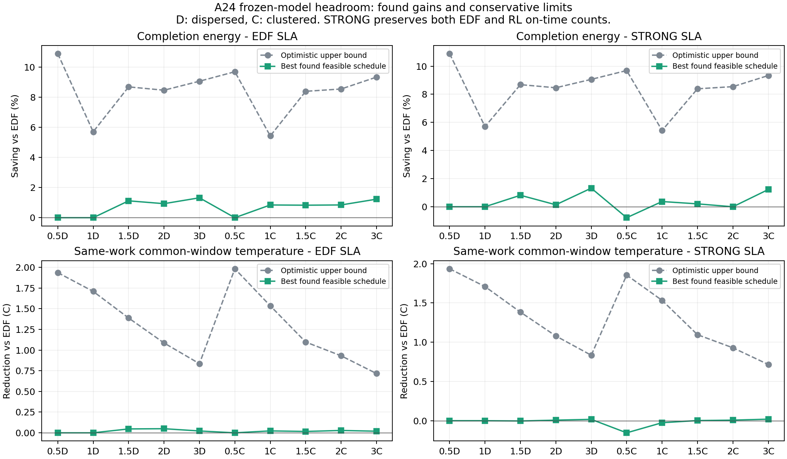

# 같은 A24 모형·밀도 입력의 열·에너지 절감 여지

2026-10-18 사용자 요청에 따라 원 LOAD_DENSITY의10입력·잠재작업량·물리계수·도착·납기·서비스/관측창을 고정했다. 새82실행(정확engine/model 재현2＋8종 오프라인 일정×10)과40 LP를 별도 등록했다. 학습·물리fit·실기기0이다. 원32/NN/실측을 수정하지 않았다.

## 비교와 판정의 범위

- EDF층은 조건별 EDF의 전체/긴급 정시 수를 각각 보존한다. STRONG층은 EDF와 현재RL 중 더 큰 전체/긴급 정시 수를 각각 보존한다. 이는 모든요청이 정시라는 뜻이 아니다. 과부하에서 불가능할수있는 전요청정시로 바꿔말하지 않는다. 모든후보의 전체도착 분모·완료P95·미응답/미완료를 아래 공개한다.
- 에너지는 첫공급35초부터 자기 마지막AVAILABLE까지의 기저＋증분J*다. 전부완료하지않으면 미정의다. 평균온도는 원3정책의공통완료시각을 조건별로사전에동결한 창으로비교한다. 그시각까지전부완료한일정만 온도 적격이다. 더늦게처리해 차갑게보이는일정은 열우위로쓰지않는다. 열상한은 이같은완료시한을지키는문제의상한이며 전service창을허용한에너지상한과범위가다르다.
- CPU/GPU각1·최대2·AVAILABLE비선점·원명목긴급WAIT mask·총12초/선두1.5초·공통50ms모음을 유지했다. 후보8개 제한은정책제한이므로 오프라인진단에서는전체ready와 양route실현작업량을쓴다. 미래정보를아는 진단일정이며 온라인달성성/새RL우위/전역최적값을주장하지않는다.
- ENERGY/TOTAL/REGRET/LP_ROUTE/HEAT/COOL35/COOL36/SLA_ENERGY의8개 사전고정휴리스틱을 모두보고한다. 기준EDF/ATC/RL30저장일정도 그대로포함한다. 발견한최저에너지와최저온도는 서로다른일정일수있다. 공동10%/.5℃는 반드시 같은일정에서 확인한다. 조건별사후선택모음은 단일정책성능이아니다.
- 사용자 추가지시에 따라 신규82(재현2 포함)＋기준30의112행을 모두 표시하며 삭제0이다. 선정에서 제외되는 이유는 EDF/STRONG 납기와 온도창 완료 여부별로 비고에 적었다. P0도 표에 남긴다. 모든40 LP 상태/수치 여유는 CERT와 BOUNDS에 보존한다.
- LP는 연속route분할·독립온도별실행작업·가장유리한구간끝점·선점가능한용량·독립발열배치를허용한다. 실제일정을포함하는낙관적완화이므로 비용하한에서 최대절감상한을얻는다. LP해를 실행가능일정으로쓰지않는다. 모든변수의유한box에서쌍대잔차를보수적으로보정하고수치여유를뺀하한을독립JS로재계산했다. solver의primal이나탐색실패는상한근거가아니다.
- 각원EDF/ATC/RL trace를 LP에매핑해구조제약과조건부count제약을검사했다. 독립온도구간0.05℃·원RC상한41.7054℃·공유비용의owner당H/2 하한을쓴다. 열은같은RC식의에너지침착커널과상한전력으로완화했다. 수치적보수경계이며기기물리최적상한은아니다.

## 모든조건의달성량과최대가능상한

에너지 단위는EDF대비절감%, 온도는EDF대비하락℃다. 음수는악화다. 같은행의에너지/온도달성량은별개최선일정일수있다.

|배수|파형|납기층|필요전체/긴급정시|찾은에너지절감%|낙관적최대절감%|찾은온도하락℃|낙관적최대하락℃|공동목표일정수|
|---:|---|---|---:|---:|---:|---:|---:|---:|
|0.5|staggered_wave|EDF|185/46|0.000|10.893|0.000|1.936|0|
|0.5|staggered_wave|STRONG|185/46|0.000|10.893|0.000|1.936|0|
|1|staggered_wave|EDF|364/88|0.000|5.703|0.000|1.709|0|
|1|staggered_wave|STRONG|364/88|0.000|5.703|0.000|1.709|0|
|1.5|staggered_wave|EDF|110/26|1.120|8.687|0.047|1.388|0|
|1.5|staggered_wave|STRONG|349/118|0.816|8.687|-0.003|1.384|0|
|2|staggered_wave|EDF|26/6|0.932|8.466|0.050|1.086|0|
|2|staggered_wave|STRONG|438/162|0.139|8.466|0.007|1.079|0|
|3|staggered_wave|EDF|17/5|1.321|9.063|0.022|0.836|0|
|3|staggered_wave|STRONG|612/219|1.321|9.063|0.017|0.834|0|
|0.5|clustered_recovery|EDF|234/54|0.000|9.692|0.000|1.983|0|
|0.5|clustered_recovery|STRONG|238/60|-0.780|9.692|-0.154|1.855|0|
|1|clustered_recovery|EDF|194/46|0.845|5.428|0.023|1.535|0|
|1|clustered_recovery|STRONG|335/95|0.370|5.428|-0.026|1.533|0|
|1.5|clustered_recovery|EDF|27/6|0.830|8.393|0.016|1.097|0|
|1.5|clustered_recovery|STRONG|392/137|0.204|8.393|0.002|1.096|0|
|2|clustered_recovery|EDF|25/8|0.847|8.546|0.028|0.931|0|
|2|clustered_recovery|STRONG|509/177|-0.003|8.546|0.007|0.929|0|
|3|clustered_recovery|EDF|20/6|1.230|9.336|0.019|0.716|0|
|3|clustered_recovery|STRONG|692/183|1.227|9.336|0.019|0.716|0|

숫자판정: {"EDF":{"energy10_impossible":9,"temperature_point5_impossible":0,"found_joint":0},"STRONG":{"energy10_impossible":9,"temperature_point5_impossible":0,"found_joint":0}}. 상한이목표보다작으면 해당모형/입력/조건에서는목표가불가능하다. 큰개선의실행가능일정을찾으면현재정책에남은여지가있다. 둘사이간격이넓으면정확한최적값과원인비중은미결정이며 탐색실패를모형한계로승격하지않는다.

## 모든후보와손해

|조건|정책/일정|출처|전체정시|긴급정시|완료응답P95초|미응답/미완료|완료시간초|완료J*|고정공통평균AP℃|최고AP℃|비고|
|---|---|---|---:|---:|---:|---:|---:|---:|---:|---:|---|
|DENSITY_050_0|REPLAY_EDF|P0|185/185|46/46|1.100|0/0|120.144|206.131|30.889|32.466|P0:원본 재현 검증용, 정책 우위 선정 대상에서만 제외; EDF:납기 적격; STRONG:납기 적격; 온도창 완료 적격|
|DENSITY_050_0|ENERGY|WITNESS|185/185|46/46|1.165|0/0|120.144|206.768|30.939|32.541|EDF:납기 적격; STRONG:납기 적격; 온도창 완료 적격|
|DENSITY_050_0|TOTAL|WITNESS|185/185|46/46|1.165|0/0|120.144|206.768|30.939|32.541|EDF:납기 적격; STRONG:납기 적격; 온도창 완료 적격|
|DENSITY_050_0|REGRET|WITNESS|185/185|46/46|1.165|0/0|120.144|206.768|30.939|32.541|EDF:납기 적격; STRONG:납기 적격; 온도창 완료 적격|
|DENSITY_050_0|LP_ROUTE|WITNESS|185/185|46/46|1.165|0/0|120.144|206.768|30.939|32.541|EDF:납기 적격; STRONG:납기 적격; 온도창 완료 적격|
|DENSITY_050_0|HEAT|WITNESS|185/185|46/46|1.172|0/0|120.204|208.533|31.079|32.670|EDF:납기 적격; STRONG:납기 적격; 온도창 완료 적격|
|DENSITY_050_0|COOL35|WITNESS|185/185|46/46|1.165|0/0|120.144|206.768|30.939|32.541|EDF:납기 적격; STRONG:납기 적격; 온도창 완료 적격|
|DENSITY_050_0|COOL36|WITNESS|185/185|46/46|1.165|0/0|120.144|206.768|30.939|32.541|EDF:납기 적격; STRONG:납기 적격; 온도창 완료 적격|
|DENSITY_050_0|SLA_ENERGY|WITNESS|185/185|46/46|1.100|0/0|120.144|206.131|30.889|32.466|EDF:납기 적격; STRONG:납기 적격; 온도창 완료 적격|
|DENSITY_100_0|ENERGY|WITNESS|359/364|83/88|1.524|0/0|119.969|243.094|33.876|35.548|EDF:선정 제외(전체정시 359<364, 긴급정시 83<88); STRONG:선정 제외(전체정시 359<364, 긴급정시 83<88); 온도창 완료 적격|
|DENSITY_100_0|TOTAL|WITNESS|359/364|83/88|1.526|0/0|119.969|243.096|33.876|35.548|EDF:선정 제외(전체정시 359<364, 긴급정시 83<88); STRONG:선정 제외(전체정시 359<364, 긴급정시 83<88); 온도창 완료 적격|
|DENSITY_100_0|REGRET|WITNESS|356/364|83/88|1.525|0/0|119.969|243.071|33.877|35.546|EDF:선정 제외(전체정시 356<364, 긴급정시 83<88); STRONG:선정 제외(전체정시 356<364, 긴급정시 83<88); 온도창 완료 적격|
|DENSITY_100_0|LP_ROUTE|WITNESS|359/364|83/88|1.523|0/0|119.969|243.063|33.873|35.549|EDF:선정 제외(전체정시 359<364, 긴급정시 83<88); STRONG:선정 제외(전체정시 359<364, 긴급정시 83<88); 온도창 완료 적격|
|DENSITY_100_0|HEAT|WITNESS|360/364|84/88|1.538|0/0|120.193|243.558|33.885|35.584|EDF:선정 제외(전체정시 360<364, 긴급정시 84<88); STRONG:선정 제외(전체정시 360<364, 긴급정시 84<88); 온도 선정 제외:동결 공통창 안에 전부 완료하지 못함|
|DENSITY_100_0|COOL35|WITNESS|351/364|81/88|1.918|0/0|119.970|243.378|33.873|35.697|EDF:선정 제외(전체정시 351<364, 긴급정시 81<88); STRONG:선정 제외(전체정시 351<364, 긴급정시 81<88); 온도 선정 제외:동결 공통창 안에 전부 완료하지 못함|
|DENSITY_100_0|COOL36|WITNESS|359/364|83/88|1.526|0/0|119.969|243.096|33.876|35.548|EDF:선정 제외(전체정시 359<364, 긴급정시 83<88); STRONG:선정 제외(전체정시 359<364, 긴급정시 83<88); 온도창 완료 적격|
|DENSITY_100_0|SLA_ENERGY|WITNESS|362/364|88/88|1.527|0/0|119.969|243.020|33.869|35.546|EDF:선정 제외(전체정시 362<364); STRONG:선정 제외(전체정시 362<364); 온도창 완료 적격|
|DENSITY_150_0|ENERGY|WITNESS|410/546|110/135|58.673|0/0|148.496|315.175|35.274|36.485|EDF:납기 적격; STRONG:선정 제외(긴급정시 110<118); 온도창 완료 적격|
|DENSITY_150_0|TOTAL|WITNESS|414/546|111/135|58.158|0/0|148.314|314.944|35.278|36.490|EDF:납기 적격; STRONG:선정 제외(긴급정시 111<118); 온도창 완료 적격|
|DENSITY_150_0|REGRET|WITNESS|395/546|112/135|55.057|0/0|149.613|317.072|35.241|36.456|EDF:납기 적격; STRONG:선정 제외(긴급정시 112<118); 온도창 완료 적격|
|DENSITY_150_0|LP_ROUTE|WITNESS|401/546|112/135|56.551|0/0|148.497|314.999|35.281|36.485|EDF:납기 적격; STRONG:선정 제외(긴급정시 112<118); 온도창 완료 적격|
|DENSITY_150_0|HEAT|WITNESS|414/546|110/135|65.547|0/0|148.388|315.108|35.273|36.494|EDF:납기 적격; STRONG:선정 제외(긴급정시 110<118); 온도창 완료 적격|
|DENSITY_150_0|COOL35|WITNESS|414/546|111/135|61.706|0/0|152.330|320.682|35.251|36.460|EDF:납기 적격; STRONG:선정 제외(긴급정시 111<118); 온도 선정 제외:동결 공통창 안에 전부 완료하지 못함|
|DENSITY_150_0|COOL36|WITNESS|414/546|111/135|60.074|0/0|150.235|317.623|35.259|36.460|EDF:납기 적격; STRONG:선정 제외(긴급정시 111<118); 온도창 완료 적격|
|DENSITY_150_0|SLA_ENERGY|WITNESS|408/546|110/135|62.277|0/0|148.673|315.487|35.269|36.485|EDF:납기 적격; STRONG:선정 제외(긴급정시 110<118); 온도창 완료 적격|
|DENSITY_200_0|ENERGY|WITNESS|495/730|155/182|126.236|0/0|199.120|420.039|35.547|36.528|EDF:납기 적격; STRONG:선정 제외(긴급정시 155<162); 온도창 완료 적격|
|DENSITY_200_0|TOTAL|WITNESS|494/730|156/182|126.851|0/0|199.619|420.843|35.548|36.526|EDF:납기 적격; STRONG:선정 제외(긴급정시 156<162); 온도창 완료 적격|
|DENSITY_200_0|REGRET|WITNESS|456/730|146/182|119.611|0/0|200.600|422.478|35.516|36.497|EDF:납기 적격; STRONG:선정 제외(긴급정시 146<162); 온도창 완료 적격|
|DENSITY_200_0|LP_ROUTE|WITNESS|487/730|159/182|127.489|0/0|198.617|419.130|35.555|36.526|EDF:납기 적격; STRONG:선정 제외(긴급정시 159<162); 온도창 완료 적격|
|DENSITY_200_0|HEAT|WITNESS|492/730|158/182|131.326|0/0|199.994|421.585|35.541|36.538|EDF:납기 적격; STRONG:선정 제외(긴급정시 158<162); 온도창 완료 적격|
|DENSITY_200_0|COOL35|WITNESS|494/730|156/182|129.083|0/0|202.428|424.788|35.499|36.499|EDF:납기 적격; STRONG:선정 제외(긴급정시 156<162); 온도 선정 제외:동결 공통창 안에 전부 완료하지 못함|
|DENSITY_200_0|COOL36|WITNESS|494/730|156/182|128.241|0/0|202.371|424.811|35.513|36.499|EDF:납기 적격; STRONG:선정 제외(긴급정시 156<162); 온도 선정 제외:동결 공통창 안에 전부 완료하지 못함|
|DENSITY_200_0|SLA_ENERGY|WITNESS|480/730|145/182|126.066|0/0|199.287|420.231|35.548|36.527|EDF:납기 적격; STRONG:선정 제외(긴급정시 145<162); 온도창 완료 적격|
|DENSITY_300_0|ENERGY|WITNESS|644/1096|216/274|217.629|0/0|301.403|631.356|35.814|36.539|EDF:납기 적격; STRONG:선정 제외(긴급정시 216<219); 온도창 완료 적격|
|DENSITY_300_0|TOTAL|WITNESS|642/1096|218/274|216.671|0/0|301.218|631.086|35.816|36.536|EDF:납기 적격; STRONG:선정 제외(긴급정시 218<219); 온도창 완료 적격|
|DENSITY_300_0|REGRET|WITNESS|594/1096|203/274|221.011|0/0|305.761|638.513|35.760|36.504|EDF:납기 적격; STRONG:선정 제외(전체정시 594<612, 긴급정시 203<219); 온도 선정 제외:동결 공통창 안에 전부 완료하지 못함|
|DENSITY_300_0|LP_ROUTE|WITNESS|630/1096|220/274|216.980|0/0|300.265|629.349|35.826|36.538|EDF:납기 적격; STRONG:납기 적격; 온도창 완료 적격|
|DENSITY_300_0|HEAT|WITNESS|643/1096|220/274|220.326|0/0|302.233|632.946|35.814|36.548|EDF:납기 적격; STRONG:납기 적격; 온도창 완료 적격|
|DENSITY_300_0|COOL35|WITNESS|642/1096|218/274|216.671|0/0|303.425|634.047|35.815|36.536|EDF:납기 적격; STRONG:선정 제외(긴급정시 218<219); 온도창 완료 적격|
|DENSITY_300_0|COOL36|WITNESS|642/1096|218/274|216.671|0/0|303.228|633.785|35.815|36.536|EDF:납기 적격; STRONG:선정 제외(긴급정시 218<219); 온도창 완료 적격|
|DENSITY_300_0|SLA_ENERGY|WITNESS|615/1096|198/274|217.252|0/0|301.799|631.948|35.808|36.536|EDF:납기 적격; STRONG:선정 제외(긴급정시 198<219); 온도창 완료 적격|
|DENSITY_050_1|ENERGY|WITNESS|231/240|59/60|1.397|0/0|120.870|216.375|31.599|33.140|EDF:선정 제외(전체정시 231<234); STRONG:선정 제외(전체정시 231<238, 긴급정시 59<60); 온도창 완료 적격|
|DENSITY_050_1|TOTAL|WITNESS|231/240|59/60|1.397|0/0|120.870|216.375|31.599|33.140|EDF:선정 제외(전체정시 231<234); STRONG:선정 제외(전체정시 231<238, 긴급정시 59<60); 온도창 완료 적격|
|DENSITY_050_1|REGRET|WITNESS|238/240|60/60|1.777|0/0|120.811|217.919|31.740|33.319|EDF:납기 적격; STRONG:납기 적격; 온도창 완료 적격|
|DENSITY_050_1|LP_ROUTE|WITNESS|231/240|59/60|1.397|0/0|120.870|216.375|31.599|33.140|EDF:선정 제외(전체정시 231<234); STRONG:선정 제외(전체정시 231<238, 긴급정시 59<60); 온도창 완료 적격|
|DENSITY_050_1|HEAT|WITNESS|238/240|60/60|1.775|0/0|120.878|218.268|31.760|33.300|EDF:납기 적격; STRONG:납기 적격; 온도창 완료 적격|
|DENSITY_050_1|COOL35|WITNESS|231/240|59/60|1.397|0/0|120.870|216.375|31.599|33.140|EDF:선정 제외(전체정시 231<234); STRONG:선정 제외(전체정시 231<238, 긴급정시 59<60); 온도창 완료 적격|
|DENSITY_050_1|COOL36|WITNESS|231/240|59/60|1.397|0/0|120.870|216.375|31.599|33.140|EDF:선정 제외(전체정시 231<234); STRONG:선정 제외(전체정시 231<238, 긴급정시 59<60); 온도창 완료 적격|
|DENSITY_050_1|SLA_ENERGY|WITNESS|226/240|51/60|1.414|0/0|120.873|216.771|31.627|33.121|EDF:선정 제외(전체정시 226<234, 긴급정시 51<54); STRONG:선정 제외(전체정시 226<238, 긴급정시 51<60); 온도창 완료 적격|
|DENSITY_100_1|ENERGY|WITNESS|382/474|89/119|9.936|0/0|129.418|274.545|35.007|36.416|EDF:납기 적격; STRONG:선정 제외(긴급정시 89<95); 온도창 완료 적격|
|DENSITY_100_1|TOTAL|WITNESS|384/474|90/119|6.196|0/0|129.355|274.447|35.007|36.415|EDF:납기 적격; STRONG:선정 제외(긴급정시 90<95); 온도창 완료 적격|
|DENSITY_100_1|REGRET|WITNESS|347/474|88/119|16.024|0/0|130.561|276.389|34.964|36.390|EDF:납기 적격; STRONG:선정 제외(긴급정시 88<95); 온도 선정 제외:동결 공통창 안에 전부 완료하지 못함|
|DENSITY_100_1|LP_ROUTE|WITNESS|365/474|90/119|10.158|0/0|129.182|274.027|35.010|36.421|EDF:납기 적격; STRONG:선정 제외(긴급정시 90<95); 온도창 완료 적격|
|DENSITY_100_1|HEAT|WITNESS|374/474|90/119|8.212|0/0|129.677|275.133|35.017|36.419|EDF:납기 적격; STRONG:선정 제외(긴급정시 90<95); 온도창 완료 적격|
|DENSITY_100_1|COOL35|WITNESS|373/474|88/119|9.647|0/0|130.214|275.733|34.977|36.421|EDF:납기 적격; STRONG:선정 제외(긴급정시 88<95); 온도창 완료 적격|
|DENSITY_100_1|COOL36|WITNESS|384/474|90/119|6.196|0/0|129.355|274.447|35.007|36.415|EDF:납기 적격; STRONG:선정 제외(긴급정시 90<95); 온도창 완료 적격|
|DENSITY_100_1|SLA_ENERGY|WITNESS|363/474|87/119|8.677|0/0|129.311|274.340|35.006|36.414|EDF:납기 적격; STRONG:선정 제외(긴급정시 87<95); 온도창 완료 적격|
|DENSITY_150_1|ENERGY|WITNESS|458/708|125/177|127.090|0/0|192.288|405.907|35.521|36.520|EDF:납기 적격; STRONG:선정 제외(긴급정시 125<137); 온도창 완료 적격|
|DENSITY_150_1|TOTAL|WITNESS|463/708|136/177|126.399|0/0|192.890|406.780|35.521|36.516|EDF:납기 적격; STRONG:선정 제외(긴급정시 136<137); 온도창 완료 적격|
|DENSITY_150_1|REGRET|WITNESS|431/708|129/177|123.845|0/0|194.537|409.547|35.469|36.498|EDF:납기 적격; STRONG:선정 제외(긴급정시 129<137); 온도 선정 제외:동결 공통창 안에 전부 완료하지 못함|
|DENSITY_150_1|LP_ROUTE|WITNESS|434/708|128/177|125.459|0/0|191.999|405.377|35.525|36.522|EDF:납기 적격; STRONG:선정 제외(긴급정시 128<137); 온도창 완료 적격|
|DENSITY_150_1|HEAT|WITNESS|454/708|134/177|120.051|0/0|192.493|406.330|35.525|36.535|EDF:납기 적격; STRONG:선정 제외(긴급정시 134<137); 온도창 완료 적격|
|DENSITY_150_1|COOL35|WITNESS|463/708|136/177|126.399|0/0|193.544|407.457|35.520|36.515|EDF:납기 적격; STRONG:선정 제외(긴급정시 136<137); 온도창 완료 적격|
|DENSITY_150_1|COOL36|WITNESS|463/708|136/177|126.399|0/0|193.544|407.457|35.520|36.515|EDF:납기 적격; STRONG:선정 제외(긴급정시 136<137); 온도창 완료 적격|
|DENSITY_150_1|SLA_ENERGY|WITNESS|437/708|128/177|125.966|0/0|192.309|405.926|35.520|36.515|EDF:납기 적격; STRONG:선정 제외(긴급정시 128<137); 온도창 완료 적격|
|DENSITY_200_1|ENERGY|WITNESS|549/942|166/236|185.610|0/0|258.213|541.741|35.725|36.535|EDF:납기 적격; STRONG:선정 제외(긴급정시 166<177); 온도창 완료 적격|
|DENSITY_200_1|TOTAL|WITNESS|549/942|168/236|186.799|0/0|257.682|540.874|35.728|36.527|EDF:납기 적격; STRONG:선정 제외(긴급정시 168<177); 온도창 완료 적격|
|DENSITY_200_1|REGRET|WITNESS|525/942|168/236|181.566|0/0|260.521|545.616|35.680|36.506|EDF:납기 적격; STRONG:선정 제외(긴급정시 168<177); 온도 선정 제외:동결 공통창 안에 전부 완료하지 못함|
|DENSITY_200_1|LP_ROUTE|WITNESS|537/942|166/236|182.958|0/0|256.598|539.154|35.738|36.532|EDF:납기 적격; STRONG:선정 제외(긴급정시 166<177); 온도창 완료 적격|
|DENSITY_200_1|HEAT|WITNESS|539/942|170/236|182.009|0/0|258.732|542.821|35.728|36.547|EDF:납기 적격; STRONG:선정 제외(긴급정시 170<177); 온도창 완료 적격|
|DENSITY_200_1|COOL35|WITNESS|549/942|168/236|186.799|0/0|257.682|540.874|35.728|36.527|EDF:납기 적격; STRONG:선정 제외(긴급정시 168<177); 온도창 완료 적격|
|DENSITY_200_1|COOL36|WITNESS|549/942|168/236|186.799|0/0|257.682|540.874|35.728|36.527|EDF:납기 적격; STRONG:선정 제외(긴급정시 168<177); 온도창 완료 적격|
|DENSITY_200_1|SLA_ENERGY|WITNESS|524/942|158/236|186.848|0/0|257.986|541.372|35.724|36.527|EDF:납기 적격; STRONG:선정 제외(긴급정시 158<177); 온도창 완료 적격|
|DENSITY_300_1|REPLAY_EDF|P0|20/1410|6/352|257.930|0/0|393.345|820.820|35.931|36.387|P0:원본 재현 검증용, 정책 우위 선정 대상에서만 제외; EDF:납기 적격; STRONG:선정 제외(전체정시 20<692, 긴급정시 6<183); 온도창 완료 적격|
|DENSITY_300_1|ENERGY|WITNESS|743/1410|192/352|297.752|0/0|388.933|811.940|35.931|36.549|EDF:납기 적격; STRONG:납기 적격; 온도창 완료 적격|
|DENSITY_300_1|TOTAL|WITNESS|741/1410|192/352|298.222|0/0|388.145|810.752|35.929|36.544|EDF:납기 적격; STRONG:납기 적격; 온도창 완료 적격|
|DENSITY_300_1|REGRET|WITNESS|741/1410|185/352|296.628|0/0|390.447|814.524|35.912|36.506|EDF:납기 적격; STRONG:납기 적격; 온도창 완료 적격|
|DENSITY_300_1|LP_ROUTE|WITNESS|734/1410|190/352|295.950|0/0|388.381|811.037|35.932|36.538|EDF:납기 적격; STRONG:납기 적격; 온도창 완료 적격|
|DENSITY_300_1|HEAT|WITNESS|729/1410|184/352|299.677|0/0|389.547|813.421|35.930|36.557|EDF:납기 적격; STRONG:납기 적격; 온도창 완료 적격|
|DENSITY_300_1|COOL35|WITNESS|741/1410|192/352|298.222|0/0|389.529|812.681|35.930|36.544|EDF:납기 적격; STRONG:납기 적격; 온도창 완료 적격|
|DENSITY_300_1|COOL36|WITNESS|741/1410|192/352|298.222|0/0|389.529|812.681|35.930|36.544|EDF:납기 적격; STRONG:납기 적격; 온도창 완료 적격|
|DENSITY_300_1|SLA_ENERGY|WITNESS|687/1410|172/352|298.259|0/0|388.181|810.720|35.926|36.544|EDF:납기 적격; STRONG:선정 제외(전체정시 687<692, 긴급정시 172<183); 온도창 완료 적격|
|DENSITY_050_0|EDF|ORIGINAL|185/185|46/46|1.100|0/0|120.144|206.131|30.889|32.466|EDF:납기 적격; STRONG:납기 적격; 온도창 완료 적격|
|DENSITY_050_0|ATC|ORIGINAL|185/185|46/46|1.100|0/0|120.144|206.131|30.889|32.466|EDF:납기 적격; STRONG:납기 적격; 온도창 완료 적격|
|DENSITY_050_0|RL|ORIGINAL|178/185|39/46|1.177|0/0|120.208|209.267|31.132|32.757|EDF:선정 제외(전체정시 178<185, 긴급정시 39<46); STRONG:선정 제외(전체정시 178<185, 긴급정시 39<46); 온도창 완료 적격|
|DENSITY_100_0|EDF|ORIGINAL|364/364|88/88|1.520|0/0|119.969|242.977|33.869|35.541|EDF:납기 적격; STRONG:납기 적격; 온도창 완료 적격|
|DENSITY_100_0|ATC|ORIGINAL|364/364|88/88|1.520|0/0|119.969|242.977|33.869|35.541|EDF:납기 적격; STRONG:납기 적격; 온도창 완료 적격|
|DENSITY_100_0|RL|ORIGINAL|357/364|83/88|1.553|0/0|119.969|243.241|33.887|35.580|EDF:선정 제외(전체정시 357<364, 긴급정시 83<88); STRONG:선정 제외(전체정시 357<364, 긴급정시 83<88); 온도창 완료 적격|
|DENSITY_150_0|EDF|ORIGINAL|110/546|26/135|27.438|0/0|150.293|318.510|35.288|36.370|EDF:납기 적격; STRONG:선정 제외(전체정시 110<349, 긴급정시 26<118); 온도창 완료 적격|
|DENSITY_150_0|ATC|ORIGINAL|346/546|115/135|34.034|0/0|149.502|317.106|35.284|36.474|EDF:납기 적격; STRONG:선정 제외(전체정시 346<349, 긴급정시 115<118); 온도창 완료 적격|
|DENSITY_150_0|RL|ORIGINAL|349/546|118/135|32.234|0/0|148.721|315.911|35.291|36.477|EDF:납기 적격; STRONG:납기 적격; 온도창 완료 적격|
|DENSITY_200_0|EDF|ORIGINAL|26/730|6/182|75.796|0/0|200.681|423.073|35.566|36.389|EDF:납기 적격; STRONG:선정 제외(전체정시 26<438, 긴급정시 6<162); 온도창 완료 적격|
|DENSITY_200_0|ATC|ORIGINAL|424/730|159/182|79.883|0/0|200.963|423.505|35.549|36.516|EDF:납기 적격; STRONG:선정 제외(전체정시 424<438, 긴급정시 159<162); 온도창 완료 적격|
|DENSITY_200_0|RL|ORIGINAL|438/730|162/182|78.667|0/0|200.346|422.483|35.559|36.513|EDF:납기 적격; STRONG:납기 적격; 온도창 완료 적격|
|DENSITY_300_0|EDF|ORIGINAL|17/1096|5/274|173.324|0/0|304.684|637.775|35.831|36.397|EDF:납기 적격; STRONG:선정 제외(전체정시 17<612, 긴급정시 5<219); 온도창 완료 적격|
|DENSITY_300_0|ATC|ORIGINAL|604/1096|210/274|174.641|0/0|304.592|637.637|35.823|36.525|EDF:납기 적격; STRONG:선정 제외(전체정시 604<612, 긴급정시 210<219); 온도창 완료 적격|
|DENSITY_300_0|RL|ORIGINAL|612/1096|219/274|174.050|0/0|303.498|635.894|35.831|36.523|EDF:납기 적격; STRONG:납기 적격; 온도창 완료 적격|
|DENSITY_050_1|EDF|ORIGINAL|234/240|54/60|1.448|0/0|120.876|216.231|31.585|33.134|EDF:납기 적격; STRONG:선정 제외(전체정시 234<238, 긴급정시 54<60); 온도창 완료 적격|
|DENSITY_050_1|ATC|ORIGINAL|234/240|54/60|1.451|0/0|120.879|216.747|31.623|33.122|EDF:납기 적격; STRONG:선정 제외(전체정시 234<238, 긴급정시 54<60); 온도창 완료 적격|
|DENSITY_050_1|RL|ORIGINAL|238/240|60/60|1.833|0/0|120.887|219.554|31.855|33.463|EDF:납기 적격; STRONG:납기 적격; 온도창 완료 적격|
|DENSITY_100_1|EDF|ORIGINAL|194/474|46/119|9.648|0/0|130.444|276.363|35.000|36.368|EDF:납기 적격; STRONG:선정 제외(전체정시 194<335, 긴급정시 46<95); 온도창 완료 적격|
|DENSITY_100_1|ATC|ORIGINAL|332/474|102/119|11.448|0/0|129.695|275.210|35.016|36.419|EDF:납기 적격; STRONG:선정 제외(전체정시 332<335); 온도창 완료 적격|
|DENSITY_100_1|RL|ORIGINAL|335/474|95/119|9.949|0/0|129.726|275.341|35.026|36.426|EDF:납기 적격; STRONG:납기 적격; 온도창 완료 적격|
|DENSITY_150_1|EDF|ORIGINAL|27/708|6/177|67.918|0/0|193.867|408.769|35.536|36.389|EDF:납기 적격; STRONG:선정 제외(전체정시 27<392, 긴급정시 6<137); 온도창 완료 적격|
|DENSITY_150_1|ATC|ORIGINAL|393/708|136/177|72.928|0/0|193.618|408.606|35.527|36.509|EDF:납기 적격; STRONG:선정 제외(긴급정시 136<137); 온도창 완료 적격|
|DENSITY_150_1|RL|ORIGINAL|392/708|137/177|71.872|0/0|193.237|407.934|35.534|36.514|EDF:납기 적격; STRONG:납기 적격; 온도창 완료 적격|
|DENSITY_200_1|EDF|ORIGINAL|25/942|8/236|130.505|0/0|258.886|543.759|35.753|36.400|EDF:납기 적격; STRONG:선정 제외(전체정시 25<509, 긴급정시 8<177); 온도창 완료 적격|
|DENSITY_200_1|ATC|ORIGINAL|521/942|176/236|134.181|0/0|260.208|545.975|35.724|36.520|EDF:납기 적격; STRONG:선정 제외(긴급정시 176<177); 온도창 완료 적격|
|DENSITY_200_1|RL|ORIGINAL|509/942|177/236|132.702|0/0|258.994|543.775|35.746|36.518|EDF:납기 적격; STRONG:납기 적격; 온도창 완료 적격|
|DENSITY_300_1|EDF|ORIGINAL|20/1410|6/352|257.930|0/0|393.345|820.820|35.931|36.387|EDF:납기 적격; STRONG:선정 제외(전체정시 20<692, 긴급정시 6<183); 온도창 완료 적격|
|DENSITY_300_1|ATC|ORIGINAL|679/1410|172/352|256.239|0/0|393.234|820.646|35.924|36.528|EDF:납기 적격; STRONG:선정 제외(전체정시 679<692, 긴급정시 172<183); 온도창 완료 적격|
|DENSITY_300_1|RL|ORIGINAL|692/1410|183/352|254.859|0/0|392.391|819.070|35.932|36.527|EDF:납기 적격; STRONG:납기 적격; 온도창 완료 적격|

## 검증·재개

82START/82COMPLETE/FAIL0·40LP·독립7024264검사/쌍대40건 PASS다. 새88예약중 잔6·기존coupled38/savings8/sustained4/density4/RR1은 미사용·추적125962/137712 snapshot이며 전host실시간집계는아니다. 원자료SHA·잠재양route계보·P0전trace/clock정확·적분/자원점유/원WAIT mask·P95와전체분모를검산했다. 결과RESULT/BOUNDS/EVALUATION/HEADROOM_SUMMARY/ALL_ROWS_WITH_REASONS, 각CERT/원시/receipt·AUDIT·최종파일SHA를같은폴더에보존한다. 새NN학습/물리fit/단말명령/자동추가실행0이다.
