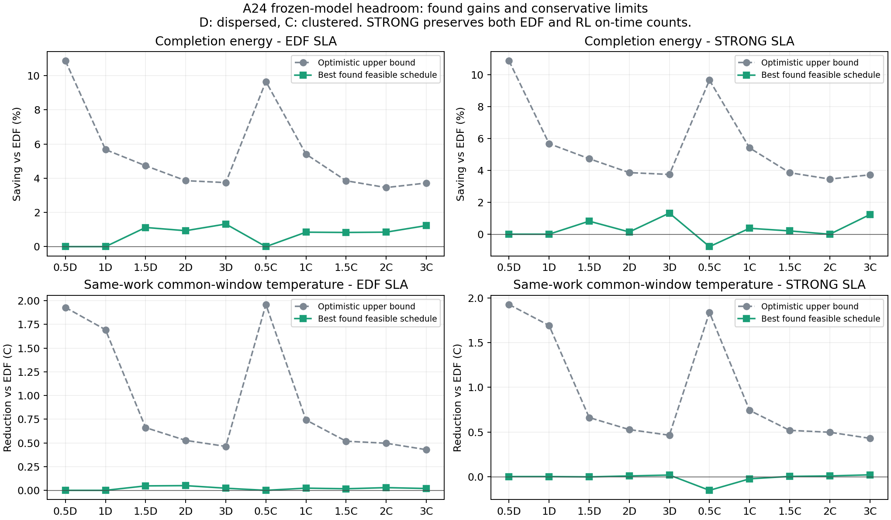

# 같은 모형의 절감 여지: 실행 가능한 일정과 좁힌 상한

원밀도10입력·도착·납기·잠재작업·물리계수와82개 새 실행을 모두 고정했다. [첫 진단](../DENSITY_HEADROOM_20261018_01/REPORT.md)의40개 LP 뒤, 저장 자료만으로40개 LP를 추가하여 열·에너지 결합 필요조건과 작업단계 길이를 반영했다. 추가 native/학습/fit/타이밍은행복원/실기기0이다. 새 물리 효과나 온도 clip을 넣은 결과가 아니다.

## 해석

찾은 일정은 실제 원engine에서 실행한 오프라인 진단 일정이다. 발견한 최선 절감은 달성 하한, 낙관적 완화의 비용하한으로부터 얻은 최대 절감은 달성 상한이다. 그 사이가 넓으면 최적값과 모형/정책 원인 비율은 미결정이다. 검색한 일정이 절감하지 못한 사실만으로 모형이 불가능하다고 판정하지 않는다. 모든112개 일정과40개 기존/신규 LP 결과를 아래 남겼으며 삭제0이다.

- EDF층: 원EDF의 전체정시와 긴급정시 수를 각각 보존. STRONG층: 원EDF/RL 중 큰 값을 각각 보존. 전요청 정시를 뜻하지 않는다. 미응답/미완료는 모두0이어야 적격이다.
- 에너지: 첫공급35초부터 자기 마지막AVAILABLE까지 기저＋증분J*. 완료는 원drain785초 이내. 온도: 원3정책의 공통완료시각을 고정한 창이며, 그시각까지 모든작업을 완료한 일정만 열우위 선정에 쓴다. 열상한은 이 더빠른 완료시한 조건의 상한이다.
- 최저에너지 일정과 최저온도 일정은 다를 수 있다. 공동10%/.5℃는 반드시 같은 납기적격·온도창완료 일정에서 확인한다. 조건별 사후최선 묶음은 한 온라인정책 성능이 아니다. 미래 실현작업량을 아는 일정을 온라인 달성성이나 새RL 우위로 해석하지 않는다.
- J*/AP는 현재 A24 가설모형의 출력이다. 실측 에너지·실기기 최적한계가 아니다. 원정책/NN/보상/물리/입력을 바꾸지 않았다.

## 달성량과 상한: 모든20조건

에너지 단위는EDF대비%, 온도는EDF대비하락℃다. 음수는악화. 상한은 기존→강화후 순서다.

|배수|파형|납기층|필요전체/긴급정시|찾은에너지절감%|낙관적최대절감%|찾은온도하락℃|낙관적최대하락℃|공동목표일정수|
|---:|---|---|---:|---:|---:|---:|---:|---:|
|0.5|staggered_wave|EDF|185/46|0.000|10.893 → 10.868|0.000|1.936 → 1.929|0|
|0.5|staggered_wave|STRONG|185/46|0.000|10.893 → 10.868|0.000|1.936 → 1.929|0|
|1|staggered_wave|EDF|364/88|0.000|5.703 → 5.674|0.000|1.709 → 1.694|0|
|1|staggered_wave|STRONG|364/88|0.000|5.703 → 5.674|0.000|1.709 → 1.694|0|
|1.5|staggered_wave|EDF|110/26|1.120|8.687 → 4.730|0.047|1.388 → 0.661|0|
|1.5|staggered_wave|STRONG|349/118|0.816|8.687 → 4.730|-0.003|1.384 → 0.661|0|
|2|staggered_wave|EDF|26/6|0.932|8.466 → 3.858|0.050|1.086 → 0.527|0|
|2|staggered_wave|STRONG|438/162|0.139|8.466 → 3.858|0.007|1.079 → 0.527|0|
|3|staggered_wave|EDF|17/5|1.321|9.063 → 3.744|0.022|0.836 → 0.463|0|
|3|staggered_wave|STRONG|612/219|1.321|9.063 → 3.744|0.017|0.834 → 0.463|0|
|0.5|clustered_recovery|EDF|234/54|0.000|9.692 → 9.655|0.000|1.983 → 1.960|0|
|0.5|clustered_recovery|STRONG|238/60|-0.780|9.692 → 9.655|-0.154|1.855 → 1.840|0|
|1|clustered_recovery|EDF|194/46|0.845|5.428 → 5.407|0.023|1.535 → 0.742|0|
|1|clustered_recovery|STRONG|335/95|0.370|5.428 → 5.407|-0.026|1.533 → 0.742|0|
|1.5|clustered_recovery|EDF|27/6|0.830|8.393 → 3.852|0.016|1.097 → 0.518|0|
|1.5|clustered_recovery|STRONG|392/137|0.204|8.393 → 3.852|0.002|1.096 → 0.518|0|
|2|clustered_recovery|EDF|25/8|0.847|8.546 → 3.454|0.028|0.931 → 0.497|0|
|2|clustered_recovery|STRONG|509/177|-0.003|8.546 → 3.454|0.007|0.929 → 0.497|0|
|3|clustered_recovery|EDF|20/6|1.230|9.336 → 3.719|0.019|0.716 → 0.429|0|
|3|clustered_recovery|STRONG|692/183|1.227|9.336 → 3.719|0.019|0.716 → 0.429|0|

각 최선일정의 식별자를 아래 공개한다. 정확한 request별 route/dispatch/response/AVAILABLE는 원 보고서의 raw_path 및 ALL_ROWS_WITH_REASONS에 연결되어 있다. 에너지최선이 온도완료창을 넘기면 그일정의 온도개선은 미정의다.

|조건|납기층|에너지최선 일정|온도최선 일정|에너지최선의온도하락℃|온도최선의에너지절감%|
|---|---|---|---|---:|---:|
|DENSITY_050_0|EDF|DENSITY_050_0_ATC|DENSITY_050_0_ATC|0.000|0.000|
|DENSITY_050_0|STRONG|DENSITY_050_0_ATC|DENSITY_050_0_ATC|0.000|0.000|
|DENSITY_100_0|EDF|DENSITY_100_0_ATC|DENSITY_100_0_ATC|0.000|0.000|
|DENSITY_100_0|STRONG|DENSITY_100_0_ATC|DENSITY_100_0_ATC|0.000|0.000|
|DENSITY_150_0|EDF|DENSITY_150_0_TOTAL|DENSITY_150_0_REGRET|0.010|0.451|
|DENSITY_150_0|STRONG|DENSITY_150_0_RL|DENSITY_150_0_RL|-0.003|0.816|
|DENSITY_200_0|EDF|DENSITY_200_0_LP_ROUTE|DENSITY_200_0_REGRET|0.011|0.140|
|DENSITY_200_0|STRONG|DENSITY_200_0_RL|DENSITY_200_0_RL|0.007|0.139|
|DENSITY_300_0|EDF|DENSITY_300_0_LP_ROUTE|DENSITY_300_0_SLA_ENERGY|0.005|0.914|
|DENSITY_300_0|STRONG|DENSITY_300_0_LP_ROUTE|DENSITY_300_0_HEAT|0.005|0.757|
|DENSITY_050_1|EDF|DENSITY_050_1_EDF|DENSITY_050_1_EDF|0.000|0.000|
|DENSITY_050_1|STRONG|DENSITY_050_1_REGRET|DENSITY_050_1_REGRET|-0.154|-0.780|
|DENSITY_100_1|EDF|DENSITY_100_1_LP_ROUTE|DENSITY_100_1_COOL35|-0.010|0.228|
|DENSITY_100_1|STRONG|DENSITY_100_1_RL|DENSITY_100_1_RL|-0.026|0.370|
|DENSITY_150_1|EDF|DENSITY_150_1_LP_ROUTE|DENSITY_150_1_COOL36|0.012|0.321|
|DENSITY_150_1|STRONG|DENSITY_150_1_RL|DENSITY_150_1_RL|0.002|0.204|
|DENSITY_200_1|EDF|DENSITY_200_1_LP_ROUTE|DENSITY_200_1_SLA_ENERGY|0.015|0.439|
|DENSITY_200_1|STRONG|DENSITY_200_1_RL|DENSITY_200_1_RL|0.007|-0.003|
|DENSITY_300_1|EDF|DENSITY_300_1_SLA_ENERGY|DENSITY_300_1_REGRET|0.006|0.767|
|DENSITY_300_1|STRONG|DENSITY_300_1_TOTAL|DENSITY_300_1_REGRET|0.002|0.767|

수치판정 {"EDF":{"energy10_impossible":9,"temperature_point5_impossible":3,"found_joint":0},"STRONG":{"energy10_impossible":9,"temperature_point5_impossible":3,"found_joint":0}}. 정확한 전역최적은 미확인이다. 최대절감상한<10% 또는 최대온도하락<.5℃이면 그 조건의 목표는 이 모형에서 불가능하다. 에너지·열 각각 큰상한은 둘의 동시달성을 증명하지 않는다. 이전 판정과 범위를 소급변경하지 않는다.

전체요청을 전부정시로처리하는 해석도 별도로 확인했다. release≥a 및 deadline≤b인 요청의 가장빠른route 냉간응답prefix 합은 2(b−a) 이하여야 한다. 각구간의 초과분에서 큰작업부터 빼도 남는 최소 미정시수를 구했다. 양route분할/냉간속도/무열/응답후suffix0까지 유리하게 허용한 필요조건이다. 양수이면 전요청정시는 불가능, 0이면 이 검사로 결정할수없다. 모든구간 수치는 ALL_DEADLINE_CAPACITY에 남겼다.

|조건|전체도착|최소미정시수 증명|비고|
|---|---:|---:|---|
|DENSITY_050_0|185|0|필요조건만으로 불가능 판정 못함; 가능성 입증 아님|
|DENSITY_100_0|364|0|필요조건만으로 불가능 판정 못함; 가능성 입증 아님|
|DENSITY_150_0|546|0|필요조건만으로 불가능 판정 못함; 가능성 입증 아님|
|DENSITY_200_0|730|1|전요청정시 불가능: 냉간 최단작업도 2자원 용량 초과|
|DENSITY_300_0|1096|204|전요청정시 불가능: 냉간 최단작업도 2자원 용량 초과|
|DENSITY_050_1|240|0|필요조건만으로 불가능 판정 못함; 가능성 입증 아님|
|DENSITY_100_1|474|0|필요조건만으로 불가능 판정 못함; 가능성 입증 아님|
|DENSITY_150_1|708|0|필요조건만으로 불가능 판정 못함; 가능성 입증 아님|
|DENSITY_200_1|942|117|전요청정시 불가능: 냉간 최단작업도 2자원 용량 초과|
|DENSITY_300_1|1410|388|전요청정시 불가능: 냉간 최단작업도 2자원 용량 초과|

## 소비 차이의 기저/증분 분해

EDF−적격에너지최선의 절감J*를 기저와 증분으로 나눴다. 음수는 악화이며 조기완료만으로 생긴 절감도 숨기지 않는다. RL−최선J*는 같은전체/긴급정시를 RL이 충족하는지 HEADROOM_SUMMARY에 함께 표시한다. STRONG층 최선은 RL 정시수를 모두 보존한다. 마지막열은 아직풀리지않은 에너지 절감 간격(상한−찾은값)으로, 실제 달성가능하다는 뜻이 아니다.

|조건|납기층|총절감J*|기저절감J*|증분절감J*|조기완료초|EDF기저비율%|RL−최선J*|미결정절감간격%p|
|---|---|---:|---:|---:|---:|---:|---:|---:|
|DENSITY_050_0|EDF|0.000|0.000|0.000|0.000|70.199|3.136|10.868|
|DENSITY_050_0|STRONG|0.000|0.000|0.000|0.000|70.199|3.136|10.868|
|DENSITY_100_0|EDF|0.000|0.000|0.000|0.000|59.467|0.264|5.674|
|DENSITY_100_0|STRONG|0.000|0.000|0.000|0.000|59.467|0.264|5.674|
|DENSITY_150_0|EDF|3.566|2.383|1.183|1.979|56.831|0.967|3.610|
|DENSITY_150_0|STRONG|2.599|1.893|0.706|1.572|56.831|0.000|3.914|
|DENSITY_200_0|EDF|3.942|2.486|1.457|2.064|57.130|3.353|2.926|
|DENSITY_200_0|STRONG|0.589|0.403|0.186|0.335|57.130|0.000|3.719|
|DENSITY_300_0|EDF|8.426|5.322|3.104|4.419|57.538|6.545|2.423|
|DENSITY_300_0|STRONG|8.426|5.322|3.104|4.419|57.538|6.545|2.423|
|DENSITY_050_1|EDF|0.000|0.000|0.000|0.000|67.327|3.323|9.655|
|DENSITY_050_1|STRONG|-1.687|0.078|-1.765|0.064|67.327|1.635|10.435|
|DENSITY_100_1|EDF|2.336|1.520|0.816|1.262|56.848|1.315|4.561|
|DENSITY_100_1|STRONG|1.021|0.865|0.156|0.718|56.848|0.000|5.037|
|DENSITY_150_1|EDF|3.392|2.249|1.143|1.868|57.121|2.557|3.022|
|DENSITY_150_1|STRONG|0.835|0.759|0.076|0.630|57.121|0.000|3.648|
|DENSITY_200_1|EDF|4.605|2.756|1.849|2.288|57.342|4.621|2.607|
|DENSITY_200_1|STRONG|-0.016|-0.131|0.115|-0.109|57.342|0.000|3.457|
|DENSITY_300_1|EDF|10.100|6.219|3.881|5.164|57.716|8.349|2.489|
|DENSITY_300_1|STRONG|10.069|6.263|3.805|5.200|57.716|8.318|2.493|

## 모형을 고치지 않고 상한을 좁힌 근거

같은 RC식에서 A=∫(T−26)dt, E=증분에너지, D=창길이, U=온도상한−26이면 A=R E−τ(T끝−26)이다. 실행작업 W를 온도구간[lo,hi]에 놓을 때, 최대2owner와 active step≤0.1초로부터 다음 필요조건을 더했다. 온도는 step시작값을 쓰므로 |T′|의 보수적 상한 L을 써서 step오차를 유리하게 더한다. ns phase올림도 별도 여유로 포함한다.

    Σ (lo−26) W/fmax ≤ 2A + L tick D + ε
    2A ≤ 2U D + Σ [(hi−26)/fmin − U/fmax] W + L tick D + ε

에너지는 실제증분 변수 e≥기존 작업에너지하한과 R e−τU≤A≤R e를 연결했다. 열은 원1초-bin 에너지침착의 RC 상·하 커널로 A를 감쌌다. 각bin종료 온도도 작업단계 상한이하여야 하므로 bin에너지를 유리한 시작점으로옮긴 낮은RC끝온도≤U를 추가했다. 열을 끝에몰아 실제상한을넘기는 완화도 방지한다. 두LP 모두 동일 온도가 시간·전력·열에서 가져오는 필수연결만 추가했으며 실제 스케줄보다 유리한 분할/선점/침착 자유는 여전히 허용한다.

원41.705℃ 상한은 비실행 단계가 계속되는 상태까지 포함한다. 하지만 한 비선점 작업에서 비실행시간 N은 고정되어 있고 실행시간은 원실행작업 W 이상이다. route별 ρ=max N/(N+W), b=2 max N으로 잡으면 모든길이 l의 구간에서 비실행시간≤ρ l+b이다. 최대두개의 경계작업이 부분적으로 걸리는 경우까지 b에 포함한다. RC의 지수커널에 이 필요조건을 적분하면 비실행의 추가발열은 δ[ρτ(1−exp(−l/τ))+b] 이하이다.

실행발열의 온도미분이 음수인 범위를 독립계산하고, step시작 온도오차 η=L tick를 포함한 교차온도 B=26+R[Pexec(B−η)+Σδρ]를 구했다. 초기26℃에서 B를 마지막으로 통과한 시각을 잡으면 이후 온도는 B+(R/τ)Σδb 이하이다. 1e−6℃를 추가하고 원상한과 작은 값을 취했다. 이는 주어진 작업은행의 임의순서/WAIT를 포함하는 열방정식의 상한이며 시뮬레이터에 온도를 잘라넣지 않았다. 소스 Python과 별개 JS로 계수·근·도함수·단계길이를 다시 계산하고 기존112개 최고온도가 모두 안에 있음을 확인했다.

|조건|원상한℃|작업단계 반영상한℃|CPU비실행비율상한|GPU비실행비율상한|경계burst여유℃|
|---|---:|---:|---:|---:|---:|
|DENSITY_050_0|41.705437|37.130769|0.115852|0.164303|0.053452|
|DENSITY_100_0|41.705437|37.135721|0.117468|0.164303|0.053452|
|DENSITY_150_0|41.705437|37.135721|0.117468|0.164303|0.053452|
|DENSITY_200_0|41.705437|37.165888|0.117468|0.180169|0.057949|
|DENSITY_300_0|41.705437|37.166321|0.117468|0.180169|0.058382|
|DENSITY_050_1|41.705437|37.085838|0.103962|0.159477|0.052673|
|DENSITY_100_1|41.705437|37.165941|0.117468|0.179934|0.058382|
|DENSITY_150_1|41.705437|37.165941|0.117468|0.179934|0.058382|
|DENSITY_200_1|41.705437|37.165941|0.117468|0.179934|0.058382|
|DENSITY_300_1|41.705437|37.210506|0.117468|0.203214|0.065197|

모든 LP는 유한box의 쌍대잔차를 보정한 하한에서 수치여유를 뺀다. JS가 모든40인증을 독립재계산했다. 새 쌍대가 약해지면 원하한을 유지하고 그이유를 아래 표시한다. solver primal이나 탐색실패를 절감상한으로 쓰지 않는다.

## 모든40개 상한 비교와 solver 상태

에너지행은%, temperature행은℃. status0은 solver 최적종료, 나머지상태도 숨기지 않는다. 채택값은 두 유효하한 중 큰 값에서 계산한다.

|조건|납기층|종류|기존status|새status|새쌍대사용가능|기존최대절감|새결합만의최대절감|채택최대절감|비고|
|---|---|---|---:|---:|---|---:|---:|---:|---|
|DENSITY_050_0|EDF|energy|0|0|true|10.893279|10.867858|10.867858|새 결합 하한 채택|
|DENSITY_050_0|EDF|temperature|0|0|true|1.935865|1.929084|1.929084|새 결합 하한 채택|
|DENSITY_050_0|STRONG|energy|0|0|true|10.893279|10.867858|10.867858|새 결합 하한 채택|
|DENSITY_050_0|STRONG|temperature|0|0|true|1.935865|1.929084|1.929084|새 결합 하한 채택|
|DENSITY_100_0|EDF|energy|0|0|true|5.703033|5.673909|5.673909|새 결합 하한 채택|
|DENSITY_100_0|EDF|temperature|0|0|true|1.709170|1.693767|1.693767|새 결합 하한 채택|
|DENSITY_100_0|STRONG|energy|0|0|true|5.703033|5.673909|5.673909|새 결합 하한 채택|
|DENSITY_100_0|STRONG|temperature|0|0|true|1.709170|1.693767|1.693767|새 결합 하한 채택|
|DENSITY_150_0|EDF|energy|0|0|true|8.687008|4.730079|4.730079|새 결합 하한 채택|
|DENSITY_150_0|EDF|temperature|0|0|true|1.387522|0.661494|0.661494|새 결합 하한 채택|
|DENSITY_150_0|STRONG|energy|0|0|true|8.687008|4.730079|4.730079|새 결합 하한 채택|
|DENSITY_150_0|STRONG|temperature|0|0|true|1.383542|0.661494|0.661494|새 결합 하한 채택|
|DENSITY_200_0|EDF|energy|0|0|true|8.465940|3.858081|3.858081|새 결합 하한 채택|
|DENSITY_200_0|EDF|temperature|0|0|true|1.085987|0.526836|0.526836|새 결합 하한 채택|
|DENSITY_200_0|STRONG|energy|0|0|true|8.465940|3.858081|3.858081|새 결합 하한 채택|
|DENSITY_200_0|STRONG|temperature|0|0|true|1.079500|0.526836|0.526836|새 결합 하한 채택|
|DENSITY_300_0|EDF|energy|0|0|true|9.063170|3.744442|3.744442|새 결합 하한 채택|
|DENSITY_300_0|EDF|temperature|0|0|true|0.835817|0.463381|0.463381|새 결합 하한 채택|
|DENSITY_300_0|STRONG|energy|0|0|true|9.063170|3.744442|3.744442|새 결합 하한 채택|
|DENSITY_300_0|STRONG|temperature|0|0|true|0.834009|0.463381|0.463381|새 결합 하한 채택|
|DENSITY_050_1|EDF|energy|0|0|true|9.691568|9.654992|9.654992|새 결합 하한 채택|
|DENSITY_050_1|EDF|temperature|0|0|true|1.982647|1.959995|1.959995|새 결합 하한 채택|
|DENSITY_050_1|STRONG|energy|0|0|true|9.691568|9.654992|9.654992|새 결합 하한 채택|
|DENSITY_050_1|STRONG|temperature|0|0|true|1.855196|1.840235|1.840235|새 결합 하한 채택|
|DENSITY_100_1|EDF|energy|0|0|true|5.428079|5.406650|5.406650|새 결합 하한 채택|
|DENSITY_100_1|EDF|temperature|0|0|true|1.534957|0.742163|0.742163|새 결합 하한 채택|
|DENSITY_100_1|STRONG|energy|0|0|true|5.428079|5.406650|5.406650|새 결합 하한 채택|
|DENSITY_100_1|STRONG|temperature|0|0|true|1.533271|0.742163|0.742163|새 결합 하한 채택|
|DENSITY_150_1|EDF|energy|0|0|true|8.392639|3.852042|3.852042|새 결합 하한 채택|
|DENSITY_150_1|EDF|temperature|0|0|true|1.097098|0.518144|0.518144|새 결합 하한 채택|
|DENSITY_150_1|STRONG|energy|0|0|true|8.392639|3.852042|3.852042|새 결합 하한 채택|
|DENSITY_150_1|STRONG|temperature|0|0|true|1.095802|0.518144|0.518144|새 결합 하한 채택|
|DENSITY_200_1|EDF|energy|0|0|true|8.545704|3.453996|3.453996|새 결합 하한 채택|
|DENSITY_200_1|EDF|temperature|0|0|true|0.931045|0.496598|0.496598|새 결합 하한 채택|
|DENSITY_200_1|STRONG|energy|0|0|true|8.545704|3.453996|3.453996|새 결합 하한 채택|
|DENSITY_200_1|STRONG|temperature|0|0|true|0.928735|0.496598|0.496598|새 결합 하한 채택|
|DENSITY_300_1|EDF|energy|0|0|true|9.335712|3.719243|3.719243|새 결합 하한 채택|
|DENSITY_300_1|EDF|temperature|0|0|true|0.716243|0.428941|0.428941|새 결합 하한 채택|
|DENSITY_300_1|STRONG|energy|0|0|true|9.335712|3.719243|3.719243|새 결합 하한 채택|
|DENSITY_300_1|STRONG|temperature|0|0|true|0.716165|0.428941|0.428941|새 결합 하한 채택|

## 모든112개 일정과 제외사유

원새82개(재현2 포함)＋기준30개를 그대로 표시한다. 납기부족·온도창을넘긴완료·재현용 구분은 비고에 남기며 행을 제거하지 않는다. 완료P95와 전체 도착/긴급 분모, 미응답/미완료를 함께 제공한다.

|조건|정책/일정|출처|전체정시|긴급정시|완료응답P95초|미응답/미완료|완료시간초|완료J*|고정공통평균AP℃|최고AP℃|비고|
|---|---|---|---:|---:|---:|---:|---:|---:|---:|---:|---|
|DENSITY_050_0|REPLAY_EDF|P0|185/185|46/46|1.100|0/0|120.144|206.131|30.889|32.466|P0:원본 재현 검증용, 정책 우위 선정 대상에서만 제외; EDF:납기 적격; STRONG:납기 적격; 온도창 완료 적격|
|DENSITY_050_0|ENERGY|WITNESS|185/185|46/46|1.165|0/0|120.144|206.768|30.939|32.541|EDF:납기 적격; STRONG:납기 적격; 온도창 완료 적격|
|DENSITY_050_0|TOTAL|WITNESS|185/185|46/46|1.165|0/0|120.144|206.768|30.939|32.541|EDF:납기 적격; STRONG:납기 적격; 온도창 완료 적격|
|DENSITY_050_0|REGRET|WITNESS|185/185|46/46|1.165|0/0|120.144|206.768|30.939|32.541|EDF:납기 적격; STRONG:납기 적격; 온도창 완료 적격|
|DENSITY_050_0|LP_ROUTE|WITNESS|185/185|46/46|1.165|0/0|120.144|206.768|30.939|32.541|EDF:납기 적격; STRONG:납기 적격; 온도창 완료 적격|
|DENSITY_050_0|HEAT|WITNESS|185/185|46/46|1.172|0/0|120.204|208.533|31.079|32.670|EDF:납기 적격; STRONG:납기 적격; 온도창 완료 적격|
|DENSITY_050_0|COOL35|WITNESS|185/185|46/46|1.165|0/0|120.144|206.768|30.939|32.541|EDF:납기 적격; STRONG:납기 적격; 온도창 완료 적격|
|DENSITY_050_0|COOL36|WITNESS|185/185|46/46|1.165|0/0|120.144|206.768|30.939|32.541|EDF:납기 적격; STRONG:납기 적격; 온도창 완료 적격|
|DENSITY_050_0|SLA_ENERGY|WITNESS|185/185|46/46|1.100|0/0|120.144|206.131|30.889|32.466|EDF:납기 적격; STRONG:납기 적격; 온도창 완료 적격|
|DENSITY_100_0|ENERGY|WITNESS|359/364|83/88|1.524|0/0|119.969|243.094|33.876|35.548|EDF:선정 제외(전체정시 359<364, 긴급정시 83<88); STRONG:선정 제외(전체정시 359<364, 긴급정시 83<88); 온도창 완료 적격|
|DENSITY_100_0|TOTAL|WITNESS|359/364|83/88|1.526|0/0|119.969|243.096|33.876|35.548|EDF:선정 제외(전체정시 359<364, 긴급정시 83<88); STRONG:선정 제외(전체정시 359<364, 긴급정시 83<88); 온도창 완료 적격|
|DENSITY_100_0|REGRET|WITNESS|356/364|83/88|1.525|0/0|119.969|243.071|33.877|35.546|EDF:선정 제외(전체정시 356<364, 긴급정시 83<88); STRONG:선정 제외(전체정시 356<364, 긴급정시 83<88); 온도창 완료 적격|
|DENSITY_100_0|LP_ROUTE|WITNESS|359/364|83/88|1.523|0/0|119.969|243.063|33.873|35.549|EDF:선정 제외(전체정시 359<364, 긴급정시 83<88); STRONG:선정 제외(전체정시 359<364, 긴급정시 83<88); 온도창 완료 적격|
|DENSITY_100_0|HEAT|WITNESS|360/364|84/88|1.538|0/0|120.193|243.558|33.885|35.584|EDF:선정 제외(전체정시 360<364, 긴급정시 84<88); STRONG:선정 제외(전체정시 360<364, 긴급정시 84<88); 온도 선정 제외:동결 공통창 안에 전부 완료하지 못함|
|DENSITY_100_0|COOL35|WITNESS|351/364|81/88|1.918|0/0|119.970|243.378|33.873|35.697|EDF:선정 제외(전체정시 351<364, 긴급정시 81<88); STRONG:선정 제외(전체정시 351<364, 긴급정시 81<88); 온도 선정 제외:동결 공통창 안에 전부 완료하지 못함|
|DENSITY_100_0|COOL36|WITNESS|359/364|83/88|1.526|0/0|119.969|243.096|33.876|35.548|EDF:선정 제외(전체정시 359<364, 긴급정시 83<88); STRONG:선정 제외(전체정시 359<364, 긴급정시 83<88); 온도창 완료 적격|
|DENSITY_100_0|SLA_ENERGY|WITNESS|362/364|88/88|1.527|0/0|119.969|243.020|33.869|35.546|EDF:선정 제외(전체정시 362<364); STRONG:선정 제외(전체정시 362<364); 온도창 완료 적격|
|DENSITY_150_0|ENERGY|WITNESS|410/546|110/135|58.673|0/0|148.496|315.175|35.274|36.485|EDF:납기 적격; STRONG:선정 제외(긴급정시 110<118); 온도창 완료 적격|
|DENSITY_150_0|TOTAL|WITNESS|414/546|111/135|58.158|0/0|148.314|314.944|35.278|36.490|EDF:납기 적격; STRONG:선정 제외(긴급정시 111<118); 온도창 완료 적격|
|DENSITY_150_0|REGRET|WITNESS|395/546|112/135|55.057|0/0|149.613|317.072|35.241|36.456|EDF:납기 적격; STRONG:선정 제외(긴급정시 112<118); 온도창 완료 적격|
|DENSITY_150_0|LP_ROUTE|WITNESS|401/546|112/135|56.551|0/0|148.497|314.999|35.281|36.485|EDF:납기 적격; STRONG:선정 제외(긴급정시 112<118); 온도창 완료 적격|
|DENSITY_150_0|HEAT|WITNESS|414/546|110/135|65.547|0/0|148.388|315.108|35.273|36.494|EDF:납기 적격; STRONG:선정 제외(긴급정시 110<118); 온도창 완료 적격|
|DENSITY_150_0|COOL35|WITNESS|414/546|111/135|61.706|0/0|152.330|320.682|35.251|36.460|EDF:납기 적격; STRONG:선정 제외(긴급정시 111<118); 온도 선정 제외:동결 공통창 안에 전부 완료하지 못함|
|DENSITY_150_0|COOL36|WITNESS|414/546|111/135|60.074|0/0|150.235|317.623|35.259|36.460|EDF:납기 적격; STRONG:선정 제외(긴급정시 111<118); 온도창 완료 적격|
|DENSITY_150_0|SLA_ENERGY|WITNESS|408/546|110/135|62.277|0/0|148.673|315.487|35.269|36.485|EDF:납기 적격; STRONG:선정 제외(긴급정시 110<118); 온도창 완료 적격|
|DENSITY_200_0|ENERGY|WITNESS|495/730|155/182|126.236|0/0|199.120|420.039|35.547|36.528|EDF:납기 적격; STRONG:선정 제외(긴급정시 155<162); 온도창 완료 적격|
|DENSITY_200_0|TOTAL|WITNESS|494/730|156/182|126.851|0/0|199.619|420.843|35.548|36.526|EDF:납기 적격; STRONG:선정 제외(긴급정시 156<162); 온도창 완료 적격|
|DENSITY_200_0|REGRET|WITNESS|456/730|146/182|119.611|0/0|200.600|422.478|35.516|36.497|EDF:납기 적격; STRONG:선정 제외(긴급정시 146<162); 온도창 완료 적격|
|DENSITY_200_0|LP_ROUTE|WITNESS|487/730|159/182|127.489|0/0|198.617|419.130|35.555|36.526|EDF:납기 적격; STRONG:선정 제외(긴급정시 159<162); 온도창 완료 적격|
|DENSITY_200_0|HEAT|WITNESS|492/730|158/182|131.326|0/0|199.994|421.585|35.541|36.538|EDF:납기 적격; STRONG:선정 제외(긴급정시 158<162); 온도창 완료 적격|
|DENSITY_200_0|COOL35|WITNESS|494/730|156/182|129.083|0/0|202.428|424.788|35.499|36.499|EDF:납기 적격; STRONG:선정 제외(긴급정시 156<162); 온도 선정 제외:동결 공통창 안에 전부 완료하지 못함|
|DENSITY_200_0|COOL36|WITNESS|494/730|156/182|128.241|0/0|202.371|424.811|35.513|36.499|EDF:납기 적격; STRONG:선정 제외(긴급정시 156<162); 온도 선정 제외:동결 공통창 안에 전부 완료하지 못함|
|DENSITY_200_0|SLA_ENERGY|WITNESS|480/730|145/182|126.066|0/0|199.287|420.231|35.548|36.527|EDF:납기 적격; STRONG:선정 제외(긴급정시 145<162); 온도창 완료 적격|
|DENSITY_300_0|ENERGY|WITNESS|644/1096|216/274|217.629|0/0|301.403|631.356|35.814|36.539|EDF:납기 적격; STRONG:선정 제외(긴급정시 216<219); 온도창 완료 적격|
|DENSITY_300_0|TOTAL|WITNESS|642/1096|218/274|216.671|0/0|301.218|631.086|35.816|36.536|EDF:납기 적격; STRONG:선정 제외(긴급정시 218<219); 온도창 완료 적격|
|DENSITY_300_0|REGRET|WITNESS|594/1096|203/274|221.011|0/0|305.761|638.513|35.760|36.504|EDF:납기 적격; STRONG:선정 제외(전체정시 594<612, 긴급정시 203<219); 온도 선정 제외:동결 공통창 안에 전부 완료하지 못함|
|DENSITY_300_0|LP_ROUTE|WITNESS|630/1096|220/274|216.980|0/0|300.265|629.349|35.826|36.538|EDF:납기 적격; STRONG:납기 적격; 온도창 완료 적격|
|DENSITY_300_0|HEAT|WITNESS|643/1096|220/274|220.326|0/0|302.233|632.946|35.814|36.548|EDF:납기 적격; STRONG:납기 적격; 온도창 완료 적격|
|DENSITY_300_0|COOL35|WITNESS|642/1096|218/274|216.671|0/0|303.425|634.047|35.815|36.536|EDF:납기 적격; STRONG:선정 제외(긴급정시 218<219); 온도창 완료 적격|
|DENSITY_300_0|COOL36|WITNESS|642/1096|218/274|216.671|0/0|303.228|633.785|35.815|36.536|EDF:납기 적격; STRONG:선정 제외(긴급정시 218<219); 온도창 완료 적격|
|DENSITY_300_0|SLA_ENERGY|WITNESS|615/1096|198/274|217.252|0/0|301.799|631.948|35.808|36.536|EDF:납기 적격; STRONG:선정 제외(긴급정시 198<219); 온도창 완료 적격|
|DENSITY_050_1|ENERGY|WITNESS|231/240|59/60|1.397|0/0|120.870|216.375|31.599|33.140|EDF:선정 제외(전체정시 231<234); STRONG:선정 제외(전체정시 231<238, 긴급정시 59<60); 온도창 완료 적격|
|DENSITY_050_1|TOTAL|WITNESS|231/240|59/60|1.397|0/0|120.870|216.375|31.599|33.140|EDF:선정 제외(전체정시 231<234); STRONG:선정 제외(전체정시 231<238, 긴급정시 59<60); 온도창 완료 적격|
|DENSITY_050_1|REGRET|WITNESS|238/240|60/60|1.777|0/0|120.811|217.919|31.740|33.319|EDF:납기 적격; STRONG:납기 적격; 온도창 완료 적격|
|DENSITY_050_1|LP_ROUTE|WITNESS|231/240|59/60|1.397|0/0|120.870|216.375|31.599|33.140|EDF:선정 제외(전체정시 231<234); STRONG:선정 제외(전체정시 231<238, 긴급정시 59<60); 온도창 완료 적격|
|DENSITY_050_1|HEAT|WITNESS|238/240|60/60|1.775|0/0|120.878|218.268|31.760|33.300|EDF:납기 적격; STRONG:납기 적격; 온도창 완료 적격|
|DENSITY_050_1|COOL35|WITNESS|231/240|59/60|1.397|0/0|120.870|216.375|31.599|33.140|EDF:선정 제외(전체정시 231<234); STRONG:선정 제외(전체정시 231<238, 긴급정시 59<60); 온도창 완료 적격|
|DENSITY_050_1|COOL36|WITNESS|231/240|59/60|1.397|0/0|120.870|216.375|31.599|33.140|EDF:선정 제외(전체정시 231<234); STRONG:선정 제외(전체정시 231<238, 긴급정시 59<60); 온도창 완료 적격|
|DENSITY_050_1|SLA_ENERGY|WITNESS|226/240|51/60|1.414|0/0|120.873|216.771|31.627|33.121|EDF:선정 제외(전체정시 226<234, 긴급정시 51<54); STRONG:선정 제외(전체정시 226<238, 긴급정시 51<60); 온도창 완료 적격|
|DENSITY_100_1|ENERGY|WITNESS|382/474|89/119|9.936|0/0|129.418|274.545|35.007|36.416|EDF:납기 적격; STRONG:선정 제외(긴급정시 89<95); 온도창 완료 적격|
|DENSITY_100_1|TOTAL|WITNESS|384/474|90/119|6.196|0/0|129.355|274.447|35.007|36.415|EDF:납기 적격; STRONG:선정 제외(긴급정시 90<95); 온도창 완료 적격|
|DENSITY_100_1|REGRET|WITNESS|347/474|88/119|16.024|0/0|130.561|276.389|34.964|36.390|EDF:납기 적격; STRONG:선정 제외(긴급정시 88<95); 온도 선정 제외:동결 공통창 안에 전부 완료하지 못함|
|DENSITY_100_1|LP_ROUTE|WITNESS|365/474|90/119|10.158|0/0|129.182|274.027|35.010|36.421|EDF:납기 적격; STRONG:선정 제외(긴급정시 90<95); 온도창 완료 적격|
|DENSITY_100_1|HEAT|WITNESS|374/474|90/119|8.212|0/0|129.677|275.133|35.017|36.419|EDF:납기 적격; STRONG:선정 제외(긴급정시 90<95); 온도창 완료 적격|
|DENSITY_100_1|COOL35|WITNESS|373/474|88/119|9.647|0/0|130.214|275.733|34.977|36.421|EDF:납기 적격; STRONG:선정 제외(긴급정시 88<95); 온도창 완료 적격|
|DENSITY_100_1|COOL36|WITNESS|384/474|90/119|6.196|0/0|129.355|274.447|35.007|36.415|EDF:납기 적격; STRONG:선정 제외(긴급정시 90<95); 온도창 완료 적격|
|DENSITY_100_1|SLA_ENERGY|WITNESS|363/474|87/119|8.677|0/0|129.311|274.340|35.006|36.414|EDF:납기 적격; STRONG:선정 제외(긴급정시 87<95); 온도창 완료 적격|
|DENSITY_150_1|ENERGY|WITNESS|458/708|125/177|127.090|0/0|192.288|405.907|35.521|36.520|EDF:납기 적격; STRONG:선정 제외(긴급정시 125<137); 온도창 완료 적격|
|DENSITY_150_1|TOTAL|WITNESS|463/708|136/177|126.399|0/0|192.890|406.780|35.521|36.516|EDF:납기 적격; STRONG:선정 제외(긴급정시 136<137); 온도창 완료 적격|
|DENSITY_150_1|REGRET|WITNESS|431/708|129/177|123.845|0/0|194.537|409.547|35.469|36.498|EDF:납기 적격; STRONG:선정 제외(긴급정시 129<137); 온도 선정 제외:동결 공통창 안에 전부 완료하지 못함|
|DENSITY_150_1|LP_ROUTE|WITNESS|434/708|128/177|125.459|0/0|191.999|405.377|35.525|36.522|EDF:납기 적격; STRONG:선정 제외(긴급정시 128<137); 온도창 완료 적격|
|DENSITY_150_1|HEAT|WITNESS|454/708|134/177|120.051|0/0|192.493|406.330|35.525|36.535|EDF:납기 적격; STRONG:선정 제외(긴급정시 134<137); 온도창 완료 적격|
|DENSITY_150_1|COOL35|WITNESS|463/708|136/177|126.399|0/0|193.544|407.457|35.520|36.515|EDF:납기 적격; STRONG:선정 제외(긴급정시 136<137); 온도창 완료 적격|
|DENSITY_150_1|COOL36|WITNESS|463/708|136/177|126.399|0/0|193.544|407.457|35.520|36.515|EDF:납기 적격; STRONG:선정 제외(긴급정시 136<137); 온도창 완료 적격|
|DENSITY_150_1|SLA_ENERGY|WITNESS|437/708|128/177|125.966|0/0|192.309|405.926|35.520|36.515|EDF:납기 적격; STRONG:선정 제외(긴급정시 128<137); 온도창 완료 적격|
|DENSITY_200_1|ENERGY|WITNESS|549/942|166/236|185.610|0/0|258.213|541.741|35.725|36.535|EDF:납기 적격; STRONG:선정 제외(긴급정시 166<177); 온도창 완료 적격|
|DENSITY_200_1|TOTAL|WITNESS|549/942|168/236|186.799|0/0|257.682|540.874|35.728|36.527|EDF:납기 적격; STRONG:선정 제외(긴급정시 168<177); 온도창 완료 적격|
|DENSITY_200_1|REGRET|WITNESS|525/942|168/236|181.566|0/0|260.521|545.616|35.680|36.506|EDF:납기 적격; STRONG:선정 제외(긴급정시 168<177); 온도 선정 제외:동결 공통창 안에 전부 완료하지 못함|
|DENSITY_200_1|LP_ROUTE|WITNESS|537/942|166/236|182.958|0/0|256.598|539.154|35.738|36.532|EDF:납기 적격; STRONG:선정 제외(긴급정시 166<177); 온도창 완료 적격|
|DENSITY_200_1|HEAT|WITNESS|539/942|170/236|182.009|0/0|258.732|542.821|35.728|36.547|EDF:납기 적격; STRONG:선정 제외(긴급정시 170<177); 온도창 완료 적격|
|DENSITY_200_1|COOL35|WITNESS|549/942|168/236|186.799|0/0|257.682|540.874|35.728|36.527|EDF:납기 적격; STRONG:선정 제외(긴급정시 168<177); 온도창 완료 적격|
|DENSITY_200_1|COOL36|WITNESS|549/942|168/236|186.799|0/0|257.682|540.874|35.728|36.527|EDF:납기 적격; STRONG:선정 제외(긴급정시 168<177); 온도창 완료 적격|
|DENSITY_200_1|SLA_ENERGY|WITNESS|524/942|158/236|186.848|0/0|257.986|541.372|35.724|36.527|EDF:납기 적격; STRONG:선정 제외(긴급정시 158<177); 온도창 완료 적격|
|DENSITY_300_1|REPLAY_EDF|P0|20/1410|6/352|257.930|0/0|393.345|820.820|35.931|36.387|P0:원본 재현 검증용, 정책 우위 선정 대상에서만 제외; EDF:납기 적격; STRONG:선정 제외(전체정시 20<692, 긴급정시 6<183); 온도창 완료 적격|
|DENSITY_300_1|ENERGY|WITNESS|743/1410|192/352|297.752|0/0|388.933|811.940|35.931|36.549|EDF:납기 적격; STRONG:납기 적격; 온도창 완료 적격|
|DENSITY_300_1|TOTAL|WITNESS|741/1410|192/352|298.222|0/0|388.145|810.752|35.929|36.544|EDF:납기 적격; STRONG:납기 적격; 온도창 완료 적격|
|DENSITY_300_1|REGRET|WITNESS|741/1410|185/352|296.628|0/0|390.447|814.524|35.912|36.506|EDF:납기 적격; STRONG:납기 적격; 온도창 완료 적격|
|DENSITY_300_1|LP_ROUTE|WITNESS|734/1410|190/352|295.950|0/0|388.381|811.037|35.932|36.538|EDF:납기 적격; STRONG:납기 적격; 온도창 완료 적격|
|DENSITY_300_1|HEAT|WITNESS|729/1410|184/352|299.677|0/0|389.547|813.421|35.930|36.557|EDF:납기 적격; STRONG:납기 적격; 온도창 완료 적격|
|DENSITY_300_1|COOL35|WITNESS|741/1410|192/352|298.222|0/0|389.529|812.681|35.930|36.544|EDF:납기 적격; STRONG:납기 적격; 온도창 완료 적격|
|DENSITY_300_1|COOL36|WITNESS|741/1410|192/352|298.222|0/0|389.529|812.681|35.930|36.544|EDF:납기 적격; STRONG:납기 적격; 온도창 완료 적격|
|DENSITY_300_1|SLA_ENERGY|WITNESS|687/1410|172/352|298.259|0/0|388.181|810.720|35.926|36.544|EDF:납기 적격; STRONG:선정 제외(전체정시 687<692, 긴급정시 172<183); 온도창 완료 적격|
|DENSITY_050_0|EDF|ORIGINAL|185/185|46/46|1.100|0/0|120.144|206.131|30.889|32.466|EDF:납기 적격; STRONG:납기 적격; 온도창 완료 적격|
|DENSITY_050_0|ATC|ORIGINAL|185/185|46/46|1.100|0/0|120.144|206.131|30.889|32.466|EDF:납기 적격; STRONG:납기 적격; 온도창 완료 적격|
|DENSITY_050_0|RL|ORIGINAL|178/185|39/46|1.177|0/0|120.208|209.267|31.132|32.757|EDF:선정 제외(전체정시 178<185, 긴급정시 39<46); STRONG:선정 제외(전체정시 178<185, 긴급정시 39<46); 온도창 완료 적격|
|DENSITY_100_0|EDF|ORIGINAL|364/364|88/88|1.520|0/0|119.969|242.977|33.869|35.541|EDF:납기 적격; STRONG:납기 적격; 온도창 완료 적격|
|DENSITY_100_0|ATC|ORIGINAL|364/364|88/88|1.520|0/0|119.969|242.977|33.869|35.541|EDF:납기 적격; STRONG:납기 적격; 온도창 완료 적격|
|DENSITY_100_0|RL|ORIGINAL|357/364|83/88|1.553|0/0|119.969|243.241|33.887|35.580|EDF:선정 제외(전체정시 357<364, 긴급정시 83<88); STRONG:선정 제외(전체정시 357<364, 긴급정시 83<88); 온도창 완료 적격|
|DENSITY_150_0|EDF|ORIGINAL|110/546|26/135|27.438|0/0|150.293|318.510|35.288|36.370|EDF:납기 적격; STRONG:선정 제외(전체정시 110<349, 긴급정시 26<118); 온도창 완료 적격|
|DENSITY_150_0|ATC|ORIGINAL|346/546|115/135|34.034|0/0|149.502|317.106|35.284|36.474|EDF:납기 적격; STRONG:선정 제외(전체정시 346<349, 긴급정시 115<118); 온도창 완료 적격|
|DENSITY_150_0|RL|ORIGINAL|349/546|118/135|32.234|0/0|148.721|315.911|35.291|36.477|EDF:납기 적격; STRONG:납기 적격; 온도창 완료 적격|
|DENSITY_200_0|EDF|ORIGINAL|26/730|6/182|75.796|0/0|200.681|423.073|35.566|36.389|EDF:납기 적격; STRONG:선정 제외(전체정시 26<438, 긴급정시 6<162); 온도창 완료 적격|
|DENSITY_200_0|ATC|ORIGINAL|424/730|159/182|79.883|0/0|200.963|423.505|35.549|36.516|EDF:납기 적격; STRONG:선정 제외(전체정시 424<438, 긴급정시 159<162); 온도창 완료 적격|
|DENSITY_200_0|RL|ORIGINAL|438/730|162/182|78.667|0/0|200.346|422.483|35.559|36.513|EDF:납기 적격; STRONG:납기 적격; 온도창 완료 적격|
|DENSITY_300_0|EDF|ORIGINAL|17/1096|5/274|173.324|0/0|304.684|637.775|35.831|36.397|EDF:납기 적격; STRONG:선정 제외(전체정시 17<612, 긴급정시 5<219); 온도창 완료 적격|
|DENSITY_300_0|ATC|ORIGINAL|604/1096|210/274|174.641|0/0|304.592|637.637|35.823|36.525|EDF:납기 적격; STRONG:선정 제외(전체정시 604<612, 긴급정시 210<219); 온도창 완료 적격|
|DENSITY_300_0|RL|ORIGINAL|612/1096|219/274|174.050|0/0|303.498|635.894|35.831|36.523|EDF:납기 적격; STRONG:납기 적격; 온도창 완료 적격|
|DENSITY_050_1|EDF|ORIGINAL|234/240|54/60|1.448|0/0|120.876|216.231|31.585|33.134|EDF:납기 적격; STRONG:선정 제외(전체정시 234<238, 긴급정시 54<60); 온도창 완료 적격|
|DENSITY_050_1|ATC|ORIGINAL|234/240|54/60|1.451|0/0|120.879|216.747|31.623|33.122|EDF:납기 적격; STRONG:선정 제외(전체정시 234<238, 긴급정시 54<60); 온도창 완료 적격|
|DENSITY_050_1|RL|ORIGINAL|238/240|60/60|1.833|0/0|120.887|219.554|31.855|33.463|EDF:납기 적격; STRONG:납기 적격; 온도창 완료 적격|
|DENSITY_100_1|EDF|ORIGINAL|194/474|46/119|9.648|0/0|130.444|276.363|35.000|36.368|EDF:납기 적격; STRONG:선정 제외(전체정시 194<335, 긴급정시 46<95); 온도창 완료 적격|
|DENSITY_100_1|ATC|ORIGINAL|332/474|102/119|11.448|0/0|129.695|275.210|35.016|36.419|EDF:납기 적격; STRONG:선정 제외(전체정시 332<335); 온도창 완료 적격|
|DENSITY_100_1|RL|ORIGINAL|335/474|95/119|9.949|0/0|129.726|275.341|35.026|36.426|EDF:납기 적격; STRONG:납기 적격; 온도창 완료 적격|
|DENSITY_150_1|EDF|ORIGINAL|27/708|6/177|67.918|0/0|193.867|408.769|35.536|36.389|EDF:납기 적격; STRONG:선정 제외(전체정시 27<392, 긴급정시 6<137); 온도창 완료 적격|
|DENSITY_150_1|ATC|ORIGINAL|393/708|136/177|72.928|0/0|193.618|408.606|35.527|36.509|EDF:납기 적격; STRONG:선정 제외(긴급정시 136<137); 온도창 완료 적격|
|DENSITY_150_1|RL|ORIGINAL|392/708|137/177|71.872|0/0|193.237|407.934|35.534|36.514|EDF:납기 적격; STRONG:납기 적격; 온도창 완료 적격|
|DENSITY_200_1|EDF|ORIGINAL|25/942|8/236|130.505|0/0|258.886|543.759|35.753|36.400|EDF:납기 적격; STRONG:선정 제외(전체정시 25<509, 긴급정시 8<177); 온도창 완료 적격|
|DENSITY_200_1|ATC|ORIGINAL|521/942|176/236|134.181|0/0|260.208|545.975|35.724|36.520|EDF:납기 적격; STRONG:선정 제외(긴급정시 176<177); 온도창 완료 적격|
|DENSITY_200_1|RL|ORIGINAL|509/942|177/236|132.702|0/0|258.994|543.775|35.746|36.518|EDF:납기 적격; STRONG:납기 적격; 온도창 완료 적격|
|DENSITY_300_1|EDF|ORIGINAL|20/1410|6/352|257.930|0/0|393.345|820.820|35.931|36.387|EDF:납기 적격; STRONG:선정 제외(전체정시 20<692, 긴급정시 6<183); 온도창 완료 적격|
|DENSITY_300_1|ATC|ORIGINAL|679/1410|172/352|256.239|0/0|393.234|820.646|35.924|36.528|EDF:납기 적격; STRONG:선정 제외(전체정시 679<692, 긴급정시 172<183); 온도창 완료 적격|
|DENSITY_300_1|RL|ORIGINAL|692/1410|183/352|254.859|0/0|392.391|819.070|35.932|36.527|EDF:납기 적격; STRONG:납기 적격; 온도창 완료 적격|

## 검증과 재개

첫등록82START/82COMPLETE/FAIL0·40LP·원독립감사를 보존하고, 이번은 saved-only40LP/독립286592검사 PASS·실행행112완전동일·삭제0이다. 전체 LP80, native82이고 새88예약잔6 및 기존잔38/8/4/4/RR1을 더쓰지 않았다. 전역추적125962/137712는 과거snapshot이며 전host실시간집계가 아니다. 원완료op·실패·원상한/보고서는 보존하며 자동추가/재시도0이다. 현재정본은 이 보고서와 HEADROOM_SUMMARY/ALL_ROWS_WITH_REASONS/EVALUATION, 각CERT/PHASE_PROOFS/AUDIT/FINAL_HANDOFF_PROOF다.
