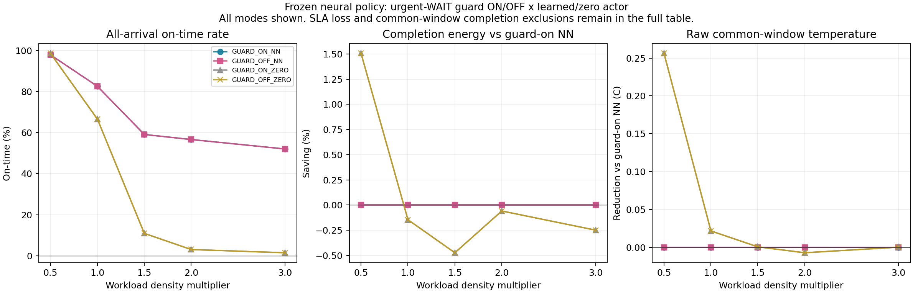

# 납기보호만 끈 RL: 고정NN의 2×2 대조

2026-10-18 사용자 추가 요청에 따른40개 native 실행이다. 현재 RL은 원래 NN logits만으로 요청/자원을 결정한다. 강제 납기보호는 긴급요청이 늦어지는 WAIT를 후보에서 빼는 조건이며 그 부분만 해제했다. 원보상 가중치(.5,.5,8,4,30)·납기페널티·후보8·관측·물리·NN체크포인트·도착/납기/잠재를 유지했다. 공통50ms모음과 WAIT12초/선두1.5초는 유지했다.

고정NN은 보호하에서 학습됐으므로 OFF추론 결과를 보호없이학습한RL의 성능으로 바꾸어 말하지 않는다. 다음은 이 대조와 원인에 맞는 보호없는 paired학습/정책 보완이며 별도 유한등록으로 수행한다. 지금 결과는 재학습이 아니다. 최종actor층0은 동점의 첫후보 선택 대조이며 다른encoder/critic은 그대로다.

새40/FAIL0·원10조건 ON_NN 전체물리trace/요청clock/NN입력/후보/예측 정확재현·독립3600137검사/NN26780 PASS다. 원잠재은행은engine만 보며actor는원공개명목추정만 본다. 이전결과112개와이번40개를 아래모두표시했고삭제0이다. [절감상한과오프라인일정](../DENSITY_HEADROOM_COUPLED_20261018_01/REPORT.md)은그대로보존한다. 상한은 임의WAIT까지허용한완화여서보호해제일정도포함하는지검사했다. J*/AP는A24가설모형이며실측기기우위가아니다.

## 보호 OFF−ON의 모든대조

소비는자기마지막AVAILABLE까지의기저＋증분,온도는원3정책의동결공통종료창이다. 그창안에전부완료하지못한결과는수치를남기되열우위선정에서제외한다. 납기손해도같이표시한다. 모든요청정시가아니라ON의전체/긴급정시수를각각보존하는지판정한다. 숫자요약 {"SLA_nonworse":10,"common_complete":10,"selected_unsafe_WAIT":0,"all_joint_10_point5":0}.

|조건|NN|전체정시Δ|긴급정시Δ|소비절감%|평균온도하락℃|WAIT초ON→OFF|보호가막았을WAIT상태수|그WAIT선택수|비고|
|---|---|---:|---:|---:|---:|---:|---:|---:|---|
|DENSITY_050_0|NN|0|0|0.000|0.000|3.850 → 3.850|16|0|대조납기보존; 공통창 완료|
|DENSITY_050_0|ZERO|0|0|0.000|0.000|4.700 → 4.700|16|0|대조납기보존; 공통창 완료|
|DENSITY_100_0|NN|0|0|0.000|0.000|2.600 → 2.600|32|0|대조납기보존; 공통창 완료|
|DENSITY_100_0|ZERO|0|0|0.000|0.000|2.600 → 2.600|33|0|대조납기보존; 공통창 완료|
|DENSITY_150_0|NN|0|0|0.000|0.000|0.050 → 0.050|100|0|대조납기보존; 공통창 완료|
|DENSITY_150_0|ZERO|0|0|0.000|0.000|0.050 → 0.050|434|0|대조납기보존; 공통창 완료|
|DENSITY_200_0|NN|0|0|0.000|0.000|0.050 → 0.050|127|0|대조납기보존; 공통창 완료|
|DENSITY_200_0|ZERO|0|0|0.000|0.000|0.050 → 0.050|703|0|대조납기보존; 공통창 완료|
|DENSITY_300_0|NN|0|0|0.000|0.000|0.050 → 0.050|497|0|대조납기보존; 공통창 완료|
|DENSITY_300_0|ZERO|0|0|0.000|0.000|0.050 → 0.050|1078|0|대조납기보존; 공통창 완료|
|DENSITY_050_1|NN|0|0|0.000|0.000|2.000 → 2.000|35|0|대조납기보존; 공통창 완료|
|DENSITY_050_1|ZERO|0|0|0.000|0.000|2.000 → 2.000|28|0|대조납기보존; 공통창 완료|
|DENSITY_100_1|NN|0|0|0.000|0.000|0.150 → 0.150|97|0|대조납기보존; 공통창 완료|
|DENSITY_100_1|ZERO|0|0|0.000|0.000|0.150 → 0.150|279|0|대조납기보존; 공통창 완료|
|DENSITY_150_1|NN|0|0|0.000|0.000|0.050 → 0.050|169|0|대조납기보존; 공통창 완료|
|DENSITY_150_1|ZERO|0|0|0.000|0.000|0.050 → 0.050|681|0|대조납기보존; 공통창 완료|
|DENSITY_200_1|NN|0|0|0.000|0.000|0.050 → 0.050|306|0|대조납기보존; 공통창 완료|
|DENSITY_200_1|ZERO|0|0|0.000|0.000|0.050 → 0.050|917|0|대조납기보존; 공통창 완료|
|DENSITY_300_1|NN|0|0|0.000|0.000|0.050 → 0.050|870|0|대조납기보존; 공통창 완료|
|DENSITY_300_1|ZERO|0|0|0.000|0.000|0.050 → 0.050|1386|0|대조납기보존; 공통창 완료|

## 원인을 구분하는 모든행

새WAIT를허용해도선택하지않으면고정NN의학습선호와새행동분포를봐야한다. 선택하고납기손해가나면기존페널티만으로그손해를막지못한경우다. NN0과다른행동을고르면서열/소비가비슷하면NN이동작하지않는다는주장과구분한다. 큐특징포화/후보밖요청합계를함께남겨장기입력외삽과후보제한을확인한다. 이고정대조만으로수렴이나보호없는재학습의최선을판정하지않는다.

|일정|NN의사결정수|큐특징포화수|후보밖ready합/전체ready합|새로열린불리WAIT상태|불리WAIT선택|
|---|---:|---:|---:|---:|---:|
|DENSITY_050_0_GUARD_ON_NN|185|0|0/185|0|0|
|DENSITY_050_0_GUARD_OFF_NN|185|0|0/185|16|0|
|DENSITY_050_0_GUARD_ON_ZERO|185|0|0/185|0|0|
|DENSITY_050_0_GUARD_OFF_ZERO|185|0|0/185|16|0|
|DENSITY_100_0_GUARD_ON_NN|364|0|0/428|0|0|
|DENSITY_100_0_GUARD_OFF_NN|364|0|0/428|32|0|
|DENSITY_100_0_GUARD_ON_ZERO|364|0|0/421|0|0|
|DENSITY_100_0_GUARD_OFF_ZERO|364|0|0/421|33|0|
|DENSITY_150_0_GUARD_ON_NN|546|0|12080/14637|0|0|
|DENSITY_150_0_GUARD_OFF_NN|546|0|12080/14637|100|0|
|DENSITY_150_0_GUARD_ON_ZERO|546|0|20332/23301|0|0|
|DENSITY_150_0_GUARD_OFF_ZERO|546|0|20332/23301|434|0|
|DENSITY_200_0_GUARD_ON_NN|730|0|55585/59226|0|0|
|DENSITY_200_0_GUARD_OFF_NN|730|0|55585/59226|127|0|
|DENSITY_200_0_GUARD_ON_ZERO|730|100|91980/96401|0|0|
|DENSITY_200_0_GUARD_OFF_ZERO|730|100|91980/96401|703|0|
|DENSITY_300_0_GUARD_ON_NN|1096|409|203703/209610|0|0|
|DENSITY_300_0_GUARD_OFF_NN|1096|409|203703/209610|497|0|
|DENSITY_300_0_GUARD_ON_ZERO|1096|663|336375/343385|0|0|
|DENSITY_300_0_GUARD_OFF_ZERO|1096|663|336375/343385|1078|0|
|DENSITY_050_1_GUARD_ON_NN|240|0|0/510|0|0|
|DENSITY_050_1_GUARD_OFF_NN|240|0|0/510|35|0|
|DENSITY_050_1_GUARD_ON_ZERO|240|0|0/438|0|0|
|DENSITY_050_1_GUARD_OFF_ZERO|240|0|0/438|28|0|
|DENSITY_100_1_GUARD_ON_NN|474|0|2220/4136|0|0|
|DENSITY_100_1_GUARD_OFF_NN|474|0|2220/4136|97|0|
|DENSITY_100_1_GUARD_ON_ZERO|474|0|3665/5734|0|0|
|DENSITY_100_1_GUARD_OFF_ZERO|474|0|3665/5734|279|0|
|DENSITY_150_1_GUARD_ON_NN|708|0|48341/51849|0|0|
|DENSITY_150_1_GUARD_OFF_NN|708|0|48341/51849|169|0|
|DENSITY_150_1_GUARD_ON_ZERO|708|39|79547/83745|0|0|
|DENSITY_150_1_GUARD_OFF_ZERO|708|39|79547/83745|681|0|
|DENSITY_200_1_GUARD_ON_NN|942|171|129877/134872|0|0|
|DENSITY_200_1_GUARD_OFF_NN|942|171|129877/134872|306|0|
|DENSITY_200_1_GUARD_ON_ZERO|942|455|214926/220731|0|0|
|DENSITY_200_1_GUARD_OFF_ZERO|942|455|214926/220731|917|0|
|DENSITY_300_1_GUARD_ON_NN|1410|810|395323/403026|0|0|
|DENSITY_300_1_GUARD_OFF_NN|1410|810|395323/403026|870|0|
|DENSITY_300_1_GUARD_ON_ZERO|1410|1029|650386/659151|0|0|
|DENSITY_300_1_GUARD_OFF_ZERO|1410|1029|650386/659151|1386|0|

|조건|대조|자원변경요청|자원또는배정시각변경요청|
|---|---|---:|---:|
|DENSITY_050_0|GUARD_ON_NN → GUARD_OFF_NN|0/185|0/185|
|DENSITY_050_0|GUARD_ON_NN → GUARD_ON_ZERO|136/185|176/185|
|DENSITY_050_0|GUARD_OFF_NN → GUARD_OFF_ZERO|136/185|176/185|
|DENSITY_050_0|GUARD_ON_ZERO → GUARD_OFF_ZERO|0/185|0/185|
|DENSITY_100_0|GUARD_ON_NN → GUARD_OFF_NN|0/364|0/364|
|DENSITY_100_0|GUARD_ON_NN → GUARD_ON_ZERO|171/364|302/364|
|DENSITY_100_0|GUARD_OFF_NN → GUARD_OFF_ZERO|171/364|302/364|
|DENSITY_100_0|GUARD_ON_ZERO → GUARD_OFF_ZERO|0/364|0/364|
|DENSITY_150_0|GUARD_ON_NN → GUARD_OFF_NN|0/546|0/546|
|DENSITY_150_0|GUARD_ON_NN → GUARD_ON_ZERO|264/546|546/546|
|DENSITY_150_0|GUARD_OFF_NN → GUARD_OFF_ZERO|264/546|546/546|
|DENSITY_150_0|GUARD_ON_ZERO → GUARD_OFF_ZERO|0/546|0/546|
|DENSITY_200_0|GUARD_ON_NN → GUARD_OFF_NN|0/730|0/730|
|DENSITY_200_0|GUARD_ON_NN → GUARD_ON_ZERO|329/730|730/730|
|DENSITY_200_0|GUARD_OFF_NN → GUARD_OFF_ZERO|329/730|730/730|
|DENSITY_200_0|GUARD_ON_ZERO → GUARD_OFF_ZERO|0/730|0/730|
|DENSITY_300_0|GUARD_ON_NN → GUARD_OFF_NN|0/1096|0/1096|
|DENSITY_300_0|GUARD_ON_NN → GUARD_ON_ZERO|495/1096|1096/1096|
|DENSITY_300_0|GUARD_OFF_NN → GUARD_OFF_ZERO|495/1096|1096/1096|
|DENSITY_300_0|GUARD_ON_ZERO → GUARD_OFF_ZERO|0/1096|0/1096|
|DENSITY_050_1|GUARD_ON_NN → GUARD_OFF_NN|0/240|0/240|
|DENSITY_050_1|GUARD_ON_NN → GUARD_ON_ZERO|175/240|240/240|
|DENSITY_050_1|GUARD_OFF_NN → GUARD_OFF_ZERO|175/240|240/240|
|DENSITY_050_1|GUARD_ON_ZERO → GUARD_OFF_ZERO|0/240|0/240|
|DENSITY_100_1|GUARD_ON_NN → GUARD_OFF_NN|0/474|0/474|
|DENSITY_100_1|GUARD_ON_NN → GUARD_ON_ZERO|214/474|471/474|
|DENSITY_100_1|GUARD_OFF_NN → GUARD_OFF_ZERO|214/474|471/474|
|DENSITY_100_1|GUARD_ON_ZERO → GUARD_OFF_ZERO|0/474|0/474|
|DENSITY_150_1|GUARD_ON_NN → GUARD_OFF_NN|0/708|0/708|
|DENSITY_150_1|GUARD_ON_NN → GUARD_ON_ZERO|298/708|708/708|
|DENSITY_150_1|GUARD_OFF_NN → GUARD_OFF_ZERO|298/708|708/708|
|DENSITY_150_1|GUARD_ON_ZERO → GUARD_OFF_ZERO|0/708|0/708|
|DENSITY_200_1|GUARD_ON_NN → GUARD_OFF_NN|0/942|0/942|
|DENSITY_200_1|GUARD_ON_NN → GUARD_ON_ZERO|416/942|942/942|
|DENSITY_200_1|GUARD_OFF_NN → GUARD_OFF_ZERO|416/942|942/942|
|DENSITY_200_1|GUARD_ON_ZERO → GUARD_OFF_ZERO|0/942|0/942|
|DENSITY_300_1|GUARD_ON_NN → GUARD_OFF_NN|0/1410|0/1410|
|DENSITY_300_1|GUARD_ON_NN → GUARD_ON_ZERO|686/1410|1410/1410|
|DENSITY_300_1|GUARD_OFF_NN → GUARD_OFF_ZERO|686/1410|1410/1410|
|DENSITY_300_1|GUARD_ON_ZERO → GUARD_OFF_ZERO|0/1410|0/1410|

## 실제로 확인한 비용창 차이

현재긴입력의30개저장결과에서 최고온도벌점을뺀 누적열항/에너지항은 1.399999944～1.400000000였다. RC식에서충분히식는시간까지적분하면열노출량이R×증분에너지에수렴하고,두정규화상수때문에비율은12×.35/3=1.4가된다. 원학습384개단기episode의비율은 1.166～1.270로달랐다. 원NN이처음부터정확히중복된열항으로학습됐다고주장하지않는다.

긴입력에서공개후보전망도같은긴drain을써서열항이거의1.4×에너지항이었다. 보고지표인작업공통창평균AP와다르므로, 보호없이재학습만해도이비용창차이는자동해결되지않는다. 후속정책보완에서는작업완료소비/동결작업창열과보상을맞추고같은창완료손해를함께벌점/검증해야한다. 모든30＋384비용행및10전망요약·원자료SHA는 [진단원자료](../../experiments/guard_ablation_20261018_v3/SAVED_REWARD_DIAGNOSIS.json)에남겼다. 계수를회귀해서맞춘값이아니라같은RC식의항등관계다.

## 원112＋새40: 모든152행과비고

출처WITNESS는미래실현작업량을아는원오프라인진단이며온라인RL과구분한다. P0재현용도행을남긴다. 기준EDF/STRONG미달·미완료·온도창실패사유를표시하며평가분모에서요청을삭제하지않는다.

|조건|정책/일정|출처|전체정시|긴급정시|완료응답P95초|미응답/미완료|완료시간초|완료J*|고정공통평균AP℃|최고AP℃|비고|
|---|---|---|---:|---:|---:|---:|---:|---:|---:|---:|---|
|DENSITY_050_0|REPLAY_EDF|P0|185/185|46/46|1.100|0/0|120.144|206.131|30.889|32.466|P0:원본 재현 검증용, 정책 우위 선정 대상에서만 제외; EDF:납기 적격; STRONG:납기 적격; 온도창 완료 적격|
|DENSITY_050_0|ENERGY|WITNESS|185/185|46/46|1.165|0/0|120.144|206.768|30.939|32.541|EDF:납기 적격; STRONG:납기 적격; 온도창 완료 적격|
|DENSITY_050_0|TOTAL|WITNESS|185/185|46/46|1.165|0/0|120.144|206.768|30.939|32.541|EDF:납기 적격; STRONG:납기 적격; 온도창 완료 적격|
|DENSITY_050_0|REGRET|WITNESS|185/185|46/46|1.165|0/0|120.144|206.768|30.939|32.541|EDF:납기 적격; STRONG:납기 적격; 온도창 완료 적격|
|DENSITY_050_0|LP_ROUTE|WITNESS|185/185|46/46|1.165|0/0|120.144|206.768|30.939|32.541|EDF:납기 적격; STRONG:납기 적격; 온도창 완료 적격|
|DENSITY_050_0|HEAT|WITNESS|185/185|46/46|1.172|0/0|120.204|208.533|31.079|32.670|EDF:납기 적격; STRONG:납기 적격; 온도창 완료 적격|
|DENSITY_050_0|COOL35|WITNESS|185/185|46/46|1.165|0/0|120.144|206.768|30.939|32.541|EDF:납기 적격; STRONG:납기 적격; 온도창 완료 적격|
|DENSITY_050_0|COOL36|WITNESS|185/185|46/46|1.165|0/0|120.144|206.768|30.939|32.541|EDF:납기 적격; STRONG:납기 적격; 온도창 완료 적격|
|DENSITY_050_0|SLA_ENERGY|WITNESS|185/185|46/46|1.100|0/0|120.144|206.131|30.889|32.466|EDF:납기 적격; STRONG:납기 적격; 온도창 완료 적격|
|DENSITY_100_0|ENERGY|WITNESS|359/364|83/88|1.524|0/0|119.969|243.094|33.876|35.548|EDF:선정 제외(전체정시 359<364, 긴급정시 83<88); STRONG:선정 제외(전체정시 359<364, 긴급정시 83<88); 온도창 완료 적격|
|DENSITY_100_0|TOTAL|WITNESS|359/364|83/88|1.526|0/0|119.969|243.096|33.876|35.548|EDF:선정 제외(전체정시 359<364, 긴급정시 83<88); STRONG:선정 제외(전체정시 359<364, 긴급정시 83<88); 온도창 완료 적격|
|DENSITY_100_0|REGRET|WITNESS|356/364|83/88|1.525|0/0|119.969|243.071|33.877|35.546|EDF:선정 제외(전체정시 356<364, 긴급정시 83<88); STRONG:선정 제외(전체정시 356<364, 긴급정시 83<88); 온도창 완료 적격|
|DENSITY_100_0|LP_ROUTE|WITNESS|359/364|83/88|1.523|0/0|119.969|243.063|33.873|35.549|EDF:선정 제외(전체정시 359<364, 긴급정시 83<88); STRONG:선정 제외(전체정시 359<364, 긴급정시 83<88); 온도창 완료 적격|
|DENSITY_100_0|HEAT|WITNESS|360/364|84/88|1.538|0/0|120.193|243.558|33.885|35.584|EDF:선정 제외(전체정시 360<364, 긴급정시 84<88); STRONG:선정 제외(전체정시 360<364, 긴급정시 84<88); 온도 선정 제외:동결 공통창 안에 전부 완료하지 못함|
|DENSITY_100_0|COOL35|WITNESS|351/364|81/88|1.918|0/0|119.970|243.378|33.873|35.697|EDF:선정 제외(전체정시 351<364, 긴급정시 81<88); STRONG:선정 제외(전체정시 351<364, 긴급정시 81<88); 온도 선정 제외:동결 공통창 안에 전부 완료하지 못함|
|DENSITY_100_0|COOL36|WITNESS|359/364|83/88|1.526|0/0|119.969|243.096|33.876|35.548|EDF:선정 제외(전체정시 359<364, 긴급정시 83<88); STRONG:선정 제외(전체정시 359<364, 긴급정시 83<88); 온도창 완료 적격|
|DENSITY_100_0|SLA_ENERGY|WITNESS|362/364|88/88|1.527|0/0|119.969|243.020|33.869|35.546|EDF:선정 제외(전체정시 362<364); STRONG:선정 제외(전체정시 362<364); 온도창 완료 적격|
|DENSITY_150_0|ENERGY|WITNESS|410/546|110/135|58.673|0/0|148.496|315.175|35.274|36.485|EDF:납기 적격; STRONG:선정 제외(긴급정시 110<118); 온도창 완료 적격|
|DENSITY_150_0|TOTAL|WITNESS|414/546|111/135|58.158|0/0|148.314|314.944|35.278|36.490|EDF:납기 적격; STRONG:선정 제외(긴급정시 111<118); 온도창 완료 적격|
|DENSITY_150_0|REGRET|WITNESS|395/546|112/135|55.057|0/0|149.613|317.072|35.241|36.456|EDF:납기 적격; STRONG:선정 제외(긴급정시 112<118); 온도창 완료 적격|
|DENSITY_150_0|LP_ROUTE|WITNESS|401/546|112/135|56.551|0/0|148.497|314.999|35.281|36.485|EDF:납기 적격; STRONG:선정 제외(긴급정시 112<118); 온도창 완료 적격|
|DENSITY_150_0|HEAT|WITNESS|414/546|110/135|65.547|0/0|148.388|315.108|35.273|36.494|EDF:납기 적격; STRONG:선정 제외(긴급정시 110<118); 온도창 완료 적격|
|DENSITY_150_0|COOL35|WITNESS|414/546|111/135|61.706|0/0|152.330|320.682|35.251|36.460|EDF:납기 적격; STRONG:선정 제외(긴급정시 111<118); 온도 선정 제외:동결 공통창 안에 전부 완료하지 못함|
|DENSITY_150_0|COOL36|WITNESS|414/546|111/135|60.074|0/0|150.235|317.623|35.259|36.460|EDF:납기 적격; STRONG:선정 제외(긴급정시 111<118); 온도창 완료 적격|
|DENSITY_150_0|SLA_ENERGY|WITNESS|408/546|110/135|62.277|0/0|148.673|315.487|35.269|36.485|EDF:납기 적격; STRONG:선정 제외(긴급정시 110<118); 온도창 완료 적격|
|DENSITY_200_0|ENERGY|WITNESS|495/730|155/182|126.236|0/0|199.120|420.039|35.547|36.528|EDF:납기 적격; STRONG:선정 제외(긴급정시 155<162); 온도창 완료 적격|
|DENSITY_200_0|TOTAL|WITNESS|494/730|156/182|126.851|0/0|199.619|420.843|35.548|36.526|EDF:납기 적격; STRONG:선정 제외(긴급정시 156<162); 온도창 완료 적격|
|DENSITY_200_0|REGRET|WITNESS|456/730|146/182|119.611|0/0|200.600|422.478|35.516|36.497|EDF:납기 적격; STRONG:선정 제외(긴급정시 146<162); 온도창 완료 적격|
|DENSITY_200_0|LP_ROUTE|WITNESS|487/730|159/182|127.489|0/0|198.617|419.130|35.555|36.526|EDF:납기 적격; STRONG:선정 제외(긴급정시 159<162); 온도창 완료 적격|
|DENSITY_200_0|HEAT|WITNESS|492/730|158/182|131.326|0/0|199.994|421.585|35.541|36.538|EDF:납기 적격; STRONG:선정 제외(긴급정시 158<162); 온도창 완료 적격|
|DENSITY_200_0|COOL35|WITNESS|494/730|156/182|129.083|0/0|202.428|424.788|35.499|36.499|EDF:납기 적격; STRONG:선정 제외(긴급정시 156<162); 온도 선정 제외:동결 공통창 안에 전부 완료하지 못함|
|DENSITY_200_0|COOL36|WITNESS|494/730|156/182|128.241|0/0|202.371|424.811|35.513|36.499|EDF:납기 적격; STRONG:선정 제외(긴급정시 156<162); 온도 선정 제외:동결 공통창 안에 전부 완료하지 못함|
|DENSITY_200_0|SLA_ENERGY|WITNESS|480/730|145/182|126.066|0/0|199.287|420.231|35.548|36.527|EDF:납기 적격; STRONG:선정 제외(긴급정시 145<162); 온도창 완료 적격|
|DENSITY_300_0|ENERGY|WITNESS|644/1096|216/274|217.629|0/0|301.403|631.356|35.814|36.539|EDF:납기 적격; STRONG:선정 제외(긴급정시 216<219); 온도창 완료 적격|
|DENSITY_300_0|TOTAL|WITNESS|642/1096|218/274|216.671|0/0|301.218|631.086|35.816|36.536|EDF:납기 적격; STRONG:선정 제외(긴급정시 218<219); 온도창 완료 적격|
|DENSITY_300_0|REGRET|WITNESS|594/1096|203/274|221.011|0/0|305.761|638.513|35.760|36.504|EDF:납기 적격; STRONG:선정 제외(전체정시 594<612, 긴급정시 203<219); 온도 선정 제외:동결 공통창 안에 전부 완료하지 못함|
|DENSITY_300_0|LP_ROUTE|WITNESS|630/1096|220/274|216.980|0/0|300.265|629.349|35.826|36.538|EDF:납기 적격; STRONG:납기 적격; 온도창 완료 적격|
|DENSITY_300_0|HEAT|WITNESS|643/1096|220/274|220.326|0/0|302.233|632.946|35.814|36.548|EDF:납기 적격; STRONG:납기 적격; 온도창 완료 적격|
|DENSITY_300_0|COOL35|WITNESS|642/1096|218/274|216.671|0/0|303.425|634.047|35.815|36.536|EDF:납기 적격; STRONG:선정 제외(긴급정시 218<219); 온도창 완료 적격|
|DENSITY_300_0|COOL36|WITNESS|642/1096|218/274|216.671|0/0|303.228|633.785|35.815|36.536|EDF:납기 적격; STRONG:선정 제외(긴급정시 218<219); 온도창 완료 적격|
|DENSITY_300_0|SLA_ENERGY|WITNESS|615/1096|198/274|217.252|0/0|301.799|631.948|35.808|36.536|EDF:납기 적격; STRONG:선정 제외(긴급정시 198<219); 온도창 완료 적격|
|DENSITY_050_1|ENERGY|WITNESS|231/240|59/60|1.397|0/0|120.870|216.375|31.599|33.140|EDF:선정 제외(전체정시 231<234); STRONG:선정 제외(전체정시 231<238, 긴급정시 59<60); 온도창 완료 적격|
|DENSITY_050_1|TOTAL|WITNESS|231/240|59/60|1.397|0/0|120.870|216.375|31.599|33.140|EDF:선정 제외(전체정시 231<234); STRONG:선정 제외(전체정시 231<238, 긴급정시 59<60); 온도창 완료 적격|
|DENSITY_050_1|REGRET|WITNESS|238/240|60/60|1.777|0/0|120.811|217.919|31.740|33.319|EDF:납기 적격; STRONG:납기 적격; 온도창 완료 적격|
|DENSITY_050_1|LP_ROUTE|WITNESS|231/240|59/60|1.397|0/0|120.870|216.375|31.599|33.140|EDF:선정 제외(전체정시 231<234); STRONG:선정 제외(전체정시 231<238, 긴급정시 59<60); 온도창 완료 적격|
|DENSITY_050_1|HEAT|WITNESS|238/240|60/60|1.775|0/0|120.878|218.268|31.760|33.300|EDF:납기 적격; STRONG:납기 적격; 온도창 완료 적격|
|DENSITY_050_1|COOL35|WITNESS|231/240|59/60|1.397|0/0|120.870|216.375|31.599|33.140|EDF:선정 제외(전체정시 231<234); STRONG:선정 제외(전체정시 231<238, 긴급정시 59<60); 온도창 완료 적격|
|DENSITY_050_1|COOL36|WITNESS|231/240|59/60|1.397|0/0|120.870|216.375|31.599|33.140|EDF:선정 제외(전체정시 231<234); STRONG:선정 제외(전체정시 231<238, 긴급정시 59<60); 온도창 완료 적격|
|DENSITY_050_1|SLA_ENERGY|WITNESS|226/240|51/60|1.414|0/0|120.873|216.771|31.627|33.121|EDF:선정 제외(전체정시 226<234, 긴급정시 51<54); STRONG:선정 제외(전체정시 226<238, 긴급정시 51<60); 온도창 완료 적격|
|DENSITY_100_1|ENERGY|WITNESS|382/474|89/119|9.936|0/0|129.418|274.545|35.007|36.416|EDF:납기 적격; STRONG:선정 제외(긴급정시 89<95); 온도창 완료 적격|
|DENSITY_100_1|TOTAL|WITNESS|384/474|90/119|6.196|0/0|129.355|274.447|35.007|36.415|EDF:납기 적격; STRONG:선정 제외(긴급정시 90<95); 온도창 완료 적격|
|DENSITY_100_1|REGRET|WITNESS|347/474|88/119|16.024|0/0|130.561|276.389|34.964|36.390|EDF:납기 적격; STRONG:선정 제외(긴급정시 88<95); 온도 선정 제외:동결 공통창 안에 전부 완료하지 못함|
|DENSITY_100_1|LP_ROUTE|WITNESS|365/474|90/119|10.158|0/0|129.182|274.027|35.010|36.421|EDF:납기 적격; STRONG:선정 제외(긴급정시 90<95); 온도창 완료 적격|
|DENSITY_100_1|HEAT|WITNESS|374/474|90/119|8.212|0/0|129.677|275.133|35.017|36.419|EDF:납기 적격; STRONG:선정 제외(긴급정시 90<95); 온도창 완료 적격|
|DENSITY_100_1|COOL35|WITNESS|373/474|88/119|9.647|0/0|130.214|275.733|34.977|36.421|EDF:납기 적격; STRONG:선정 제외(긴급정시 88<95); 온도창 완료 적격|
|DENSITY_100_1|COOL36|WITNESS|384/474|90/119|6.196|0/0|129.355|274.447|35.007|36.415|EDF:납기 적격; STRONG:선정 제외(긴급정시 90<95); 온도창 완료 적격|
|DENSITY_100_1|SLA_ENERGY|WITNESS|363/474|87/119|8.677|0/0|129.311|274.340|35.006|36.414|EDF:납기 적격; STRONG:선정 제외(긴급정시 87<95); 온도창 완료 적격|
|DENSITY_150_1|ENERGY|WITNESS|458/708|125/177|127.090|0/0|192.288|405.907|35.521|36.520|EDF:납기 적격; STRONG:선정 제외(긴급정시 125<137); 온도창 완료 적격|
|DENSITY_150_1|TOTAL|WITNESS|463/708|136/177|126.399|0/0|192.890|406.780|35.521|36.516|EDF:납기 적격; STRONG:선정 제외(긴급정시 136<137); 온도창 완료 적격|
|DENSITY_150_1|REGRET|WITNESS|431/708|129/177|123.845|0/0|194.537|409.547|35.469|36.498|EDF:납기 적격; STRONG:선정 제외(긴급정시 129<137); 온도 선정 제외:동결 공통창 안에 전부 완료하지 못함|
|DENSITY_150_1|LP_ROUTE|WITNESS|434/708|128/177|125.459|0/0|191.999|405.377|35.525|36.522|EDF:납기 적격; STRONG:선정 제외(긴급정시 128<137); 온도창 완료 적격|
|DENSITY_150_1|HEAT|WITNESS|454/708|134/177|120.051|0/0|192.493|406.330|35.525|36.535|EDF:납기 적격; STRONG:선정 제외(긴급정시 134<137); 온도창 완료 적격|
|DENSITY_150_1|COOL35|WITNESS|463/708|136/177|126.399|0/0|193.544|407.457|35.520|36.515|EDF:납기 적격; STRONG:선정 제외(긴급정시 136<137); 온도창 완료 적격|
|DENSITY_150_1|COOL36|WITNESS|463/708|136/177|126.399|0/0|193.544|407.457|35.520|36.515|EDF:납기 적격; STRONG:선정 제외(긴급정시 136<137); 온도창 완료 적격|
|DENSITY_150_1|SLA_ENERGY|WITNESS|437/708|128/177|125.966|0/0|192.309|405.926|35.520|36.515|EDF:납기 적격; STRONG:선정 제외(긴급정시 128<137); 온도창 완료 적격|
|DENSITY_200_1|ENERGY|WITNESS|549/942|166/236|185.610|0/0|258.213|541.741|35.725|36.535|EDF:납기 적격; STRONG:선정 제외(긴급정시 166<177); 온도창 완료 적격|
|DENSITY_200_1|TOTAL|WITNESS|549/942|168/236|186.799|0/0|257.682|540.874|35.728|36.527|EDF:납기 적격; STRONG:선정 제외(긴급정시 168<177); 온도창 완료 적격|
|DENSITY_200_1|REGRET|WITNESS|525/942|168/236|181.566|0/0|260.521|545.616|35.680|36.506|EDF:납기 적격; STRONG:선정 제외(긴급정시 168<177); 온도 선정 제외:동결 공통창 안에 전부 완료하지 못함|
|DENSITY_200_1|LP_ROUTE|WITNESS|537/942|166/236|182.958|0/0|256.598|539.154|35.738|36.532|EDF:납기 적격; STRONG:선정 제외(긴급정시 166<177); 온도창 완료 적격|
|DENSITY_200_1|HEAT|WITNESS|539/942|170/236|182.009|0/0|258.732|542.821|35.728|36.547|EDF:납기 적격; STRONG:선정 제외(긴급정시 170<177); 온도창 완료 적격|
|DENSITY_200_1|COOL35|WITNESS|549/942|168/236|186.799|0/0|257.682|540.874|35.728|36.527|EDF:납기 적격; STRONG:선정 제외(긴급정시 168<177); 온도창 완료 적격|
|DENSITY_200_1|COOL36|WITNESS|549/942|168/236|186.799|0/0|257.682|540.874|35.728|36.527|EDF:납기 적격; STRONG:선정 제외(긴급정시 168<177); 온도창 완료 적격|
|DENSITY_200_1|SLA_ENERGY|WITNESS|524/942|158/236|186.848|0/0|257.986|541.372|35.724|36.527|EDF:납기 적격; STRONG:선정 제외(긴급정시 158<177); 온도창 완료 적격|
|DENSITY_300_1|REPLAY_EDF|P0|20/1410|6/352|257.930|0/0|393.345|820.820|35.931|36.387|P0:원본 재현 검증용, 정책 우위 선정 대상에서만 제외; EDF:납기 적격; STRONG:선정 제외(전체정시 20<692, 긴급정시 6<183); 온도창 완료 적격|
|DENSITY_300_1|ENERGY|WITNESS|743/1410|192/352|297.752|0/0|388.933|811.940|35.931|36.549|EDF:납기 적격; STRONG:납기 적격; 온도창 완료 적격|
|DENSITY_300_1|TOTAL|WITNESS|741/1410|192/352|298.222|0/0|388.145|810.752|35.929|36.544|EDF:납기 적격; STRONG:납기 적격; 온도창 완료 적격|
|DENSITY_300_1|REGRET|WITNESS|741/1410|185/352|296.628|0/0|390.447|814.524|35.912|36.506|EDF:납기 적격; STRONG:납기 적격; 온도창 완료 적격|
|DENSITY_300_1|LP_ROUTE|WITNESS|734/1410|190/352|295.950|0/0|388.381|811.037|35.932|36.538|EDF:납기 적격; STRONG:납기 적격; 온도창 완료 적격|
|DENSITY_300_1|HEAT|WITNESS|729/1410|184/352|299.677|0/0|389.547|813.421|35.930|36.557|EDF:납기 적격; STRONG:납기 적격; 온도창 완료 적격|
|DENSITY_300_1|COOL35|WITNESS|741/1410|192/352|298.222|0/0|389.529|812.681|35.930|36.544|EDF:납기 적격; STRONG:납기 적격; 온도창 완료 적격|
|DENSITY_300_1|COOL36|WITNESS|741/1410|192/352|298.222|0/0|389.529|812.681|35.930|36.544|EDF:납기 적격; STRONG:납기 적격; 온도창 완료 적격|
|DENSITY_300_1|SLA_ENERGY|WITNESS|687/1410|172/352|298.259|0/0|388.181|810.720|35.926|36.544|EDF:납기 적격; STRONG:선정 제외(전체정시 687<692, 긴급정시 172<183); 온도창 완료 적격|
|DENSITY_050_0|EDF|ORIGINAL|185/185|46/46|1.100|0/0|120.144|206.131|30.889|32.466|EDF:납기 적격; STRONG:납기 적격; 온도창 완료 적격|
|DENSITY_050_0|ATC|ORIGINAL|185/185|46/46|1.100|0/0|120.144|206.131|30.889|32.466|EDF:납기 적격; STRONG:납기 적격; 온도창 완료 적격|
|DENSITY_050_0|RL|ORIGINAL|178/185|39/46|1.177|0/0|120.208|209.267|31.132|32.757|EDF:선정 제외(전체정시 178<185, 긴급정시 39<46); STRONG:선정 제외(전체정시 178<185, 긴급정시 39<46); 온도창 완료 적격|
|DENSITY_100_0|EDF|ORIGINAL|364/364|88/88|1.520|0/0|119.969|242.977|33.869|35.541|EDF:납기 적격; STRONG:납기 적격; 온도창 완료 적격|
|DENSITY_100_0|ATC|ORIGINAL|364/364|88/88|1.520|0/0|119.969|242.977|33.869|35.541|EDF:납기 적격; STRONG:납기 적격; 온도창 완료 적격|
|DENSITY_100_0|RL|ORIGINAL|357/364|83/88|1.553|0/0|119.969|243.241|33.887|35.580|EDF:선정 제외(전체정시 357<364, 긴급정시 83<88); STRONG:선정 제외(전체정시 357<364, 긴급정시 83<88); 온도창 완료 적격|
|DENSITY_150_0|EDF|ORIGINAL|110/546|26/135|27.438|0/0|150.293|318.510|35.288|36.370|EDF:납기 적격; STRONG:선정 제외(전체정시 110<349, 긴급정시 26<118); 온도창 완료 적격|
|DENSITY_150_0|ATC|ORIGINAL|346/546|115/135|34.034|0/0|149.502|317.106|35.284|36.474|EDF:납기 적격; STRONG:선정 제외(전체정시 346<349, 긴급정시 115<118); 온도창 완료 적격|
|DENSITY_150_0|RL|ORIGINAL|349/546|118/135|32.234|0/0|148.721|315.911|35.291|36.477|EDF:납기 적격; STRONG:납기 적격; 온도창 완료 적격|
|DENSITY_200_0|EDF|ORIGINAL|26/730|6/182|75.796|0/0|200.681|423.073|35.566|36.389|EDF:납기 적격; STRONG:선정 제외(전체정시 26<438, 긴급정시 6<162); 온도창 완료 적격|
|DENSITY_200_0|ATC|ORIGINAL|424/730|159/182|79.883|0/0|200.963|423.505|35.549|36.516|EDF:납기 적격; STRONG:선정 제외(전체정시 424<438, 긴급정시 159<162); 온도창 완료 적격|
|DENSITY_200_0|RL|ORIGINAL|438/730|162/182|78.667|0/0|200.346|422.483|35.559|36.513|EDF:납기 적격; STRONG:납기 적격; 온도창 완료 적격|
|DENSITY_300_0|EDF|ORIGINAL|17/1096|5/274|173.324|0/0|304.684|637.775|35.831|36.397|EDF:납기 적격; STRONG:선정 제외(전체정시 17<612, 긴급정시 5<219); 온도창 완료 적격|
|DENSITY_300_0|ATC|ORIGINAL|604/1096|210/274|174.641|0/0|304.592|637.637|35.823|36.525|EDF:납기 적격; STRONG:선정 제외(전체정시 604<612, 긴급정시 210<219); 온도창 완료 적격|
|DENSITY_300_0|RL|ORIGINAL|612/1096|219/274|174.050|0/0|303.498|635.894|35.831|36.523|EDF:납기 적격; STRONG:납기 적격; 온도창 완료 적격|
|DENSITY_050_1|EDF|ORIGINAL|234/240|54/60|1.448|0/0|120.876|216.231|31.585|33.134|EDF:납기 적격; STRONG:선정 제외(전체정시 234<238, 긴급정시 54<60); 온도창 완료 적격|
|DENSITY_050_1|ATC|ORIGINAL|234/240|54/60|1.451|0/0|120.879|216.747|31.623|33.122|EDF:납기 적격; STRONG:선정 제외(전체정시 234<238, 긴급정시 54<60); 온도창 완료 적격|
|DENSITY_050_1|RL|ORIGINAL|238/240|60/60|1.833|0/0|120.887|219.554|31.855|33.463|EDF:납기 적격; STRONG:납기 적격; 온도창 완료 적격|
|DENSITY_100_1|EDF|ORIGINAL|194/474|46/119|9.648|0/0|130.444|276.363|35.000|36.368|EDF:납기 적격; STRONG:선정 제외(전체정시 194<335, 긴급정시 46<95); 온도창 완료 적격|
|DENSITY_100_1|ATC|ORIGINAL|332/474|102/119|11.448|0/0|129.695|275.210|35.016|36.419|EDF:납기 적격; STRONG:선정 제외(전체정시 332<335); 온도창 완료 적격|
|DENSITY_100_1|RL|ORIGINAL|335/474|95/119|9.949|0/0|129.726|275.341|35.026|36.426|EDF:납기 적격; STRONG:납기 적격; 온도창 완료 적격|
|DENSITY_150_1|EDF|ORIGINAL|27/708|6/177|67.918|0/0|193.867|408.769|35.536|36.389|EDF:납기 적격; STRONG:선정 제외(전체정시 27<392, 긴급정시 6<137); 온도창 완료 적격|
|DENSITY_150_1|ATC|ORIGINAL|393/708|136/177|72.928|0/0|193.618|408.606|35.527|36.509|EDF:납기 적격; STRONG:선정 제외(긴급정시 136<137); 온도창 완료 적격|
|DENSITY_150_1|RL|ORIGINAL|392/708|137/177|71.872|0/0|193.237|407.934|35.534|36.514|EDF:납기 적격; STRONG:납기 적격; 온도창 완료 적격|
|DENSITY_200_1|EDF|ORIGINAL|25/942|8/236|130.505|0/0|258.886|543.759|35.753|36.400|EDF:납기 적격; STRONG:선정 제외(전체정시 25<509, 긴급정시 8<177); 온도창 완료 적격|
|DENSITY_200_1|ATC|ORIGINAL|521/942|176/236|134.181|0/0|260.208|545.975|35.724|36.520|EDF:납기 적격; STRONG:선정 제외(긴급정시 176<177); 온도창 완료 적격|
|DENSITY_200_1|RL|ORIGINAL|509/942|177/236|132.702|0/0|258.994|543.775|35.746|36.518|EDF:납기 적격; STRONG:납기 적격; 온도창 완료 적격|
|DENSITY_300_1|EDF|ORIGINAL|20/1410|6/352|257.930|0/0|393.345|820.820|35.931|36.387|EDF:납기 적격; STRONG:선정 제외(전체정시 20<692, 긴급정시 6<183); 온도창 완료 적격|
|DENSITY_300_1|ATC|ORIGINAL|679/1410|172/352|256.239|0/0|393.234|820.646|35.924|36.528|EDF:납기 적격; STRONG:선정 제외(전체정시 679<692, 긴급정시 172<183); 온도창 완료 적격|
|DENSITY_300_1|RL|ORIGINAL|692/1410|183/352|254.859|0/0|392.391|819.070|35.932|36.527|EDF:납기 적격; STRONG:납기 적격; 온도창 완료 적격|
|DENSITY_050_0|GUARD_ON_NN|GUARD_ABLATION|178/185|39/46|1.177|0/0|120.208|209.267|31.132|32.757|보호ON, 학습NN; EDF:선정 제외(전체정시 178<185, 긴급정시 39<46); STRONG:선정 제외(전체정시 178<185, 긴급정시 39<46); 온도창 완료 적격; 원RL 전체trace/clock/NN입력 정확재현 대조|
|DENSITY_050_0|GUARD_OFF_NN|GUARD_ABLATION|178/185|39/46|1.177|0/0|120.208|209.267|31.132|32.757|보호OFF, 학습NN; EDF:선정 제외(전체정시 178<185, 긴급정시 39<46); STRONG:선정 제외(전체정시 178<185, 긴급정시 39<46); 온도창 완료 적격|
|DENSITY_050_0|GUARD_ON_ZERO|GUARD_ABLATION|185/185|46/46|1.100|0/0|120.144|206.131|30.889|32.466|보호ON, actor최종층0 동점대조; EDF:납기 적격; STRONG:납기 적격; 온도창 완료 적격|
|DENSITY_050_0|GUARD_OFF_ZERO|GUARD_ABLATION|185/185|46/46|1.100|0/0|120.144|206.131|30.889|32.466|보호OFF, actor최종층0 동점대조; EDF:납기 적격; STRONG:납기 적격; 온도창 완료 적격|
|DENSITY_100_0|GUARD_ON_NN|GUARD_ABLATION|357/364|83/88|1.553|0/0|119.969|243.241|33.887|35.580|보호ON, 학습NN; EDF:선정 제외(전체정시 357<364, 긴급정시 83<88); STRONG:선정 제외(전체정시 357<364, 긴급정시 83<88); 온도창 완료 적격; 원RL 전체trace/clock/NN입력 정확재현 대조|
|DENSITY_100_0|GUARD_OFF_NN|GUARD_ABLATION|357/364|83/88|1.553|0/0|119.969|243.241|33.887|35.580|보호OFF, 학습NN; EDF:선정 제외(전체정시 357<364, 긴급정시 83<88); STRONG:선정 제외(전체정시 357<364, 긴급정시 83<88); 온도창 완료 적격|
|DENSITY_100_0|GUARD_ON_ZERO|GUARD_ABLATION|364/364|88/88|1.520|0/0|119.969|242.977|33.869|35.541|보호ON, actor최종층0 동점대조; EDF:납기 적격; STRONG:납기 적격; 온도창 완료 적격|
|DENSITY_100_0|GUARD_OFF_ZERO|GUARD_ABLATION|364/364|88/88|1.520|0/0|119.969|242.977|33.869|35.541|보호OFF, actor최종층0 동점대조; EDF:납기 적격; STRONG:납기 적격; 온도창 완료 적격|
|DENSITY_150_0|GUARD_ON_NN|GUARD_ABLATION|349/546|118/135|32.234|0/0|148.721|315.911|35.291|36.477|보호ON, 학습NN; EDF:납기 적격; STRONG:납기 적격; 온도창 완료 적격; 원RL 전체trace/clock/NN입력 정확재현 대조|
|DENSITY_150_0|GUARD_OFF_NN|GUARD_ABLATION|349/546|118/135|32.234|0/0|148.721|315.911|35.291|36.477|보호OFF, 학습NN; EDF:납기 적격; STRONG:납기 적격; 온도창 완료 적격|
|DENSITY_150_0|GUARD_ON_ZERO|GUARD_ABLATION|110/546|26/135|27.438|0/0|150.293|318.510|35.288|36.370|보호ON, actor최종층0 동점대조; EDF:납기 적격; STRONG:선정 제외(전체정시 110<349, 긴급정시 26<118); 온도창 완료 적격|
|DENSITY_150_0|GUARD_OFF_ZERO|GUARD_ABLATION|110/546|26/135|27.438|0/0|150.293|318.510|35.288|36.370|보호OFF, actor최종층0 동점대조; EDF:납기 적격; STRONG:선정 제외(전체정시 110<349, 긴급정시 26<118); 온도창 완료 적격|
|DENSITY_200_0|GUARD_ON_NN|GUARD_ABLATION|438/730|162/182|78.667|0/0|200.346|422.483|35.559|36.513|보호ON, 학습NN; EDF:납기 적격; STRONG:납기 적격; 온도창 완료 적격; 원RL 전체trace/clock/NN입력 정확재현 대조|
|DENSITY_200_0|GUARD_OFF_NN|GUARD_ABLATION|438/730|162/182|78.667|0/0|200.346|422.483|35.559|36.513|보호OFF, 학습NN; EDF:납기 적격; STRONG:납기 적격; 온도창 완료 적격|
|DENSITY_200_0|GUARD_ON_ZERO|GUARD_ABLATION|26/730|6/182|75.796|0/0|200.681|423.073|35.566|36.389|보호ON, actor최종층0 동점대조; EDF:납기 적격; STRONG:선정 제외(전체정시 26<438, 긴급정시 6<162); 온도창 완료 적격|
|DENSITY_200_0|GUARD_OFF_ZERO|GUARD_ABLATION|26/730|6/182|75.796|0/0|200.681|423.073|35.566|36.389|보호OFF, actor최종층0 동점대조; EDF:납기 적격; STRONG:선정 제외(전체정시 26<438, 긴급정시 6<162); 온도창 완료 적격|
|DENSITY_300_0|GUARD_ON_NN|GUARD_ABLATION|612/1096|219/274|174.050|0/0|303.498|635.894|35.831|36.523|보호ON, 학습NN; EDF:납기 적격; STRONG:납기 적격; 온도창 완료 적격; 원RL 전체trace/clock/NN입력 정확재현 대조|
|DENSITY_300_0|GUARD_OFF_NN|GUARD_ABLATION|612/1096|219/274|174.050|0/0|303.498|635.894|35.831|36.523|보호OFF, 학습NN; EDF:납기 적격; STRONG:납기 적격; 온도창 완료 적격|
|DENSITY_300_0|GUARD_ON_ZERO|GUARD_ABLATION|17/1096|5/274|173.324|0/0|304.684|637.775|35.831|36.397|보호ON, actor최종층0 동점대조; EDF:납기 적격; STRONG:선정 제외(전체정시 17<612, 긴급정시 5<219); 온도창 완료 적격|
|DENSITY_300_0|GUARD_OFF_ZERO|GUARD_ABLATION|17/1096|5/274|173.324|0/0|304.684|637.775|35.831|36.397|보호OFF, actor최종층0 동점대조; EDF:납기 적격; STRONG:선정 제외(전체정시 17<612, 긴급정시 5<219); 온도창 완료 적격|
|DENSITY_050_1|GUARD_ON_NN|GUARD_ABLATION|238/240|60/60|1.833|0/0|120.887|219.554|31.855|33.463|보호ON, 학습NN; EDF:납기 적격; STRONG:납기 적격; 온도창 완료 적격; 원RL 전체trace/clock/NN입력 정확재현 대조|
|DENSITY_050_1|GUARD_OFF_NN|GUARD_ABLATION|238/240|60/60|1.833|0/0|120.887|219.554|31.855|33.463|보호OFF, 학습NN; EDF:납기 적격; STRONG:납기 적격; 온도창 완료 적격|
|DENSITY_050_1|GUARD_ON_ZERO|GUARD_ABLATION|234/240|54/60|1.448|0/0|120.876|216.231|31.585|33.134|보호ON, actor최종층0 동점대조; EDF:납기 적격; STRONG:선정 제외(전체정시 234<238, 긴급정시 54<60); 온도창 완료 적격|
|DENSITY_050_1|GUARD_OFF_ZERO|GUARD_ABLATION|234/240|54/60|1.448|0/0|120.876|216.231|31.585|33.134|보호OFF, actor최종층0 동점대조; EDF:납기 적격; STRONG:선정 제외(전체정시 234<238, 긴급정시 54<60); 온도창 완료 적격|
|DENSITY_100_1|GUARD_ON_NN|GUARD_ABLATION|335/474|95/119|9.949|0/0|129.726|275.341|35.026|36.426|보호ON, 학습NN; EDF:납기 적격; STRONG:납기 적격; 온도창 완료 적격; 원RL 전체trace/clock/NN입력 정확재현 대조|
|DENSITY_100_1|GUARD_OFF_NN|GUARD_ABLATION|335/474|95/119|9.949|0/0|129.726|275.341|35.026|36.426|보호OFF, 학습NN; EDF:납기 적격; STRONG:납기 적격; 온도창 완료 적격|
|DENSITY_100_1|GUARD_ON_ZERO|GUARD_ABLATION|194/474|46/119|9.648|0/0|130.444|276.363|35.000|36.368|보호ON, actor최종층0 동점대조; EDF:납기 적격; STRONG:선정 제외(전체정시 194<335, 긴급정시 46<95); 온도창 완료 적격|
|DENSITY_100_1|GUARD_OFF_ZERO|GUARD_ABLATION|194/474|46/119|9.648|0/0|130.444|276.363|35.000|36.368|보호OFF, actor최종층0 동점대조; EDF:납기 적격; STRONG:선정 제외(전체정시 194<335, 긴급정시 46<95); 온도창 완료 적격|
|DENSITY_150_1|GUARD_ON_NN|GUARD_ABLATION|392/708|137/177|71.872|0/0|193.237|407.934|35.534|36.514|보호ON, 학습NN; EDF:납기 적격; STRONG:납기 적격; 온도창 완료 적격; 원RL 전체trace/clock/NN입력 정확재현 대조|
|DENSITY_150_1|GUARD_OFF_NN|GUARD_ABLATION|392/708|137/177|71.872|0/0|193.237|407.934|35.534|36.514|보호OFF, 학습NN; EDF:납기 적격; STRONG:납기 적격; 온도창 완료 적격|
|DENSITY_150_1|GUARD_ON_ZERO|GUARD_ABLATION|27/708|6/177|67.918|0/0|193.867|408.769|35.536|36.389|보호ON, actor최종층0 동점대조; EDF:납기 적격; STRONG:선정 제외(전체정시 27<392, 긴급정시 6<137); 온도창 완료 적격|
|DENSITY_150_1|GUARD_OFF_ZERO|GUARD_ABLATION|27/708|6/177|67.918|0/0|193.867|408.769|35.536|36.389|보호OFF, actor최종층0 동점대조; EDF:납기 적격; STRONG:선정 제외(전체정시 27<392, 긴급정시 6<137); 온도창 완료 적격|
|DENSITY_200_1|GUARD_ON_NN|GUARD_ABLATION|509/942|177/236|132.702|0/0|258.994|543.775|35.746|36.518|보호ON, 학습NN; EDF:납기 적격; STRONG:납기 적격; 온도창 완료 적격; 원RL 전체trace/clock/NN입력 정확재현 대조|
|DENSITY_200_1|GUARD_OFF_NN|GUARD_ABLATION|509/942|177/236|132.702|0/0|258.994|543.775|35.746|36.518|보호OFF, 학습NN; EDF:납기 적격; STRONG:납기 적격; 온도창 완료 적격|
|DENSITY_200_1|GUARD_ON_ZERO|GUARD_ABLATION|25/942|8/236|130.505|0/0|258.886|543.759|35.753|36.400|보호ON, actor최종층0 동점대조; EDF:납기 적격; STRONG:선정 제외(전체정시 25<509, 긴급정시 8<177); 온도창 완료 적격|
|DENSITY_200_1|GUARD_OFF_ZERO|GUARD_ABLATION|25/942|8/236|130.505|0/0|258.886|543.759|35.753|36.400|보호OFF, actor최종층0 동점대조; EDF:납기 적격; STRONG:선정 제외(전체정시 25<509, 긴급정시 8<177); 온도창 완료 적격|
|DENSITY_300_1|GUARD_ON_NN|GUARD_ABLATION|692/1410|183/352|254.859|0/0|392.391|819.070|35.932|36.527|보호ON, 학습NN; EDF:납기 적격; STRONG:납기 적격; 온도창 완료 적격; 원RL 전체trace/clock/NN입력 정확재현 대조|
|DENSITY_300_1|GUARD_OFF_NN|GUARD_ABLATION|692/1410|183/352|254.859|0/0|392.391|819.070|35.932|36.527|보호OFF, 학습NN; EDF:납기 적격; STRONG:납기 적격; 온도창 완료 적격|
|DENSITY_300_1|GUARD_ON_ZERO|GUARD_ABLATION|20/1410|6/352|257.930|0/0|393.345|820.820|35.931|36.387|보호ON, actor최종층0 동점대조; EDF:납기 적격; STRONG:선정 제외(전체정시 20<692, 긴급정시 6<183); 온도창 완료 적격|
|DENSITY_300_1|GUARD_OFF_ZERO|GUARD_ABLATION|20/1410|6/352|257.930|0/0|393.345|820.820|35.931|36.387|보호OFF, actor최종층0 동점대조; EDF:납기 적격; STRONG:선정 제외(전체정시 20<692, 긴급정시 6<183); 온도창 완료 적격|

## 예산과재개

V1은동명rewards import오류로환경START0에서중단·원소스/실패를보존했다. V2도공유실행관리슬롯대기로환경0인채보존했고V3는사용자의논리있는제약완화허용에따라미사용44를이전해40소비/잔4·이번전역신규예약0이다. 원A24추가38과병렬S26예약을합친알려진예약snapshot은126640/137712이며모든host실시간집계가아니다. 원headroom잔6이전후잔0이다. 기존38/8/4/4/RR1은불변이다. 새학습/fit/단말0·자동재시도0이다. 원32밀도/82headroom/40＋40LP와기존체크포인트는보존한다. 재학습/정책보완은사용자요청에따라별도고정설계/예산/입력으로진행하며이완료op를재실행하지않는다.
