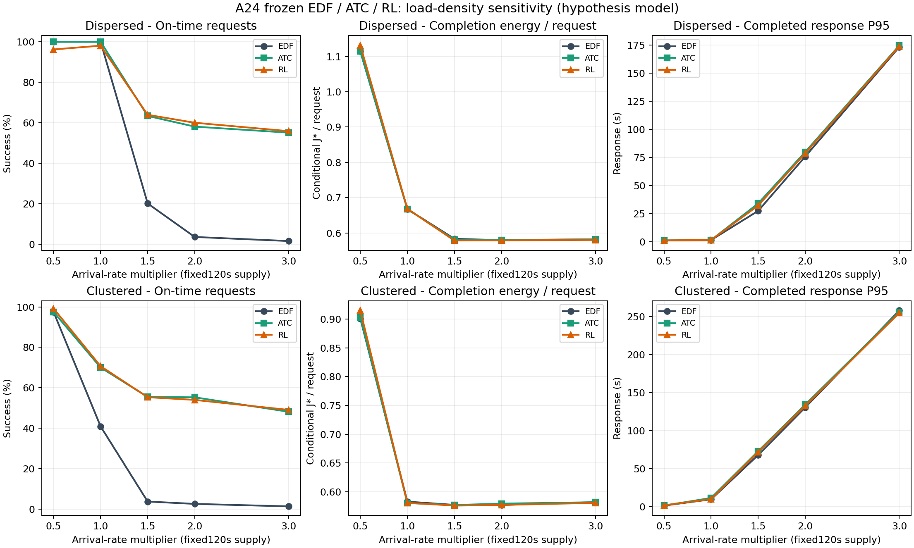
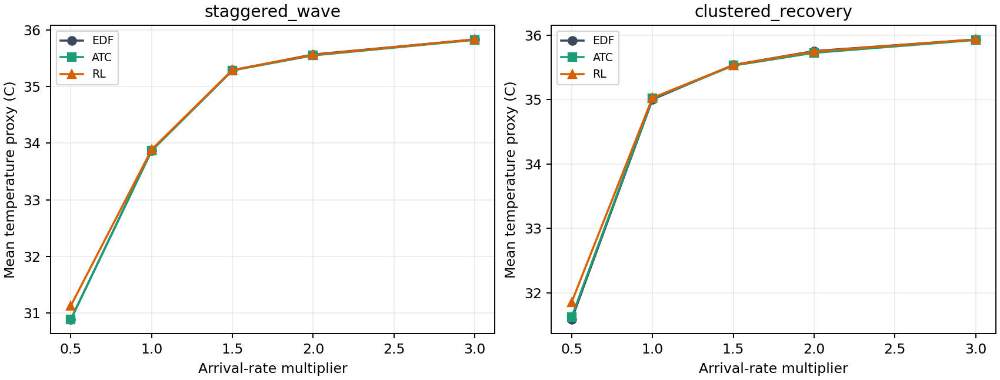

# A24 작업 밀도 민감도:120초 고정·0.5~3배

공급시간120초를 고정하고 같은48요청 도착파형의 간격만0.5/1/1.5/2/3배 도착률에 맞게 압축했다. 기준과 달리 총시간에 비례해 같은 밀도를 유지한 실험이 아니다. 각요청의 작업/우선순위/상대납기는 그대로다. 종료경계의 일부파형을 잘라 실제요청수는 정확한정수배와 조금 다르며 모든조건을 공개한다.

## 조건과 해석

- 두파형:분산staggered_wave(reference.65)와밀집clustered_recovery(reference.95), 분류/탐지 원cycle50:50·긴급25%·초기AP26℃다. 같은 ordinal의 양route잠재작업량/admission지연을 부하수준간 공유하되 실제도착시각만바꾼다. 부분cycle때문에 전체작업/긴급비율은 약간 달라질 수 있다.
- EDF·ATC·기존DEV선정RL3701/EP064를고정했다. 학습/새물리fit/실기기0이다. 원DEV qualification=false를보존하며 장시간/큰queue에맞춰 재학습한RL로 해석하지 않는다. 보호/최대2자원/CPU·GPU각1/비선점/WAIT12초는불변이다.
- 공급종료155초 후 모든부하에같은600초의새배정여유를주고service755/drain785/관측935초를사전에고정했다. 이전 공급+15초계약과 별도세대다. 완료하지못한요청은누락하지않고 완료에너지를null로보고한다. 결과를보고시간을연장해재실행하지않았다.
- 자기완료J*는35초부터마지막AVAILABLE까지의기저+증분소비이며 작업사이유휴/WAIT를포함한다. 완료시간/작업당소비도함께보고한다. 완료후활성tail약.196J*는별도필드·원잔열trace에보존한다. 같은세정책중가장늦은완료까지의공통에너지/AP도보고한다. 자기완료에너지는정책별기간이다르므로동일벽시계폰전체소비와구분한다.
- 작업당소비의부하간감소는기저소비의분산/열/동시점유변화도포함한다. 스케줄러절감은같은부하의EDF대비로만본다. 서로다른부하의절대J*를그대로비교해정책효율이라고하지않는다. 모든요청분모의정시·긴급·완료응답P95·미응답·미완료를공개한다.
- 같은원파형과잠재prefix를공유하는대응분석이며두독립측정replicate나통계CI가아니다. 원단기/장시간결과를선정에쓰거나물리계수를크게바꾸지않았다. J*와AP는미교정열RC/DVFS/누설가설모형의값이다.

## 온도가 끝없이 오르는지

현재식은 T_next=T_idle+(T-T_idle)exp(-dt/tau)+R*P*(1-exp(-dt/tau))의방열항을포함한다. 유휴평형26℃·tau25초·R12·유한증분전력이다. 초기26℃의모든허용active/idle에서 **41.705437℃** 이하라는불변상한을확인했다. 온도자체의clip은추가하지않았다. 누설전력의기존3배상한을쓰지않은저온구간부등식으로도상한이보존돼해당clip이온도를강제로막는결과가아니다.

16개고정task/실행phase조합×1시간·576000전이의순수방정식검사에서평형수렴했다. 이것은완료요청/학습episode나새실측이아니며실제A24최고온도증명도아니다. 이번실제스케줄trace의최고가설AP는36.528℃였고모든trace가수학상한안에있음을별도검산했다. 계속일한다고60/100℃로누적되는모형이아니다. 부하가변하면평형주변의변동을허용하며같은온도로정확히고정되는것을가정하지않는다.

## 두파형집계

에너지절감은각부하의두조건에너지합계대비이며모든정책이완료한경우만정의한다. 온도는같은조건의3정책공통완료창평균을조건평균했다. 음수절감은소비증가다. 공급구간지표와기저비율도WORK_METRICS에모두있다.

|도착률배수|정책|도착합|전체정시율|긴급정시|완료J*/요청|완료절감vsEDF|공통AP℃|AP차vsEDF|미완료|
|---:|---|---:|---:|---:|---:|---:|---:|---:|---:|
|0.5|EDF|425|98.588%|100/106|0.994|0.000%|31.237|0.000|0|
|0.5|ATC|425|98.588%|100/106|0.995|-0.122%|31.256|0.019|0|
|0.5|RL|425|97.882%|99/106|1.009|-1.529%|31.494|0.256|0|
|1|EDF|838|66.587%|134/207|0.620|0.000%|34.435|0.000|0|
|1|ATC|838|83.055%|190/207|0.618|0.222%|34.442|0.008|0|
|1|RL|838|82.578%|178/207|0.619|0.146%|34.456|0.022|0|
|1.5|EDF|1254|10.925%|32/312|0.580|0.000%|35.412|0.000|0|
|1.5|ATC|1254|58.931%|251/312|0.579|0.215%|35.405|-0.007|0|
|1.5|RL|1254|59.091%|255/312|0.577|0.472%|35.413|0.001|0|
|2|EDF|1672|3.050%|14/418|0.578|0.000%|35.659|0.000|0|
|2|ATC|1672|56.519%|335/418|0.580|-0.274%|35.636|-0.023|0|
|2|RL|1672|56.639%|339/418|0.578|0.059%|35.652|-0.007|0|
|3|EDF|2506|1.476%|11/626|0.582|0.000%|35.881|0.000|0|
|3|ATC|2506|51.197%|382/626|0.582|0.021%|35.874|-0.008|0|
|3|RL|2506|52.035%|402/626|0.581|0.249%|35.881|0.000|0|

## 모든30조건과대기열

queue최대는입장(+1)/배정(-1)사건을재구성했다. 공급후정리시간은마지막AVAILABLE-155초다. 완료응답P95는미응답을대신하지않으며전체도착분모/미완료와함께본다.

|배수|파형|정책|요청|정시|긴급정시|응답P95초|완료창초|완료J*/요청|공통AP℃|queue최대|공급후정리초|미응답/미완료|
|---:|---|---|---:|---:|---:|---:|---:|---:|---:|---:|---:|---:|
|0.5|staggered_wave|EDF|185|185|46|1.100|120.144|1.114|30.889|1|0.144|0/0|
|0.5|staggered_wave|ATC|185|185|46|1.100|120.144|1.114|30.889|1|0.144|0/0|
|0.5|staggered_wave|RL|185|178|39|1.177|120.208|1.131|31.132|1|0.208|0/0|
|1|staggered_wave|EDF|364|364|88|1.520|119.969|0.668|33.869|3|0.000|0/0|
|1|staggered_wave|ATC|364|364|88|1.520|119.969|0.668|33.869|3|0.000|0/0|
|1|staggered_wave|RL|364|357|83|1.553|119.969|0.668|33.887|3|0.000|0/0|
|1.5|staggered_wave|EDF|546|110|26|27.438|150.293|0.583|35.288|102|30.293|0/0|
|1.5|staggered_wave|ATC|546|346|115|34.034|149.502|0.581|35.284|63|29.502|0/0|
|1.5|staggered_wave|RL|546|349|118|32.234|148.721|0.579|35.291|64|28.721|0/0|
|2|staggered_wave|EDF|730|26|6|75.796|200.681|0.580|35.566|282|80.681|0/0|
|2|staggered_wave|ATC|730|424|159|79.883|200.963|0.580|35.549|171|80.963|0/0|
|2|staggered_wave|RL|730|438|162|78.667|200.346|0.579|35.559|170|80.346|0/0|
|3|staggered_wave|EDF|1096|17|5|173.324|304.684|0.582|35.831|648|184.684|0/0|
|3|staggered_wave|ATC|1096|604|210|174.641|304.592|0.582|35.823|389|184.592|0/0|
|3|staggered_wave|RL|1096|612|219|174.050|303.498|0.580|35.831|391|183.498|0/0|
|0.5|clustered_recovery|EDF|240|234|54|1.448|120.876|0.901|31.585|3|0.876|0/0|
|0.5|clustered_recovery|ATC|240|234|54|1.451|120.879|0.903|31.623|3|0.879|0/0|
|0.5|clustered_recovery|RL|240|238|60|1.833|120.887|0.915|31.855|4|0.887|0/0|
|1|clustered_recovery|EDF|474|194|46|9.648|130.444|0.583|35.000|33|10.444|0/0|
|1|clustered_recovery|ATC|474|332|102|11.448|129.695|0.581|35.016|22|9.695|0/0|
|1|clustered_recovery|RL|474|335|95|9.949|129.726|0.581|35.026|22|9.726|0/0|
|1.5|clustered_recovery|EDF|708|27|6|67.918|193.867|0.577|35.536|254|73.867|0/0|
|1.5|clustered_recovery|ATC|708|393|136|72.928|193.618|0.577|35.527|157|73.618|0/0|
|1.5|clustered_recovery|RL|708|392|137|71.872|193.237|0.576|35.534|157|73.237|0/0|
|2|clustered_recovery|EDF|942|25|8|130.505|258.886|0.577|35.753|488|138.886|0/0|
|2|clustered_recovery|ATC|942|521|176|134.181|260.208|0.580|35.724|299|140.208|0/0|
|2|clustered_recovery|RL|942|509|177|132.702|258.994|0.577|35.746|295|138.994|0/0|
|3|clustered_recovery|EDF|1410|20|6|257.930|393.345|0.582|35.931|957|273.345|0/0|
|3|clustered_recovery|ATC|1410|679|172|256.239|393.234|0.582|35.924|581|273.234|0/0|
|3|clustered_recovery|RL|1410|692|183|254.859|392.391|0.581|35.932|579|272.391|0/0|

## 같은부하에서에너지·열·납기대조

|배수|파형|정책|완료총J*|기저비율|완료절감|공통절감|공통AP차℃|전체/긴급납기비악화+전체완료|
|---:|---|---|---:|---:|---:|---:|---:|---|
|0.5|staggered_wave|EDF|206.131|70.199%|0.000%|0.000%|0.000|true|
|0.5|staggered_wave|ATC|206.131|70.199%|0.000%|0.000%|0.000|true|
|0.5|staggered_wave|RL|209.267|69.184%|-1.521%|-1.477%|0.243|false|
|1|staggered_wave|EDF|242.977|59.467%|0.000%|0.000%|0.000|true|
|1|staggered_wave|ATC|242.977|59.467%|0.000%|0.000%|0.000|true|
|1|staggered_wave|RL|243.241|59.402%|-0.109%|-0.108%|0.018|false|
|1.5|staggered_wave|EDF|318.510|56.831%|0.000%|0.000%|0.000|true|
|1.5|staggered_wave|ATC|317.106|56.782%|0.441%|0.106%|-0.004|true|
|1.5|staggered_wave|RL|315.911|56.699%|0.816%|0.171%|0.003|true|
|2|staggered_wave|EDF|423.073|57.130%|0.000%|0.000%|0.000|true|
|2|staggered_wave|ATC|423.505|57.152%|-0.102%|-0.009%|-0.017|true|
|2|staggered_wave|RL|422.483|57.114%|0.139%|0.033%|-0.007|true|
|3|staggered_wave|EDF|637.775|57.538%|0.000%|0.000%|0.000|true|
|3|staggered_wave|ATC|637.637|57.533%|0.022%|0.001%|-0.008|true|
|3|staggered_wave|RL|635.894|57.483%|0.295%|0.048%|-0.000|true|
|0.5|clustered_recovery|EDF|216.231|67.327%|0.000%|0.000%|0.000|true|
|0.5|clustered_recovery|ATC|216.747|67.169%|-0.239%|-0.236%|0.037|true|
|0.5|clustered_recovery|RL|219.554|66.314%|-1.537%|-1.529%|0.269|true|
|1|clustered_recovery|EDF|276.363|56.848%|0.000%|0.000%|0.000|true|
|1|clustered_recovery|ATC|275.210|56.759%|0.417%|0.051%|0.016|true|
|1|clustered_recovery|RL|275.341|56.745%|0.370%|0.018%|0.026|true|
|1.5|clustered_recovery|EDF|408.769|57.121%|0.000%|0.000%|0.000|true|
|1.5|clustered_recovery|ATC|408.606|57.070%|0.040%|-0.045%|-0.009|true|
|1.5|clustered_recovery|RL|407.934|57.052%|0.204%|-0.006%|-0.002|true|
|2|clustered_recovery|EDF|543.759|57.342%|0.000%|0.000%|0.000|true|
|2|clustered_recovery|ATC|545.975|57.401%|-0.408%|-0.086%|-0.028|true|
|2|clustered_recovery|RL|543.775|57.364%|-0.003%|0.022%|-0.007|true|
|3|clustered_recovery|EDF|820.820|57.716%|0.000%|0.000%|0.000|true|
|3|clustered_recovery|ATC|820.646|57.712%|0.021%|0.002%|-0.007|true|
|3|clustered_recovery|RL|819.070|57.699%|0.213%|0.058%|0.001|true|

새10조건에서RL의총소비10%·공통AP.5℃·납기비악화/전체완료기술조건은0/10이다. 과거원사전목표/실기기우위/전체최적한계판정으로소급하지않는다. 에너지나온도하나의개선으로다른쪽손해를성공으로바꾸지않았다.

## 검증·파일

32START/32COMPLETE/환경FAIL0(P0 EDF/RL정확2＋10조건×3정책30), 새36예약/잔4·자동추가0이다. 원coupled38/savings8/sustained4/RR1불변이다. 알려진S26공유예약48을포함한직전125838에새36을더한추적125874/137712 snapshot이며모든host의실시간전수집계는아니다.

원모형/source/CP핀·입력간격/상대납기순수계약·P0원요청경로/clock정확재현을확인했다. 독립2952840검사·저장NN입력6743개전수Float64 argmax·CP전체tensor digest PASS다. 산술최대차1.000000304784976e-9, admission지연prefix12567개·동일선택경로잠재workprefix6928개일치다. NNlogit의Torch bitwise일치주장이아니라별도계산의선택인덱스대조다. Adam/가중치/양RNG/counter는runtime불변도확인했다.

source/입력/예산은OPERATION.json·원시/NNframe/receipt는같은결과폴더·수학온도증거는experiments/load_density_20261017/THERMAL_PURE_TEST.json·정량은WORK_METRICS/POLICY_DELTAS·파일SHA는FINAL_HANDOFF_PROOF다. PNG와동일SVG를함께저장했다. 실측에너지/기기우위/장시간학습수렴/모든가능정책의최적값은미확인이다.
