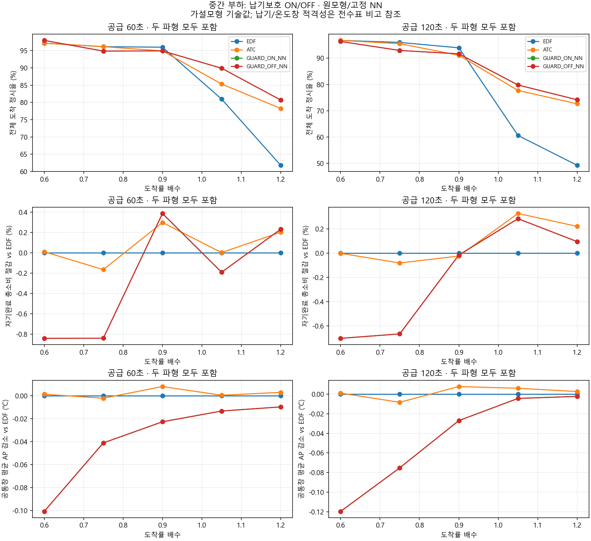

# 중간 부하와 공급시간: 모든20조건·80실행

도착률 .6/.75/.9/1.05/1.2배 × 두파형 × 공급60/120초를 사전에 고정했다. 원모형/상대납기/고정NN은 유지했다. 동일부하의60초 입력은120초 입력의 정확 도착·admission·잠재·공개명목prefix이며 1860요청을 검산했다. 공급종료 이후 배정600초/배출630초는 양쪽에 동일하다.

부하분류는 EDF/ATC 평균 이용률95% 이상 또는 정리시간/공급시간25% 초과이면 포화후보, 이용률40% 미만이며 복수요청10% 미만이면 저경쟁, 나머지는 중간후보다. 이는 유한입력의 기전 설명이며 안정성 증명이 아니다. 승리한 조건을 골라낸 분류가 아니며 모든 조건을 표시한다. 파형 간 동일배율은 같은 절대 부하를 뜻하지 않는다.

완료J*는35초부터 자기 마지막AVAILABLE까지의 기저+증분으로 작업사이 유휴/WAIT를 포함한다. 온도창은 EDF/ATC/보호ON의 최대완료로 먼저 동결하여 보호OFF의 지연으로 늘리지 않았다. 그 창 밖 완료는 수치를 남기고 온도우위 선정에서만 제외한다. EDF/STRONG의 전체·긴급정시수 기준과 미응답/미완료를 모두 비고에 쓴다. 완료응답P95는 전체도착 정시율을 대신하지 않는다. J*/AP는 A24 가설모형이며 실측J나 S26 결론이 아니다. 고정NN을 보호 없이 다시 학습한 결과와 구분한다.

## 모든 신규80행

선택기회는 실제DISPATCH에서 복수요청/두자원유휴/둘동시의 비율이다. WAIT를 복수행동에 포함하지 않는다. 이용률은 공급기간 두자원의 점유비율이다.

|조건|정책|구간|도착|정시|긴급정시|P95초|이용률%|선택기회% 요청/자원/동시|큐최대/정리초|완료J*|절감vsEDF%|공통온도감소℃|미응답/미완료|비고|
|---|---|---|---:|---|---|---:|---:|---|---|---:|---:|---:|---|---|
|MID_060_0_60|EDF|중간후보|108|108/108|26/26|1.147|40.7|0.0/35.2/0.0|1/0.000|105.734|0.000|0.00000|0/0|EDF:납기 적격; STRONG:납기 적격; 동결온도창 완료 적격|
|MID_060_0_60|ATC|중간후보|108|108/108|26/26|1.147|40.7|0.0/35.2/0.0|1/0.000|105.734|0.000|0.00000|0/0|EDF:납기 적격; STRONG:납기 적격; 동결온도창 완료 적격|
|MID_060_0_60|GUARD_ON_NN|중간후보|108|107/108|25/26|1.178|45.9|6.5/33.3/0.0|2/0.000|107.053|-1.248|-0.16840|0/0|EDF:선정제외(on_time 107<108, urgent_on_time 25<26); STRONG:선정제외(on_time 107<108, urgent_on_time 25<26); 동결온도창 완료 적격|
|MID_060_0_60|GUARD_OFF_NN|중간후보|108|107/108|25/26|1.178|45.9|6.5/33.3/0.0|2/0.000|107.053|-1.248|-0.16840|0/0|EDF:선정제외(on_time 107<108, urgent_on_time 25<26); STRONG:선정제외(on_time 107<108, urgent_on_time 25<26); 동결온도창 완료 적격|
|MID_060_0_120|EDF|중간후보|216|215/216|53/54|1.159|41.0|0.0/34.7/0.0|1/0.000|211.643|0.000|0.00000|0/0|EDF:납기 적격; STRONG:납기 적격; 동결온도창 완료 적격|
|MID_060_0_120|ATC|중간후보|216|215/216|53/54|1.159|41.0|0.0/34.7/0.0|1/0.000|211.643|0.000|0.00000|0/0|EDF:납기 적격; STRONG:납기 적격; 동결온도창 완료 적격|
|MID_060_0_120|GUARD_ON_NN|중간후보|216|213/216|51/54|1.197|46.4|6.0/33.8/0.0|2/0.000|214.166|-1.192|-0.20009|0/0|EDF:선정제외(on_time 213<215, urgent_on_time 51<53); STRONG:선정제외(on_time 213<215, urgent_on_time 51<53); 동결온도창 완료 적격|
|MID_060_0_120|GUARD_OFF_NN|중간후보|216|213/216|51/54|1.197|46.4|6.0/33.8/0.0|2/0.000|214.166|-1.192|-0.20009|0/0|EDF:선정제외(on_time 213<215, urgent_on_time 51<53); STRONG:선정제외(on_time 213<215, urgent_on_time 51<53); 동결온도창 완료 적격|
|MID_075_0_60|EDF|중간후보|138|136/138|34/36|1.161|54.2|9.4/26.1/0.0|2/0.043|114.443|0.000|0.00000|0/0|EDF:납기 적격; STRONG:납기 적격; 동결온도창 완료 적격|
|MID_075_0_60|ATC|중간후보|138|136/138|34/36|1.161|54.2|6.5/26.1/0.0|2/0.043|114.445|-0.001|0.00031|0/0|EDF:납기 적격; STRONG:납기 적격; 동결온도창 완료 적격|
|MID_075_0_60|GUARD_ON_NN|중간후보|138|135/138|33/36|1.196|55.9|10.1/25.4/0.0|3/0.623|115.408|-0.843|-0.01094|0/0|EDF:선정제외(on_time 135<136, urgent_on_time 33<34); STRONG:선정제외(on_time 135<136, urgent_on_time 33<34); 동결온도창 완료 적격|
|MID_075_0_60|GUARD_OFF_NN|중간후보|138|135/138|33/36|1.196|55.9|10.1/25.4/0.0|3/0.623|115.408|-0.843|-0.01094|0/0|EDF:선정제외(on_time 135<136, urgent_on_time 33<34); STRONG:선정제외(on_time 135<136, urgent_on_time 33<34); 동결온도창 완료 적격|
|MID_075_0_120|EDF|중간후보|274|270/274|66/70|1.198|54.2|9.9/26.3/0.0|2/0.717|226.673|0.000|0.00000|0/0|EDF:납기 적격; STRONG:납기 적격; 동결온도창 완료 적격|
|MID_075_0_120|ATC|중간후보|274|270/274|66/70|1.198|54.3|6.9/26.3/0.0|2/0.839|226.910|-0.105|-0.00447|0/0|EDF:납기 적격; STRONG:납기 적격; 동결온도창 완료 적격|
|MID_075_0_120|GUARD_ON_NN|중간후보|274|268/274|65/70|1.260|57.7|10.6/25.9/0.0|3/1.116|228.401|-0.762|-0.07358|0/0|EDF:선정제외(on_time 268<270, urgent_on_time 65<66); STRONG:선정제외(on_time 268<270, urgent_on_time 65<66); 동결온도창 완료 적격|
|MID_075_0_120|GUARD_OFF_NN|중간후보|274|268/274|65/70|1.260|57.7|10.6/25.9/0.0|3/1.116|228.401|-0.762|-0.07358|0/0|EDF:선정제외(on_time 268<270, urgent_on_time 65<66); STRONG:선정제외(on_time 268<270, urgent_on_time 65<66); 동결온도창 완료 적격|
|MID_090_0_60|EDF|중간후보|164|162/164|39/41|1.198|63.7|18.9/21.3/0.0|3/1.066|120.747|0.000|0.00000|0/0|EDF:납기 적격; STRONG:선정제외(urgent_on_time 39<40); 동결온도창 완료 적격|
|MID_090_0_60|ATC|중간후보|164|161/164|38/41|1.237|64.3|17.7/20.1/0.0|3/1.067|120.865|-0.098|-0.01143|0/0|EDF:선정제외(on_time 161<162, urgent_on_time 38<39); STRONG:선정제외(on_time 161<162, urgent_on_time 38<40); 동결온도창 완료 적격|
|MID_090_0_60|GUARD_ON_NN|중간후보|164|161/164|40/41|1.263|66.5|15.9/21.3/0.0|3/0.579|120.454|0.243|-0.04935|0/0|EDF:선정제외(on_time 161<162); STRONG:선정제외(on_time 161<162); 동결온도창 완료 적격|
|MID_090_0_60|GUARD_OFF_NN|중간후보|164|161/164|40/41|1.263|66.5|15.9/21.3/0.0|3/0.579|120.454|0.243|-0.04935|0/0|EDF:선정제외(on_time 161<162); STRONG:선정제외(on_time 161<162); 동결온도창 완료 적격|
|MID_090_0_120|EDF|중간후보|327|318/327|74/83|1.236|66.5|20.8/20.5/0.0|3/0.977|236.997|0.000|0.00000|0/0|EDF:납기 적격; STRONG:선정제외(urgent_on_time 74<79); 동결온도창 완료 적격|
|MID_090_0_120|ATC|중간후보|327|316/327|72/83|1.416|67.3|20.2/19.0/0.0|3/1.450|237.938|-0.397|-0.01591|0/0|EDF:선정제외(on_time 316<318, urgent_on_time 72<74); STRONG:선정제외(on_time 316<318, urgent_on_time 72<79); 동결온도창 완료 적격|
|MID_090_0_120|GUARD_ON_NN|중간후보|327|318/327|79/83|1.402|69.4|18.7/20.2/0.0|3/0.902|237.802|-0.340|-0.07137|0/0|EDF:납기 적격; STRONG:납기 적격; 동결온도창 완료 적격|
|MID_090_0_120|GUARD_OFF_NN|중간후보|327|318/327|79/83|1.402|69.4|18.7/20.2/0.0|3/0.902|237.802|-0.340|-0.07137|0/0|EDF:납기 적격; STRONG:납기 적격; 동결온도창 완료 적격|
|MID_105_0_60|EDF|중간후보|192|187/192|43/48|1.387|76.8|27.6/13.5/0.0|4/0.974|125.915|0.000|0.00000|0/0|EDF:납기 적격; STRONG:납기 적격; 동결온도창 완료 적격|
|MID_105_0_60|ATC|중간후보|192|181/192|40/48|1.495|76.7|25.5/13.5/0.0|3/0.938|125.764|0.120|0.00571|0/0|EDF:선정제외(on_time 181<187, urgent_on_time 40<43); STRONG:선정제외(on_time 181<187, urgent_on_time 40<43); 동결온도창 완료 적격|
|MID_105_0_60|GUARD_ON_NN|중간후보|192|184/192|41/48|1.455|78.5|23.4/12.5/0.0|3/0.939|125.948|-0.026|-0.02456|0/0|EDF:선정제외(on_time 184<187, urgent_on_time 41<43); STRONG:선정제외(on_time 184<187, urgent_on_time 41<43); 동결온도창 완료 적격|
|MID_105_0_60|GUARD_OFF_NN|중간후보|192|184/192|41/48|1.455|78.5|23.4/12.5/0.0|3/0.939|125.948|-0.026|-0.02456|0/0|EDF:선정제외(on_time 184<187, urgent_on_time 41<43); STRONG:선정제외(on_time 184<187, urgent_on_time 41<43); 동결온도창 완료 적격|
|MID_105_0_120|EDF|중간후보|380|359/380|80/96|1.603|81.1|32.9/9.7/0.0|4/0.298|245.422|0.000|0.00000|0/0|EDF:납기 적격; STRONG:납기 적격; 동결온도창 완료 적격|
|MID_105_0_120|ATC|중간후보|380|352/380|77/96|1.670|80.7|28.9/10.0/0.0|3/0.212|245.053|0.150|0.01518|0/0|EDF:선정제외(on_time 352<359, urgent_on_time 77<80); STRONG:선정제외(on_time 352<359, urgent_on_time 77<80); 동결온도창 완료 적격|
|MID_105_0_120|GUARD_ON_NN|중간후보|380|353/380|78/96|1.597|81.9|27.1/8.7/0.0|4/0.368|245.488|-0.027|-0.00411|0/0|EDF:선정제외(on_time 353<359, urgent_on_time 78<80); STRONG:선정제외(on_time 353<359, urgent_on_time 78<80); 동결온도창 완료 적격|
|MID_105_0_120|GUARD_OFF_NN|중간후보|380|353/380|78/96|1.597|81.9|27.1/8.7/0.0|4/0.368|245.488|-0.027|-0.00411|0/0|EDF:선정제외(on_time 353<359, urgent_on_time 78<80); STRONG:선정제외(on_time 353<359, urgent_on_time 78<80); 동결온도창 완료 적격|
|MID_120_0_60|EDF|중간후보|216|203/216|47/54|1.764|89.3|46.3/5.1/0.0|4/1.123|130.626|0.000|0.00000|0/0|EDF:납기 적격; STRONG:선정제외(urgent_on_time 47<51); 동결온도창 완료 적격|
|MID_120_0_60|ATC|중간후보|216|205/216|50/54|1.872|88.9|42.6/4.6/0.0|4/1.096|130.487|0.106|0.01247|0/0|EDF:납기 적격; STRONG:선정제외(urgent_on_time 50<51); 동결온도창 완료 적격|
|MID_120_0_60|GUARD_ON_NN|중간후보|216|203/216|51/54|1.815|89.6|40.3/5.1/0.0|4/1.089|130.589|0.028|-0.00517|0/0|EDF:납기 적격; STRONG:납기 적격; 동결온도창 완료 적격|
|MID_120_0_60|GUARD_OFF_NN|중간후보|216|203/216|51/54|1.815|89.6|40.3/5.1/0.0|4/1.089|130.589|0.028|-0.00517|0/0|EDF:납기 적격; STRONG:납기 적격; 동결온도창 완료 적격|
|MID_120_0_120|EDF|중간후보|432|384/432|93/108|2.518|94.5|66.2/2.5/0.0|6/1.639|255.969|0.000|0.00000|0/0|EDF:납기 적격; STRONG:선정제외(on_time 384<388, urgent_on_time 93<96); 동결온도창 완료 적격|
|MID_120_0_120|ATC|중간후보|432|387/432|97/108|2.361|94.3|64.1/2.3/0.0|6/1.276|255.308|0.258|0.00890|0/0|EDF:납기 적격; STRONG:선정제외(on_time 387<388); 동결온도창 완료 적격|
|MID_120_0_120|GUARD_ON_NN|중간후보|432|388/432|96/108|2.259|94.5|64.6/2.5/0.0|7/1.719|256.087|-0.046|0.00253|0/0|EDF:납기 적격; STRONG:납기 적격; 동결온도창 완료 적격|
|MID_120_0_120|GUARD_OFF_NN|중간후보|432|388/432|96/108|2.259|94.5|64.6/2.5/0.0|7/1.719|256.087|-0.046|0.00253|0/0|EDF:납기 적격; STRONG:납기 적격; 동결온도창 완료 적격|
|MID_060_1_60|EDF|중간후보|138|131/138|30/34|1.917|52.0|66.7/16.7/16.7|4/0.000|111.697|0.000|0.00000|0/0|EDF:납기 적격; STRONG:선정제외(on_time 131<134, urgent_on_time 30<33); 동결온도창 완료 적격|
|MID_060_1_60|ATC|중간후보|138|131/138|30/34|1.903|51.9|66.7/16.7/16.7|4/0.000|111.672|0.022|0.00268|0/0|EDF:납기 적격; STRONG:선정제외(on_time 131<134, urgent_on_time 30<33); 동결온도창 완료 적격|
|MID_060_1_60|GUARD_ON_NN|중간후보|138|134/138|33/34|1.918|52.6|66.7/16.7/16.7|4/0.000|112.210|-0.460|-0.03291|0/0|EDF:납기 적격; STRONG:납기 적격; 동결온도창 완료 적격|
|MID_060_1_60|GUARD_OFF_NN|중간후보|138|134/138|33/34|1.918|52.6|66.7/16.7/16.7|4/0.000|112.210|-0.460|-0.03291|0/0|EDF:납기 적격; STRONG:납기 적격; 동결온도창 완료 적격|
|MID_060_1_120|EDF|중간후보|276|261/276|58/67|1.986|54.0|66.7/16.7/16.7|4/0.000|223.239|0.000|0.00000|0/0|EDF:납기 적격; STRONG:선정제외(urgent_on_time 58<59); 동결온도창 완료 적격|
|MID_060_1_120|ATC|중간후보|276|261/276|58/67|1.974|54.0|66.7/16.7/16.7|4/0.000|223.245|-0.003|0.00194|0/0|EDF:납기 적격; STRONG:선정제외(urgent_on_time 58<59); 동결온도창 완료 적격|
|MID_060_1_120|GUARD_ON_NN|중간후보|276|261/276|59/67|2.000|54.8|66.3/16.3/16.3|4/0.000|223.764|-0.235|-0.03908|0/0|EDF:납기 적격; STRONG:납기 적격; 동결온도창 완료 적격|
|MID_060_1_120|GUARD_OFF_NN|중간후보|276|261/276|59/67|2.000|54.8|66.3/16.3/16.3|4/0.000|223.764|-0.235|-0.03908|0/0|EDF:납기 적격; STRONG:납기 적격; 동결온도창 완료 적격|
|MID_075_1_60|EDF|중간후보|174|164/174|35/41|2.025|67.9|67.2/15.5/15.5|5/0.261|120.810|0.000|0.00000|0/0|EDF:납기 적격; STRONG:납기 적격; 동결온도창 완료 적격|
|MID_075_1_60|ATC|중간후보|174|164/174|35/41|1.986|67.9|66.7/14.9/14.9|5/0.507|121.198|-0.321|-0.00461|0/0|EDF:납기 적격; STRONG:납기 적격; 동결온도창 완료 적격|
|MID_075_1_60|GUARD_ON_NN|중간후보|174|161/174|34/41|2.050|69.9|66.7/12.6/12.6|5/0.539|121.825|-0.840|-0.07112|0/0|EDF:선정제외(on_time 161<164, urgent_on_time 34<35); STRONG:선정제외(on_time 161<164, urgent_on_time 34<35); 동결온도창 완료 적격|
|MID_075_1_60|GUARD_OFF_NN|중간후보|174|161/174|34/41|2.050|69.9|66.7/12.6/12.6|5/0.539|121.825|-0.840|-0.07112|0/0|EDF:선정제외(on_time 161<164, urgent_on_time 34<35); STRONG:선정제외(on_time 161<164, urgent_on_time 34<35); 동결온도창 완료 적격|
|MID_075_1_120|EDF|중간후보|348|327/348|72/85|2.080|71.2|66.7/13.8/13.8|5/1.058|239.826|0.000|0.00000|0/0|EDF:납기 적격; STRONG:납기 적격; 동결온도창 완료 적격|
|MID_075_1_120|ATC|중간후보|348|324/348|69/85|2.014|71.6|66.7/12.9/12.9|5/1.059|239.968|-0.059|-0.01237|0/0|EDF:선정제외(on_time 324<327, urgent_on_time 69<72); STRONG:선정제외(on_time 324<327, urgent_on_time 69<72); 동결온도창 완료 적격|
|MID_075_1_120|GUARD_ON_NN|중간후보|348|310/348|64/85|2.053|73.1|67.5/11.8/11.8|5/1.388|241.197|-0.572|-0.07675|0/0|EDF:선정제외(on_time 310<327, urgent_on_time 64<72); STRONG:선정제외(on_time 310<327, urgent_on_time 64<72); 동결온도창 완료 적격|
|MID_075_1_120|GUARD_OFF_NN|중간후보|348|310/348|64/85|2.053|73.1|67.5/11.8/11.8|5/1.388|241.197|-0.572|-0.07675|0/0|EDF:선정제외(on_time 310<327, urgent_on_time 64<72); STRONG:선정제외(on_time 310<327, urgent_on_time 64<72); 동결온도창 완료 적격|
|MID_090_1_60|EDF|중간후보|210|197/210|42/50|2.231|85.1|72.9/7.1/7.1|6/0.875|128.423|0.000|0.00000|0/0|EDF:납기 적격; STRONG:납기 적격; 동결온도창 완료 적격|
|MID_090_1_60|ATC|중간후보|210|194/210|41/50|2.052|84.4|72.9/6.7/6.7|6/0.429|127.559|0.673|0.02747|0/0|EDF:선정제외(on_time 194<197, urgent_on_time 41<42); STRONG:선정제외(on_time 194<197, urgent_on_time 41<42); 동결온도창 완료 적격|
|MID_090_1_60|GUARD_ON_NN|중간후보|210|194/210|42/50|2.059|85.0|71.9/6.2/6.2|6/0.447|127.748|0.525|0.00406|0/0|EDF:선정제외(on_time 194<197); STRONG:선정제외(on_time 194<197); 동결온도창 완료 적격|
|MID_090_1_60|GUARD_OFF_NN|중간후보|210|194/210|42/50|2.059|85.0|71.9/6.2/6.2|6/0.447|127.748|0.525|0.00406|0/0|EDF:선정제외(on_time 194<197); STRONG:선정제외(on_time 194<197); 동결온도창 완료 적격|
|MID_090_1_120|EDF|중간후보|414|378/414|79/101|2.526|90.3|77.5/4.3/4.3|7/1.439|252.879|0.000|0.00000|0/0|EDF:납기 적격; STRONG:납기 적격; 동결온도창 완료 적격|
|MID_090_1_120|ATC|중간후보|414|359/414|74/101|2.414|89.3|77.3/4.6/4.6|7/1.127|252.056|0.326|0.03119|0/0|EDF:선정제외(on_time 359<378, urgent_on_time 74<79); STRONG:선정제외(on_time 359<378, urgent_on_time 74<79); 동결온도창 완료 적격|
|MID_090_1_120|GUARD_ON_NN|중간후보|414|361/414|76/101|2.257|89.5|76.3/4.3/4.3|7/1.128|252.149|0.289|0.01729|0/0|EDF:선정제외(on_time 361<378, urgent_on_time 76<79); STRONG:선정제외(on_time 361<378, urgent_on_time 76<79); 동결온도창 완료 적격|
|MID_090_1_120|GUARD_OFF_NN|중간후보|414|361/414|76/101|2.257|89.5|76.3/4.3/4.3|7/1.128|252.149|0.289|0.01729|0/0|EDF:선정제외(on_time 361<378, urgent_on_time 76<79); STRONG:선정제외(on_time 361<378, urgent_on_time 76<79); 동결온도창 완료 적격|
|MID_105_1_60|EDF|포화후보|244|166/244|35/60|5.004|96.4|90.2/2.0/2.0|16/4.510|140.059|0.000|0.00000|0/0|EDF:납기 적격; STRONG:선정제외(on_time 166<208, urgent_on_time 35<48); 동결온도창 완료 적격|
|MID_105_1_60|ATC|포화후보|244|191/244|49/60|5.542|96.3|89.3/1.6/1.6|12/4.608|140.204|-0.103|-0.00484|0/0|EDF:납기 적격; STRONG:선정제외(on_time 191<208); 동결온도창 완료 적격|
|MID_105_1_60|GUARD_ON_NN|포화후보|244|208/244|48/60|3.556|96.0|89.8/1.2/1.2|11/4.846|140.535|-0.340|-0.00201|0/0|EDF:납기 적격; STRONG:납기 적격; 동결온도창 완료 적격|
|MID_105_1_60|GUARD_OFF_NN|포화후보|244|208/244|48/60|3.556|96.0|89.8/1.2/1.2|11/4.846|140.535|-0.340|-0.00201|0/0|EDF:납기 적격; STRONG:납기 적격; 동결온도창 완료 적격|
|MID_105_1_120|EDF|포화후보|486|166/486|35/120|11.989|98.2|95.1/1.0/1.0|44/13.617|282.951|0.000|0.00000|0/0|EDF:납기 적격; STRONG:선정제외(on_time 166<338, urgent_on_time 35<95); 동결온도창 완료 적격|
|MID_105_1_120|ATC|포화후보|486|321/486|98/120|15.060|98.2|94.7/0.8/0.8|28/12.698|281.597|0.478|-0.00341|0/0|EDF:납기 적격; STRONG:선정제외(on_time 321<338); 동결온도창 완료 적격|
|MID_105_1_120|GUARD_ON_NN|포화후보|486|338/486|95/120|13.061|98.0|94.9/0.6/0.6|28/12.624|281.388|0.552|-0.00483|0/0|EDF:납기 적격; STRONG:납기 적격; 동결온도창 완료 적격|
|MID_105_1_120|GUARD_OFF_NN|포화후보|486|338/486|95/120|13.061|98.0|94.9/0.6/0.6|28/12.624|281.388|0.552|-0.00483|0/0|EDF:납기 적격; STRONG:납기 적격; 동결온도창 완료 적격|
|MID_120_1_60|EDF|포화후보|276|101/276|21/67|11.738|99.3|97.8/0.7/0.7|44/12.370|157.512|0.000|0.00000|0/0|EDF:납기 적격; STRONG:선정제외(on_time 101<194, urgent_on_time 21<51); 동결온도창 완료 적격|
|MID_120_1_60|ATC|포화후보|276|180/276|54/67|13.869|99.5|97.8/0.4/0.4|28/12.091|157.061|0.286|-0.00654|0/0|EDF:납기 적격; STRONG:선정제외(on_time 180<194); 동결온도창 완료 적격|
|MID_120_1_60|GUARD_ON_NN|포화후보|276|194/276|51/67|12.807|99.6|98.2/0.4/0.4|28/11.958|156.877|0.403|-0.01424|0/0|EDF:납기 적격; STRONG:납기 적격; 동결온도창 완료 적격|
|MID_120_1_60|GUARD_OFF_NN|포화후보|276|194/276|51/67|12.807|99.6|98.2/0.4/0.4|28/11.958|156.877|0.403|-0.01424|0/0|EDF:납기 적격; STRONG:납기 적격; 동결온도창 완료 적격|
|MID_120_1_120|EDF|포화후보|552|101/552|21/136|27.639|99.7|98.9/0.4/0.4|104/30.413|318.987|0.000|0.00000|0/0|EDF:납기 적격; STRONG:선정제외(on_time 101<342, urgent_on_time 21<105); 동결온도창 완료 적격|
|MID_120_1_120|ATC|포화후보|552|328/552|106/136|34.442|99.8|98.9/0.2/0.2|66/30.054|318.385|0.189|-0.00375|0/0|EDF:납기 적격; STRONG:선정제외(on_time 328<342); 동결온도창 완료 적격|
|MID_120_1_120|GUARD_ON_NN|포화후보|552|342/552|105/136|32.734|99.8|99.1/0.2/0.2|65/29.956|318.325|0.208|-0.00725|0/0|EDF:납기 적격; STRONG:납기 적격; 동결온도창 완료 적격|
|MID_120_1_120|GUARD_OFF_NN|포화후보|552|342/552|105/136|32.734|99.8|99.1/0.2/0.2|65/29.956|318.325|0.208|-0.00725|0/0|EDF:납기 적격; STRONG:납기 적격; 동결온도창 완료 적격|

## 기존152행도 모두 보존

원결과의 제외비고/과부하/오프라인미래정보 일정/P0도 유지한다. 서로 다른 입력을 한 절감률로 섞지 않는다. 원상한은 원10입력에만 유효하고 이20입력의 상한으로 전용하지 않는다.

|기존일정|정시/도착|긴급정시|P95초|완료J*|공통AP℃|미응답/미완료|비고|
|---|---|---|---:|---:|---:|---|---|
|P0_DENSITY_050_0|185/185|46/46|1.100|206.131|30.88929|0/0|P0:원본 재현 검증용, 정책 우위 선정 대상에서만 제외; EDF:납기 적격; STRONG:납기 적격; 온도창 완료 적격|
|DENSITY_050_0_ENERGY|185/185|46/46|1.165|206.768|30.93864|0/0|EDF:납기 적격; STRONG:납기 적격; 온도창 완료 적격|
|DENSITY_050_0_TOTAL|185/185|46/46|1.165|206.768|30.93864|0/0|EDF:납기 적격; STRONG:납기 적격; 온도창 완료 적격|
|DENSITY_050_0_REGRET|185/185|46/46|1.165|206.768|30.93864|0/0|EDF:납기 적격; STRONG:납기 적격; 온도창 완료 적격|
|DENSITY_050_0_LP_ROUTE|185/185|46/46|1.165|206.768|30.93864|0/0|EDF:납기 적격; STRONG:납기 적격; 온도창 완료 적격|
|DENSITY_050_0_HEAT|185/185|46/46|1.172|208.533|31.07905|0/0|EDF:납기 적격; STRONG:납기 적격; 온도창 완료 적격|
|DENSITY_050_0_COOL35|185/185|46/46|1.165|206.768|30.93864|0/0|EDF:납기 적격; STRONG:납기 적격; 온도창 완료 적격|
|DENSITY_050_0_COOL36|185/185|46/46|1.165|206.768|30.93864|0/0|EDF:납기 적격; STRONG:납기 적격; 온도창 완료 적격|
|DENSITY_050_0_SLA_ENERGY|185/185|46/46|1.100|206.131|30.88929|0/0|EDF:납기 적격; STRONG:납기 적격; 온도창 완료 적격|
|DENSITY_100_0_ENERGY|359/364|83/88|1.524|243.094|33.87601|0/0|EDF:선정 제외(전체정시 359<364, 긴급정시 83<88); STRONG:선정 제외(전체정시 359<364, 긴급정시 83<88); 온도창 완료 적격|
|DENSITY_100_0_TOTAL|359/364|83/88|1.526|243.096|33.87608|0/0|EDF:선정 제외(전체정시 359<364, 긴급정시 83<88); STRONG:선정 제외(전체정시 359<364, 긴급정시 83<88); 온도창 완료 적격|
|DENSITY_100_0_REGRET|356/364|83/88|1.525|243.071|33.87720|0/0|EDF:선정 제외(전체정시 356<364, 긴급정시 83<88); STRONG:선정 제외(전체정시 356<364, 긴급정시 83<88); 온도창 완료 적격|
|DENSITY_100_0_LP_ROUTE|359/364|83/88|1.523|243.063|33.87267|0/0|EDF:선정 제외(전체정시 359<364, 긴급정시 83<88); STRONG:선정 제외(전체정시 359<364, 긴급정시 83<88); 온도창 완료 적격|
|DENSITY_100_0_HEAT|360/364|84/88|1.538|243.558|33.88464|0/0|EDF:선정 제외(전체정시 360<364, 긴급정시 84<88); STRONG:선정 제외(전체정시 360<364, 긴급정시 84<88); 온도 선정 제외:동결 공통창 안에 전부 완료하지 못함|
|DENSITY_100_0_COOL35|351/364|81/88|1.918|243.378|33.87337|0/0|EDF:선정 제외(전체정시 351<364, 긴급정시 81<88); STRONG:선정 제외(전체정시 351<364, 긴급정시 81<88); 온도 선정 제외:동결 공통창 안에 전부 완료하지 못함|
|DENSITY_100_0_COOL36|359/364|83/88|1.526|243.096|33.87608|0/0|EDF:선정 제외(전체정시 359<364, 긴급정시 83<88); STRONG:선정 제외(전체정시 359<364, 긴급정시 83<88); 온도창 완료 적격|
|DENSITY_100_0_SLA_ENERGY|362/364|88/88|1.527|243.020|33.86897|0/0|EDF:선정 제외(전체정시 362<364); STRONG:선정 제외(전체정시 362<364); 온도창 완료 적격|
|DENSITY_150_0_ENERGY|410/546|110/135|58.673|315.175|35.27385|0/0|EDF:납기 적격; STRONG:선정 제외(긴급정시 110<118); 온도창 완료 적격|
|DENSITY_150_0_TOTAL|414/546|111/135|58.158|314.944|35.27805|0/0|EDF:납기 적격; STRONG:선정 제외(긴급정시 111<118); 온도창 완료 적격|
|DENSITY_150_0_REGRET|395/546|112/135|55.057|317.072|35.24060|0/0|EDF:납기 적격; STRONG:선정 제외(긴급정시 112<118); 온도창 완료 적격|
|DENSITY_150_0_LP_ROUTE|401/546|112/135|56.551|314.999|35.28084|0/0|EDF:납기 적격; STRONG:선정 제외(긴급정시 112<118); 온도창 완료 적격|
|DENSITY_150_0_HEAT|414/546|110/135|65.547|315.108|35.27314|0/0|EDF:납기 적격; STRONG:선정 제외(긴급정시 110<118); 온도창 완료 적격|
|DENSITY_150_0_COOL35|414/546|111/135|61.706|320.682|35.25137|0/0|EDF:납기 적격; STRONG:선정 제외(긴급정시 111<118); 온도 선정 제외:동결 공통창 안에 전부 완료하지 못함|
|DENSITY_150_0_COOL36|414/546|111/135|60.074|317.623|35.25950|0/0|EDF:납기 적격; STRONG:선정 제외(긴급정시 111<118); 온도창 완료 적격|
|DENSITY_150_0_SLA_ENERGY|408/546|110/135|62.277|315.487|35.26938|0/0|EDF:납기 적격; STRONG:선정 제외(긴급정시 110<118); 온도창 완료 적격|
|DENSITY_200_0_ENERGY|495/730|155/182|126.236|420.039|35.54662|0/0|EDF:납기 적격; STRONG:선정 제외(긴급정시 155<162); 온도창 완료 적격|
|DENSITY_200_0_TOTAL|494/730|156/182|126.851|420.843|35.54832|0/0|EDF:납기 적격; STRONG:선정 제외(긴급정시 156<162); 온도창 완료 적격|
|DENSITY_200_0_REGRET|456/730|146/182|119.611|422.478|35.51620|0/0|EDF:납기 적격; STRONG:선정 제외(긴급정시 146<162); 온도창 완료 적격|
|DENSITY_200_0_LP_ROUTE|487/730|159/182|127.489|419.130|35.55508|0/0|EDF:납기 적격; STRONG:선정 제외(긴급정시 159<162); 온도창 완료 적격|
|DENSITY_200_0_HEAT|492/730|158/182|131.326|421.585|35.54117|0/0|EDF:납기 적격; STRONG:선정 제외(긴급정시 158<162); 온도창 완료 적격|
|DENSITY_200_0_COOL35|494/730|156/182|129.083|424.788|35.49889|0/0|EDF:납기 적격; STRONG:선정 제외(긴급정시 156<162); 온도 선정 제외:동결 공통창 안에 전부 완료하지 못함|
|DENSITY_200_0_COOL36|494/730|156/182|128.241|424.811|35.51314|0/0|EDF:납기 적격; STRONG:선정 제외(긴급정시 156<162); 온도 선정 제외:동결 공통창 안에 전부 완료하지 못함|
|DENSITY_200_0_SLA_ENERGY|480/730|145/182|126.066|420.231|35.54834|0/0|EDF:납기 적격; STRONG:선정 제외(긴급정시 145<162); 온도창 완료 적격|
|DENSITY_300_0_ENERGY|644/1096|216/274|217.629|631.356|35.81429|0/0|EDF:납기 적격; STRONG:선정 제외(긴급정시 216<219); 온도창 완료 적격|
|DENSITY_300_0_TOTAL|642/1096|218/274|216.671|631.086|35.81598|0/0|EDF:납기 적격; STRONG:선정 제외(긴급정시 218<219); 온도창 완료 적격|
|DENSITY_300_0_REGRET|594/1096|203/274|221.011|638.513|35.75993|0/0|EDF:납기 적격; STRONG:선정 제외(전체정시 594<612, 긴급정시 203<219); 온도 선정 제외:동결 공통창 안에 전부 완료하지 못함|
|DENSITY_300_0_LP_ROUTE|630/1096|220/274|216.980|629.349|35.82593|0/0|EDF:납기 적격; STRONG:납기 적격; 온도창 완료 적격|
|DENSITY_300_0_HEAT|643/1096|220/274|220.326|632.946|35.81367|0/0|EDF:납기 적격; STRONG:납기 적격; 온도창 완료 적격|
|DENSITY_300_0_COOL35|642/1096|218/274|216.671|634.047|35.81474|0/0|EDF:납기 적격; STRONG:선정 제외(긴급정시 218<219); 온도창 완료 적격|
|DENSITY_300_0_COOL36|642/1096|218/274|216.671|633.785|35.81485|0/0|EDF:납기 적격; STRONG:선정 제외(긴급정시 218<219); 온도창 완료 적격|
|DENSITY_300_0_SLA_ENERGY|615/1096|198/274|217.252|631.948|35.80828|0/0|EDF:납기 적격; STRONG:선정 제외(긴급정시 198<219); 온도창 완료 적격|
|DENSITY_050_1_ENERGY|231/240|59/60|1.397|216.375|31.59872|0/0|EDF:선정 제외(전체정시 231<234); STRONG:선정 제외(전체정시 231<238, 긴급정시 59<60); 온도창 완료 적격|
|DENSITY_050_1_TOTAL|231/240|59/60|1.397|216.375|31.59872|0/0|EDF:선정 제외(전체정시 231<234); STRONG:선정 제외(전체정시 231<238, 긴급정시 59<60); 온도창 완료 적격|
|DENSITY_050_1_REGRET|238/240|60/60|1.777|217.919|31.73998|0/0|EDF:납기 적격; STRONG:납기 적격; 온도창 완료 적격|
|DENSITY_050_1_LP_ROUTE|231/240|59/60|1.397|216.375|31.59872|0/0|EDF:선정 제외(전체정시 231<234); STRONG:선정 제외(전체정시 231<238, 긴급정시 59<60); 온도창 완료 적격|
|DENSITY_050_1_HEAT|238/240|60/60|1.775|218.268|31.75973|0/0|EDF:납기 적격; STRONG:납기 적격; 온도창 완료 적격|
|DENSITY_050_1_COOL35|231/240|59/60|1.397|216.375|31.59872|0/0|EDF:선정 제외(전체정시 231<234); STRONG:선정 제외(전체정시 231<238, 긴급정시 59<60); 온도창 완료 적격|
|DENSITY_050_1_COOL36|231/240|59/60|1.397|216.375|31.59872|0/0|EDF:선정 제외(전체정시 231<234); STRONG:선정 제외(전체정시 231<238, 긴급정시 59<60); 온도창 완료 적격|
|DENSITY_050_1_SLA_ENERGY|226/240|51/60|1.414|216.771|31.62654|0/0|EDF:선정 제외(전체정시 226<234, 긴급정시 51<54); STRONG:선정 제외(전체정시 226<238, 긴급정시 51<60); 온도창 완료 적격|
|DENSITY_100_1_ENERGY|382/474|89/119|9.936|274.545|35.00671|0/0|EDF:납기 적격; STRONG:선정 제외(긴급정시 89<95); 온도창 완료 적격|
|DENSITY_100_1_TOTAL|384/474|90/119|6.196|274.447|35.00704|0/0|EDF:납기 적격; STRONG:선정 제외(긴급정시 90<95); 온도창 완료 적격|
|DENSITY_100_1_REGRET|347/474|88/119|16.024|276.389|34.96376|0/0|EDF:납기 적격; STRONG:선정 제외(긴급정시 88<95); 온도 선정 제외:동결 공통창 안에 전부 완료하지 못함|
|DENSITY_100_1_LP_ROUTE|365/474|90/119|10.158|274.027|35.01014|0/0|EDF:납기 적격; STRONG:선정 제외(긴급정시 90<95); 온도창 완료 적격|
|DENSITY_100_1_HEAT|374/474|90/119|8.212|275.133|35.01689|0/0|EDF:납기 적격; STRONG:선정 제외(긴급정시 90<95); 온도창 완료 적격|
|DENSITY_100_1_COOL35|373/474|88/119|9.647|275.733|34.97704|0/0|EDF:납기 적격; STRONG:선정 제외(긴급정시 88<95); 온도창 완료 적격|
|DENSITY_100_1_COOL36|384/474|90/119|6.196|274.447|35.00704|0/0|EDF:납기 적격; STRONG:선정 제외(긴급정시 90<95); 온도창 완료 적격|
|DENSITY_100_1_SLA_ENERGY|363/474|87/119|8.677|274.340|35.00605|0/0|EDF:납기 적격; STRONG:선정 제외(긴급정시 87<95); 온도창 완료 적격|
|DENSITY_150_1_ENERGY|458/708|125/177|127.090|405.907|35.52062|0/0|EDF:납기 적격; STRONG:선정 제외(긴급정시 125<137); 온도창 완료 적격|
|DENSITY_150_1_TOTAL|463/708|136/177|126.399|406.780|35.52124|0/0|EDF:납기 적격; STRONG:선정 제외(긴급정시 136<137); 온도창 완료 적격|
|DENSITY_150_1_REGRET|431/708|129/177|123.845|409.547|35.46893|0/0|EDF:납기 적격; STRONG:선정 제외(긴급정시 129<137); 온도 선정 제외:동결 공통창 안에 전부 완료하지 못함|
|DENSITY_150_1_LP_ROUTE|434/708|128/177|125.459|405.377|35.52453|0/0|EDF:납기 적격; STRONG:선정 제외(긴급정시 128<137); 온도창 완료 적격|
|DENSITY_150_1_HEAT|454/708|134/177|120.051|406.330|35.52478|0/0|EDF:납기 적격; STRONG:선정 제외(긴급정시 134<137); 온도창 완료 적격|
|DENSITY_150_1_COOL35|463/708|136/177|126.399|407.457|35.51964|0/0|EDF:납기 적격; STRONG:선정 제외(긴급정시 136<137); 온도창 완료 적격|
|DENSITY_150_1_COOL36|463/708|136/177|126.399|407.457|35.51964|0/0|EDF:납기 적격; STRONG:선정 제외(긴급정시 136<137); 온도창 완료 적격|
|DENSITY_150_1_SLA_ENERGY|437/708|128/177|125.966|405.926|35.51969|0/0|EDF:납기 적격; STRONG:선정 제외(긴급정시 128<137); 온도창 완료 적격|
|DENSITY_200_1_ENERGY|549/942|166/236|185.610|541.741|35.72540|0/0|EDF:납기 적격; STRONG:선정 제외(긴급정시 166<177); 온도창 완료 적격|
|DENSITY_200_1_TOTAL|549/942|168/236|186.799|540.874|35.72828|0/0|EDF:납기 적격; STRONG:선정 제외(긴급정시 168<177); 온도창 완료 적격|
|DENSITY_200_1_REGRET|525/942|168/236|181.566|545.616|35.67960|0/0|EDF:납기 적격; STRONG:선정 제외(긴급정시 168<177); 온도 선정 제외:동결 공통창 안에 전부 완료하지 못함|
|DENSITY_200_1_LP_ROUTE|537/942|166/236|182.958|539.154|35.73772|0/0|EDF:납기 적격; STRONG:선정 제외(긴급정시 166<177); 온도창 완료 적격|
|DENSITY_200_1_HEAT|539/942|170/236|182.009|542.821|35.72830|0/0|EDF:납기 적격; STRONG:선정 제외(긴급정시 170<177); 온도창 완료 적격|
|DENSITY_200_1_COOL35|549/942|168/236|186.799|540.874|35.72828|0/0|EDF:납기 적격; STRONG:선정 제외(긴급정시 168<177); 온도창 완료 적격|
|DENSITY_200_1_COOL36|549/942|168/236|186.799|540.874|35.72828|0/0|EDF:납기 적격; STRONG:선정 제외(긴급정시 168<177); 온도창 완료 적격|
|DENSITY_200_1_SLA_ENERGY|524/942|158/236|186.848|541.372|35.72414|0/0|EDF:납기 적격; STRONG:선정 제외(긴급정시 158<177); 온도창 완료 적격|
|P0_DENSITY_300_1|20/1410|6/352|257.930|820.820|35.93145|0/0|P0:원본 재현 검증용, 정책 우위 선정 대상에서만 제외; EDF:납기 적격; STRONG:선정 제외(전체정시 20<692, 긴급정시 6<183); 온도창 완료 적격|
|DENSITY_300_1_ENERGY|743/1410|192/352|297.752|811.940|35.93096|0/0|EDF:납기 적격; STRONG:납기 적격; 온도창 완료 적격|
|DENSITY_300_1_TOTAL|741/1410|192/352|298.222|810.752|35.92917|0/0|EDF:납기 적격; STRONG:납기 적격; 온도창 완료 적격|
|DENSITY_300_1_REGRET|741/1410|185/352|296.628|814.524|35.91206|0/0|EDF:납기 적격; STRONG:납기 적격; 온도창 완료 적격|
|DENSITY_300_1_LP_ROUTE|734/1410|190/352|295.950|811.037|35.93231|0/0|EDF:납기 적격; STRONG:납기 적격; 온도창 완료 적격|
|DENSITY_300_1_HEAT|729/1410|184/352|299.677|813.421|35.93001|0/0|EDF:납기 적격; STRONG:납기 적격; 온도창 완료 적격|
|DENSITY_300_1_COOL35|741/1410|192/352|298.222|812.681|35.92978|0/0|EDF:납기 적격; STRONG:납기 적격; 온도창 완료 적격|
|DENSITY_300_1_COOL36|741/1410|192/352|298.222|812.681|35.92978|0/0|EDF:납기 적격; STRONG:납기 적격; 온도창 완료 적격|
|DENSITY_300_1_SLA_ENERGY|687/1410|172/352|298.259|810.720|35.92594|0/0|EDF:납기 적격; STRONG:선정 제외(전체정시 687<692, 긴급정시 172<183); 온도창 완료 적격|
|DENSITY_050_0_EDF|185/185|46/46|1.100|206.131|30.88929|0/0|EDF:납기 적격; STRONG:납기 적격; 온도창 완료 적격|
|DENSITY_050_0_ATC|185/185|46/46|1.100|206.131|30.88929|0/0|EDF:납기 적격; STRONG:납기 적격; 온도창 완료 적격|
|DENSITY_050_0_RL|178/185|39/46|1.177|209.267|31.13240|0/0|EDF:선정 제외(전체정시 178<185, 긴급정시 39<46); STRONG:선정 제외(전체정시 178<185, 긴급정시 39<46); 온도창 완료 적격|
|DENSITY_100_0_EDF|364/364|88/88|1.520|242.977|33.86901|0/0|EDF:납기 적격; STRONG:납기 적격; 온도창 완료 적격|
|DENSITY_100_0_ATC|364/364|88/88|1.520|242.977|33.86901|0/0|EDF:납기 적격; STRONG:납기 적격; 온도창 완료 적격|
|DENSITY_100_0_RL|357/364|83/88|1.553|243.241|33.88705|0/0|EDF:선정 제외(전체정시 357<364, 긴급정시 83<88); STRONG:선정 제외(전체정시 357<364, 긴급정시 83<88); 온도창 완료 적격|
|DENSITY_150_0_EDF|110/546|26/135|27.438|318.510|35.28763|0/0|EDF:납기 적격; STRONG:선정 제외(전체정시 110<349, 긴급정시 26<118); 온도창 완료 적격|
|DENSITY_150_0_ATC|346/546|115/135|34.034|317.106|35.28379|0/0|EDF:납기 적격; STRONG:선정 제외(전체정시 346<349, 긴급정시 115<118); 온도창 완료 적격|
|DENSITY_150_0_RL|349/546|118/135|32.234|315.911|35.29108|0/0|EDF:납기 적격; STRONG:납기 적격; 온도창 완료 적격|
|DENSITY_200_0_EDF|26/730|6/182|75.796|423.073|35.56582|0/0|EDF:납기 적격; STRONG:선정 제외(전체정시 26<438, 긴급정시 6<162); 온도창 완료 적격|
|DENSITY_200_0_ATC|424/730|159/182|79.883|423.505|35.54858|0/0|EDF:납기 적격; STRONG:선정 제외(전체정시 424<438, 긴급정시 159<162); 온도창 완료 적격|
|DENSITY_200_0_RL|438/730|162/182|78.667|422.483|35.55896|0/0|EDF:납기 적격; STRONG:납기 적격; 온도창 완료 적격|
|DENSITY_300_0_EDF|17/1096|5/274|173.324|637.775|35.83070|0/0|EDF:납기 적격; STRONG:선정 제외(전체정시 17<612, 긴급정시 5<219); 온도창 완료 적격|
|DENSITY_300_0_ATC|604/1096|210/274|174.641|637.637|35.82309|0/0|EDF:납기 적격; STRONG:선정 제외(전체정시 604<612, 긴급정시 210<219); 온도창 완료 적격|
|DENSITY_300_0_RL|612/1096|219/274|174.050|635.894|35.83052|0/0|EDF:납기 적격; STRONG:납기 적격; 온도창 완료 적격|
|DENSITY_050_1_EDF|234/240|54/60|1.448|216.231|31.58550|0/0|EDF:납기 적격; STRONG:선정 제외(전체정시 234<238, 긴급정시 54<60); 온도창 완료 적격|
|DENSITY_050_1_ATC|234/240|54/60|1.451|216.747|31.62297|0/0|EDF:납기 적격; STRONG:선정 제외(전체정시 234<238, 긴급정시 54<60); 온도창 완료 적격|
|DENSITY_050_1_RL|238/240|60/60|1.833|219.554|31.85462|0/0|EDF:납기 적격; STRONG:납기 적격; 온도창 완료 적격|
|DENSITY_100_1_EDF|194/474|46/119|9.648|276.363|35.00027|0/0|EDF:납기 적격; STRONG:선정 제외(전체정시 194<335, 긴급정시 46<95); 온도창 완료 적격|
|DENSITY_100_1_ATC|332/474|102/119|11.448|275.210|35.01588|0/0|EDF:납기 적격; STRONG:선정 제외(전체정시 332<335); 온도창 완료 적격|
|DENSITY_100_1_RL|335/474|95/119|9.949|275.341|35.02588|0/0|EDF:납기 적격; STRONG:납기 적격; 온도창 완료 적격|
|DENSITY_150_1_EDF|27/708|6/177|67.918|408.769|35.53611|0/0|EDF:납기 적격; STRONG:선정 제외(전체정시 27<392, 긴급정시 6<137); 온도창 완료 적격|
|DENSITY_150_1_ATC|393/708|136/177|72.928|408.606|35.52664|0/0|EDF:납기 적격; STRONG:선정 제외(긴급정시 136<137); 온도창 완료 적격|
|DENSITY_150_1_RL|392/708|137/177|71.872|407.934|35.53433|0/0|EDF:납기 적격; STRONG:납기 적격; 온도창 완료 적격|
|DENSITY_200_1_EDF|25/942|8/236|130.505|543.759|35.75263|0/0|EDF:납기 적격; STRONG:선정 제외(전체정시 25<509, 긴급정시 8<177); 온도창 완료 적격|
|DENSITY_200_1_ATC|521/942|176/236|134.181|545.975|35.72426|0/0|EDF:납기 적격; STRONG:선정 제외(긴급정시 176<177); 온도창 완료 적격|
|DENSITY_200_1_RL|509/942|177/236|132.702|543.775|35.74553|0/0|EDF:납기 적격; STRONG:납기 적격; 온도창 완료 적격|
|DENSITY_300_1_EDF|20/1410|6/352|257.930|820.820|35.93145|0/0|EDF:납기 적격; STRONG:선정 제외(전체정시 20<692, 긴급정시 6<183); 온도창 완료 적격|
|DENSITY_300_1_ATC|679/1410|172/352|256.239|820.646|35.92401|0/0|EDF:납기 적격; STRONG:선정 제외(전체정시 679<692, 긴급정시 172<183); 온도창 완료 적격|
|DENSITY_300_1_RL|692/1410|183/352|254.859|819.070|35.93244|0/0|EDF:납기 적격; STRONG:납기 적격; 온도창 완료 적격|
|DENSITY_050_0_GUARD_ON_NN|178/185|39/46|1.177|209.267|31.13240|0/0|보호ON, 학습NN; EDF:선정 제외(전체정시 178<185, 긴급정시 39<46); STRONG:선정 제외(전체정시 178<185, 긴급정시 39<46); 온도창 완료 적격; 원RL 전체trace/clock/NN입력 정확재현 대조|
|DENSITY_050_0_GUARD_OFF_NN|178/185|39/46|1.177|209.267|31.13240|0/0|보호OFF, 학습NN; EDF:선정 제외(전체정시 178<185, 긴급정시 39<46); STRONG:선정 제외(전체정시 178<185, 긴급정시 39<46); 온도창 완료 적격|
|DENSITY_050_0_GUARD_ON_ZERO|185/185|46/46|1.100|206.131|30.88929|0/0|보호ON, actor최종층0 동점대조; EDF:납기 적격; STRONG:납기 적격; 온도창 완료 적격|
|DENSITY_050_0_GUARD_OFF_ZERO|185/185|46/46|1.100|206.131|30.88929|0/0|보호OFF, actor최종층0 동점대조; EDF:납기 적격; STRONG:납기 적격; 온도창 완료 적격|
|DENSITY_100_0_GUARD_ON_NN|357/364|83/88|1.553|243.241|33.88705|0/0|보호ON, 학습NN; EDF:선정 제외(전체정시 357<364, 긴급정시 83<88); STRONG:선정 제외(전체정시 357<364, 긴급정시 83<88); 온도창 완료 적격; 원RL 전체trace/clock/NN입력 정확재현 대조|
|DENSITY_100_0_GUARD_OFF_NN|357/364|83/88|1.553|243.241|33.88705|0/0|보호OFF, 학습NN; EDF:선정 제외(전체정시 357<364, 긴급정시 83<88); STRONG:선정 제외(전체정시 357<364, 긴급정시 83<88); 온도창 완료 적격|
|DENSITY_100_0_GUARD_ON_ZERO|364/364|88/88|1.520|242.977|33.86901|0/0|보호ON, actor최종층0 동점대조; EDF:납기 적격; STRONG:납기 적격; 온도창 완료 적격|
|DENSITY_100_0_GUARD_OFF_ZERO|364/364|88/88|1.520|242.977|33.86901|0/0|보호OFF, actor최종층0 동점대조; EDF:납기 적격; STRONG:납기 적격; 온도창 완료 적격|
|DENSITY_150_0_GUARD_ON_NN|349/546|118/135|32.234|315.911|35.29108|0/0|보호ON, 학습NN; EDF:납기 적격; STRONG:납기 적격; 온도창 완료 적격; 원RL 전체trace/clock/NN입력 정확재현 대조|
|DENSITY_150_0_GUARD_OFF_NN|349/546|118/135|32.234|315.911|35.29108|0/0|보호OFF, 학습NN; EDF:납기 적격; STRONG:납기 적격; 온도창 완료 적격|
|DENSITY_150_0_GUARD_ON_ZERO|110/546|26/135|27.438|318.510|35.28763|0/0|보호ON, actor최종층0 동점대조; EDF:납기 적격; STRONG:선정 제외(전체정시 110<349, 긴급정시 26<118); 온도창 완료 적격|
|DENSITY_150_0_GUARD_OFF_ZERO|110/546|26/135|27.438|318.510|35.28763|0/0|보호OFF, actor최종층0 동점대조; EDF:납기 적격; STRONG:선정 제외(전체정시 110<349, 긴급정시 26<118); 온도창 완료 적격|
|DENSITY_200_0_GUARD_ON_NN|438/730|162/182|78.667|422.483|35.55896|0/0|보호ON, 학습NN; EDF:납기 적격; STRONG:납기 적격; 온도창 완료 적격; 원RL 전체trace/clock/NN입력 정확재현 대조|
|DENSITY_200_0_GUARD_OFF_NN|438/730|162/182|78.667|422.483|35.55896|0/0|보호OFF, 학습NN; EDF:납기 적격; STRONG:납기 적격; 온도창 완료 적격|
|DENSITY_200_0_GUARD_ON_ZERO|26/730|6/182|75.796|423.073|35.56582|0/0|보호ON, actor최종층0 동점대조; EDF:납기 적격; STRONG:선정 제외(전체정시 26<438, 긴급정시 6<162); 온도창 완료 적격|
|DENSITY_200_0_GUARD_OFF_ZERO|26/730|6/182|75.796|423.073|35.56582|0/0|보호OFF, actor최종층0 동점대조; EDF:납기 적격; STRONG:선정 제외(전체정시 26<438, 긴급정시 6<162); 온도창 완료 적격|
|DENSITY_300_0_GUARD_ON_NN|612/1096|219/274|174.050|635.894|35.83052|0/0|보호ON, 학습NN; EDF:납기 적격; STRONG:납기 적격; 온도창 완료 적격; 원RL 전체trace/clock/NN입력 정확재현 대조|
|DENSITY_300_0_GUARD_OFF_NN|612/1096|219/274|174.050|635.894|35.83052|0/0|보호OFF, 학습NN; EDF:납기 적격; STRONG:납기 적격; 온도창 완료 적격|
|DENSITY_300_0_GUARD_ON_ZERO|17/1096|5/274|173.324|637.775|35.83070|0/0|보호ON, actor최종층0 동점대조; EDF:납기 적격; STRONG:선정 제외(전체정시 17<612, 긴급정시 5<219); 온도창 완료 적격|
|DENSITY_300_0_GUARD_OFF_ZERO|17/1096|5/274|173.324|637.775|35.83070|0/0|보호OFF, actor최종층0 동점대조; EDF:납기 적격; STRONG:선정 제외(전체정시 17<612, 긴급정시 5<219); 온도창 완료 적격|
|DENSITY_050_1_GUARD_ON_NN|238/240|60/60|1.833|219.554|31.85462|0/0|보호ON, 학습NN; EDF:납기 적격; STRONG:납기 적격; 온도창 완료 적격; 원RL 전체trace/clock/NN입력 정확재현 대조|
|DENSITY_050_1_GUARD_OFF_NN|238/240|60/60|1.833|219.554|31.85462|0/0|보호OFF, 학습NN; EDF:납기 적격; STRONG:납기 적격; 온도창 완료 적격|
|DENSITY_050_1_GUARD_ON_ZERO|234/240|54/60|1.448|216.231|31.58550|0/0|보호ON, actor최종층0 동점대조; EDF:납기 적격; STRONG:선정 제외(전체정시 234<238, 긴급정시 54<60); 온도창 완료 적격|
|DENSITY_050_1_GUARD_OFF_ZERO|234/240|54/60|1.448|216.231|31.58550|0/0|보호OFF, actor최종층0 동점대조; EDF:납기 적격; STRONG:선정 제외(전체정시 234<238, 긴급정시 54<60); 온도창 완료 적격|
|DENSITY_100_1_GUARD_ON_NN|335/474|95/119|9.949|275.341|35.02588|0/0|보호ON, 학습NN; EDF:납기 적격; STRONG:납기 적격; 온도창 완료 적격; 원RL 전체trace/clock/NN입력 정확재현 대조|
|DENSITY_100_1_GUARD_OFF_NN|335/474|95/119|9.949|275.341|35.02588|0/0|보호OFF, 학습NN; EDF:납기 적격; STRONG:납기 적격; 온도창 완료 적격|
|DENSITY_100_1_GUARD_ON_ZERO|194/474|46/119|9.648|276.363|35.00027|0/0|보호ON, actor최종층0 동점대조; EDF:납기 적격; STRONG:선정 제외(전체정시 194<335, 긴급정시 46<95); 온도창 완료 적격|
|DENSITY_100_1_GUARD_OFF_ZERO|194/474|46/119|9.648|276.363|35.00027|0/0|보호OFF, actor최종층0 동점대조; EDF:납기 적격; STRONG:선정 제외(전체정시 194<335, 긴급정시 46<95); 온도창 완료 적격|
|DENSITY_150_1_GUARD_ON_NN|392/708|137/177|71.872|407.934|35.53433|0/0|보호ON, 학습NN; EDF:납기 적격; STRONG:납기 적격; 온도창 완료 적격; 원RL 전체trace/clock/NN입력 정확재현 대조|
|DENSITY_150_1_GUARD_OFF_NN|392/708|137/177|71.872|407.934|35.53433|0/0|보호OFF, 학습NN; EDF:납기 적격; STRONG:납기 적격; 온도창 완료 적격|
|DENSITY_150_1_GUARD_ON_ZERO|27/708|6/177|67.918|408.769|35.53611|0/0|보호ON, actor최종층0 동점대조; EDF:납기 적격; STRONG:선정 제외(전체정시 27<392, 긴급정시 6<137); 온도창 완료 적격|
|DENSITY_150_1_GUARD_OFF_ZERO|27/708|6/177|67.918|408.769|35.53611|0/0|보호OFF, actor최종층0 동점대조; EDF:납기 적격; STRONG:선정 제외(전체정시 27<392, 긴급정시 6<137); 온도창 완료 적격|
|DENSITY_200_1_GUARD_ON_NN|509/942|177/236|132.702|543.775|35.74553|0/0|보호ON, 학습NN; EDF:납기 적격; STRONG:납기 적격; 온도창 완료 적격; 원RL 전체trace/clock/NN입력 정확재현 대조|
|DENSITY_200_1_GUARD_OFF_NN|509/942|177/236|132.702|543.775|35.74553|0/0|보호OFF, 학습NN; EDF:납기 적격; STRONG:납기 적격; 온도창 완료 적격|
|DENSITY_200_1_GUARD_ON_ZERO|25/942|8/236|130.505|543.759|35.75263|0/0|보호ON, actor최종층0 동점대조; EDF:납기 적격; STRONG:선정 제외(전체정시 25<509, 긴급정시 8<177); 온도창 완료 적격|
|DENSITY_200_1_GUARD_OFF_ZERO|25/942|8/236|130.505|543.759|35.75263|0/0|보호OFF, actor최종층0 동점대조; EDF:납기 적격; STRONG:선정 제외(전체정시 25<509, 긴급정시 8<177); 온도창 완료 적격|
|DENSITY_300_1_GUARD_ON_NN|692/1410|183/352|254.859|819.070|35.93244|0/0|보호ON, 학습NN; EDF:납기 적격; STRONG:납기 적격; 온도창 완료 적격; 원RL 전체trace/clock/NN입력 정확재현 대조|
|DENSITY_300_1_GUARD_OFF_NN|692/1410|183/352|254.859|819.070|35.93244|0/0|보호OFF, 학습NN; EDF:납기 적격; STRONG:납기 적격; 온도창 완료 적격|
|DENSITY_300_1_GUARD_ON_ZERO|20/1410|6/352|257.930|820.820|35.93145|0/0|보호ON, actor최종층0 동점대조; EDF:납기 적격; STRONG:선정 제외(전체정시 20<692, 긴급정시 6<183); 온도창 완료 적격|
|DENSITY_300_1_GUARD_OFF_ZERO|20/1410|6/352|257.930|820.820|35.93145|0/0|보호OFF, actor최종층0 동점대조; EDF:납기 적격; STRONG:선정 제외(전체정시 20<692, 긴급정시 6<183); 온도창 완료 적격|

## 검증과 다음 비교

80START/80COMPLETE/FAIL0·독립 3235789검사/NN 11130개 선택 replay PASS다. 입력/모형/소스/CP SHA와 전phase work보존/자원독점/열·전력 적분/전체요청분모/P95를 별도JS로 검산했다. 새88예약중80소비/잔8자동소비0·동일timing은행1회복원·학습/fit/기기0이다. 모든232행과 비고를 ALL_ROWS_WITH_REASONS에 보존했다. 다음은 새로운 입력의 별도상한과 동일예산의 보호없는학습/확인된포화·비용창원인 보완이다. 결과에 맞추어 물리계수를 바꾸지 않는다.
