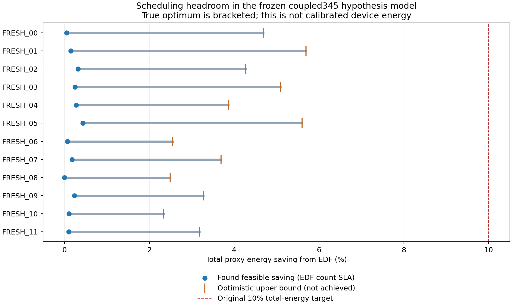

# 스케줄링 절감 한계 — 같은 coupled345 가설 모형의 오프라인 진단

전체12조건 평균의 달성 확인 절감은 **0.1855% 이상**, 낙관적인 수학적 완화에서 얻은 최대 가능 절감 상한은 **3.9828% 이하**다. 참 최적값은 이 사이에 있으며, 상한 자체를 실제로 달성했다고 해석하지 않는다. 총소비10% 목표의 평균 불가능 판정=true, 개별조건 12/12다.

EDF 평균 96.2566J*, 찾은 납기 비악화 일정 묶음 96.0781J*, 낙관적 소비 하한 92.4229J*다. 각 조건에서 기존8정책과 새3진단정책 중 전체/긴급 정시 수를 줄이지 않고 전 요청 응답/AVAILABLE을 완료한 최소소비 일정을 고른 오프라인 묶음이다. 단일 온라인 정책·새 독립 평가·실측 절감이 아니다.

## 전체 조건의 확인 구간

| 조건 | EDF J* | 찾은 실행가능 J* | 낙관적 하한 J* | 달성 확인 절감 | 최대 가능 절감 상한 |
|---|---:|---:|---:|---:|---:|
| FRESH_00 | 92.7162 | 92.6692 | 88.3730 | 0.0507% | 4.6844% |
| FRESH_01 | 119.7995 | 119.6162 | 112.9741 | 0.1530% | 5.6974% |
| FRESH_02 | 85.2943 | 85.0211 | 81.6452 | 0.3203% | 4.2782% |
| FRESH_03 | 108.8199 | 108.5458 | 103.2831 | 0.2518% | 5.0881% |
| FRESH_04 | 78.1158 | 77.8961 | 75.0978 | 0.2812% | 3.8635% |
| FRESH_05 | 99.3668 | 98.9340 | 93.7991 | 0.4356% | 5.6032% |
| FRESH_06 | 90.3046 | 90.2385 | 88.0015 | 0.0732% | 2.5503% |
| FRESH_07 | 117.3023 | 117.0889 | 112.9741 | 0.1819% | 3.6898% |
| FRESH_08 | 83.6076 | 83.6076 | 81.5260 | 0.0000% | 2.4897% |
| FRESH_09 | 105.9745 | 105.7222 | 102.5038 | 0.2381% | 3.2751% |
| FRESH_10 | 76.8937 | 76.8133 | 75.0978 | 0.1045% | 2.3355% |
| FRESH_11 | 96.8840 | 96.7836 | 93.7991 | 0.1037% | 3.1841% |

모든 조건의 미래 CPU/GPU 잠재 작업량을 공개한 뒤 하한을 구했다. 실제 온라인 정책에는 없는 정보를 허용하고, 온도 궤적 도달 가능성·동시 실행 제약의 일부를 더 완화했다. 따라서 여전히 목표가 불가능하다는 판정은 현재 후보8/NN의 약함만으로 설명할 수 없다. 반대로 목표가 배제되지 않은 경우에는 해당 절감을 달성할 일정이 있다는 뜻이 아니다.

## 하한의 근거

공유 활성 전력 H는 최대2소유자이므로 각 소유자에 H/2를 배분한 합보다 작을 수 없다. 작업량 dw=f dt에 대해 실행 단계의 배분 에너지/작업량은 A(1-l)f²+(Al·leak+H/2)/f, A=p_solo-H다. 나머지 단계는 진행률1이다. 온도26℃ 이상·진행률0.45~1·누설상한3과 RC 전이에서 보수적인 온도상한을 구하고, 0.01℃ 각 구간의 유리한 끝값을 따로 사용해 에너지 하한을 계산했다. 계수마다1e-9를 차감했다.

매 요청이 두 자원 중 하나를 택하는 완화 문제에 전체/긴급 정시 수의 EDF 비악화, 응답 prefix의 도착~기한 구간별 최소 점유량, drain까지 전 단계의 최소 점유량을 넣었다. 비선점 suffix 차단·실제 열 궤적·동시 처리의 일부는 생략한 필요조건이다. HiGHS의 dual bound에서 추가1e-5를 차감한 값과 독립 작업량 하한 중 큰 값을 사용했다. 부동소수점 solver의 보고 하한이며 유리수 형식 증명은 아니다. 각 원 EDF 일정이 이 완화 제약을 실제로 만족하는지 별도로 확인했다.

평균온도는 RC의 에너지 투입 시각별 커널을 사용해, 정시 요청의 응답 prefix 에너지를 기한에 전부 몰아넣는 낙관적 하한도 구했다. 0.5℃ 감소가 이 하한에서도 불가능한 조건은 0/12다. 그 밖의 조건은 가능성을 배제하지 못한 것이며 달성 증명이 아니다. 시간창·기저 소비·원 물리 계수는 변경하지 않았다.

## 실행 가능한 일정 탐색과 작은 전수 비교

새3정책은 잠재 작업량을 아는 공통 비용식 선택, 잠재 작업량을 아는 ATC, 작업별 저소비 자원을 선호하는 진단 휴리스틱이다. 마지막은 현재 후보8 밖의 ready 요청도 볼 수 있어 현재 NN보다 넓은 정책 공간이다. 어느 것도 전역 최적이라고 부르지 않는다. 납기 손해가 난 새 일정도 모두 저장하고 실현 절감의 증거에서 제외했다.

작은 사례는 FRESH00/06에서 입력만으로 첫 C2개/D2개를 골랐고 원 도착·기한·잠재 key·시간창을 유지했다. 자원 배정과 자원별 순서의 모든120개 list plan을 각 초기온도에서 재생했다. 지정한 즉시배정/합법50ms WAIT 실행 방식 안에서 전수 최적이며, 임의의 연속 대기 시각을 포함한 전체 일정 공간의 최적은 아니다.

| 작은 사례 | 전수 plan | 합법·납기 적격 | 총소비 절감 | 작업증분 절감 |
|---|---:|---:|---:|---:|
| MICRO_FRESH_00 | 120 | 24 | 0.1115% | 4.8900% |
| MICRO_FRESH_06 | 120 | 20 | 0.0888% | 4.1211% |

## 검산·예산·주장 경계

순수9계약 PASS, 원 EDF와 새 진단 P0 두 조건의 시각/지표 정확 일치, 새280 START=280 COMPLETE/FAIL0, 독립 저장검사 249776개 PASS다. 고정 은행은 원8정책의 모든 관측 잠재 벡터와 일치했다. V1은 JSON list/메모리 tuple 비교 오류로 환경START0에서 중단되었고 원 소스/START/실패를 보존했다. V2는 정규화만 고쳐 별도 등록했다. 원602 operation은 재실행하지 않았다. 새288예약 중280소비·잔8이며 이전640의 미할당38과 원256/RR잔1은 건드리지 않았다. 추적 예약은125766/137712 snapshot이며 현재 타host 실제소비 전수값은 아니다. 기기·새 물리 fit·NN학습·자동 후속 실행0이다.

숫자는 A24 실측J나 실기기 최적 한계가 아니라 coupled345 가설 모형의 조건부 한계다. 수학적 완화 상한, 실제 재생으로 찾은 절감, 작은 list class의 전수 최적을 서로 구분한다. 정확한 전역 최적/온라인 도달 가능성/그 외 온도·입력 조건은 미확인이다. ANALYSIS.json에 모든 새 휴리스틱 손해·각 solver의 종료상태/하한·작은 사례 최적 계획을 연결했다.

## 원인 해석과 확인 구간 그림

[기저80.2%·납기/자원 제약을 제거한 상한·공동 개선의 해석](INTERPRETATION.md). 작은 유한 클래스의 독립 검산은 MICRO_AUDIT.json의809검사 PASS이며,240계획 중44는 지정 list를 그대로 따라 끝냈고196은 금지 WAIT 필요를 기록해 적격 집합에서 제외했다.

