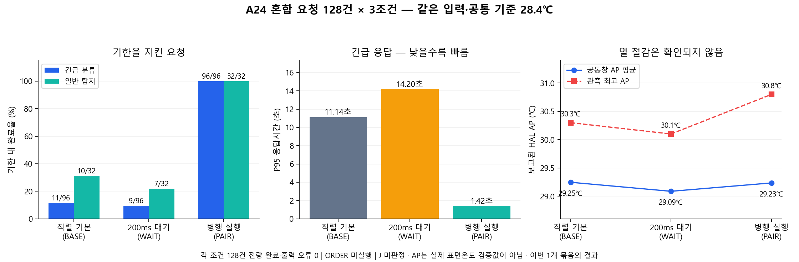

# C8 종료 — 사용자 승인 혼합 묶음

**외부 공개 확인 완료:** [로그인 없는 GitHub 다운로드·SHA 검증](PUBLIC_GITHUB_VERIFICATION.json). 커밋41342fd의3개ZIP·원자료3,199개·보고서/그림/다음PC준비문서를외부에서내려받아모두일치함을확인했다. 로컬Git상태만으로업로드를주장하지않는다.

이번 APP3회, 정상회수3회·MAIN384건이다. 전체 독립 확인은 **20/40회·2,736본요청**, 정식 예산 **61/81회**다. 종료UTC `2026-10-15T14:23:52.132711+00:00` / 사유 `PRE_APP_COOLDOWN_STOP`. 정상회수는 모든 요청의 기한 준수를 뜻하지 않는다.

사용자 승인 순서는 원0~16→18~39→17, 이번 대상은18~21 M128 WAIT→BASE→PAIR→ORDER 최대4였다. 원17 L64 PAIR_G는 원ID/27.1℃로 미실행 보존했다. M128 공통28.4℃는 첫 본요청 전에 고정했으며 MAIN·입력·기한·APK·core179·예산81은 변경하지 않았다. 순서 변경과 이월의 한계를 숨기지 않는다.

- [NEW_CONFIRM_CONFIRM_R02CONFIRM01.zip](blocks/NEW_CONFIRM_CONFIRM_R02CONFIRM01.zip): 정상회수8/8군
- [NEW_CONFIRM_CONFIRM_R02CONFIRM02.zip](blocks/NEW_CONFIRM_CONFIRM_R02CONFIRM02.zip): 정상회수8/8군
- [NEW_CONFIRM_CONFIRM_R02CONFIRM03.zip](blocks/NEW_CONFIRM_CONFIRM_R02CONFIRM03.zip): 정상회수4/8군

[ZIP SHA](BLOCK_BUNDLES.json) · [전체118슬롯 원장](attempts_all_latest.csv) · [소비/미실행 원장](GLOBAL_CONSUMPTION_LEDGER.json) · [횟수](COUNTS.json) · [이번 분석 CSV](closed_results.csv) · [전체 종료조건 CSV](all_closed_sessions.csv) · [대응 차이 CSV](all_closed_pairs.csv) · [원 실행 영수증](execution_receipts/)

실제 APP는 기존55+이번3=58, 별도 전류진단1을 합치면59다. 예전 APP이전 실패3회의 예산 소비와 실제 APP를 구분한다. 새 실패·미완료·미실행·AP부적격을 대체하지 않았다. C6/C7의 APP0 냉각 원기록은 별도 폴더에 보존했다. raw 원바이트·파일별 SHA·소스/APK/입력 SHA·개인/바이너리 제외 사유가 ZIP에 있다. 모델·APK·이미지·키·개인 식별/경로는 공유하지 않는다. J는 미판정이고 AP는 HAL 채널이며 표면온도는 미검증이다.

## 이번 혼합 조건의 결과

| 방식 | 분류 기한 내 /96 | 탐지 기한 내 /32 | 분류P95 | AP평균 | 관측 최고AP |
| --- | ---: | ---: | ---: | ---: | ---: |
| 직렬 기본 BASE | 11 | 10 | 11.137초 | 29.246℃ | 30.3℃ |
| 200ms 대기 WAIT | 9 | 7 | 14.200초 | 29.086℃ | 30.1℃ |
| 병행 PAIR | 96 | 32 | 1.418초 | 29.234℃ | 30.8℃ |

PAIR는 이번 같은 입력·기준의 혼합 부하에서 서비스가 개선됐다. 평균 AP의약−0.012℃는확실한절감으로주장하지않고,관측최고AP는오히려+0.5℃다. 열·에너지공동개선은확인하지못했다. WAIT의낮은AP관측과서비스악화를함께해석하며우위로판정하지않는다. 한묶음결과를전기기/전부하/상용시스템전체의우월성으로일반화하지않는다.

[그림 재현 코드](make_summary_plot.py) · [그림 출처/버전 SHA](PLOT_PROVENANCE.json) · [종료 후 PC 검증/수정 기록](POSTPROCESS_VERIFICATION.json) · [다음 방문 요구사항](NEXT_VISIT_REQUIREMENTS.json)

~~~powershell
python -B docs/results/a24_measurement_share_20261015/confirmation_visit_08/make_summary_plot.py docs/results/a24_measurement_share_20261015/confirmation_visit_08
~~~

다음20회/2,984요청의준비는PC전용이다. [실행불가준비·남은ID·두고정reference](../../../team/a24-measurement-revision02-20261015/confirm20_preparation_after_C8_20261015/README.md). 실제기기실행은새시간창·최신원장·동일폰사전조건을결합한뒤에만가능하다.
