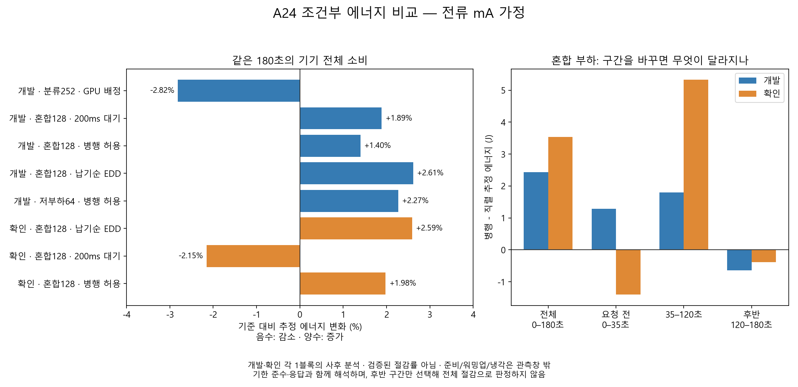

# A24 기존 원자료의 조건부 에너지 비교

2026-10-15. **원자료로 J를 계산할 수 있다. 다만 최신 혼합 부하에서 병행 허용의 응답 개선이 에너지 절감으로 이어지지는 않았다.** 이번 결과는 전류 원값을 mA로 해석한 기기 전체 배터리 에너지 추정이다. 설치 펌웨어의 단위 경로·센서 정확도·실제 절감률을 검증한 결과가 아니다.

[분석 계약](analysis_contract.json) · [12군 에너지·서비스·시작 상태](run_v1/sessions.csv) · [구간별 적분](run_v1/windows.csv) · [모든 대응 차이](run_v1/pairs.csv) · [원물 SHA·검산](run_v1/verification.json)



## 실제로 확인한 범위

- 완료된 DEV8과 새 CONFIRM 첫4군의 공개 원물 ZIP을 그대로 읽었다. 12군의 예정 1,656요청과 완료 1,656요청을 대조했고 실패·미완료는 0이다. 기존 출력 품질 판정은 원 보고서를 따른다.
- 각 비교쌍의 작업·예정 도착·기한·모델·이미지·입력 tensor SHA가 같음을 실제 요청별로 확인했다. DEV와 CONFIRM은 별도로 보고하며 시작 AP·SOC·순서가 다른 두 묶음을 동일 초기조건의 반복 표본으로 합치지 않았다.
- 0~180초를 기존 주 관측창으로 유지했다. 요청 전 0~35초, 요청 시작 이후 35~180초, 35~120초, 실행 후 120~180초도 모두 계산했다. 60개 관측창 모두 전류·전압 자료가 유효했다. APP 준비·워밍업·준비 냉각과 180초 이후 소비는 이 관측창 밖이며 무료라고 가정하지 않는다.
- 원 센서값을 바꾸지 않고 두 단위 가설을 파생 출력에 함께 보존했다. 전류 mA와 전압 mV의 곱에 10^-6을 적용하고 실제 경과시간으로 사다리꼴 적분했다. 전하량 counter를 정답이나 보정 배율로 쓰지 않았다. 원모형의 기존 ×1000 변환·계수도 수정하지 않았다.
- 이 계약은 새 계산 전에 작성한 **기존 자료 사후 분석 계약**이다. 이미 진행된 확인40의 에너지 판정을 소급 변경하거나 새로운 사전 등록 확인 결과로 승격하지 않는다.

## 같은 180초의 결과

아래 변화율은 `(후보 / 기준 - 1) × 100`이다. 양수는 더 많이 소비한 추정값이다. 표의 J와 % 모두 동일 단위 가설에 조건부다.

| 비교 | 개발 기준→후보 J | 개발 변화 | 확인 기준→후보 J | 확인 변화 |
| --- | ---: | ---: | ---: | ---: |
| 혼합 직렬→병행 허용 | 174.385→176.822 | +1.40% | 178.854→182.394 | +1.98% |
| 혼합 직렬→납기순 EDD | 174.385→178.942 | +2.61% | 178.854→183.491 | +2.59% |
| 혼합 직렬→200ms 대기 | 174.385→177.674 | +1.89% | 178.854→175.008 | −2.15% |
| 저부하 직렬→병행 허용 | 174.242→178.201 | +2.27% | 미실시 | 미실시 |
| 분류 CPU→GPU | 186.221→180.978 | −2.82% | 미실시 | 미실시 |

혼합 병행은 두 묶음 모두 분류96/96·탐지32/32를 기한 내 완료했다. 직렬의 긴급 P95 11.122/11.049초를 병행은1.426/1.421초로 줄였다. 따라서 이번 근거는 **서비스 개선이며 에너지 절감은 아니다**. EDD는 일반 기한 준수가 악화됐고, 대기는 두 과업의 기한 준수가 모두 악화됐다. 대기의 확인 에너지 감소만으로 우위라고 판정하지 않는다.

분류 GPU의 −2.82%는 한 개발쌍의 관측이다. 두 자원 모두252건 전량 기한 내지만 GPU P95는272.371ms, CPU는116.471ms다. 시작 AP도26.3/25.9℃, SOC100/97%로 달랐다. 엄격한 수치적 응답 비악화와 절대 기한 충족을 구분한다. 이 결과를 안정적인 절감이나 GPU 채택 판정으로 확대하지 않는다.

저부하 병행의 실제 동시 점유는0초다. 이 군의 차이를 병행 효과라고 부를 수 없다. CONFIRM 직렬의 AP는 기존12.34초 공백으로 부적격이므로 해당 열 비교는 null을 유지한다. 전류 관측창 유효성과 AP 관측창 유효성은 별개다.

## 측정 시점이나 가공으로 달라지는가

| 혼합 병행 − 직렬, 조건부 J | 개발 | 확인 |
| --- | ---: | ---: |
| 전체 0~180초 | +2.4369 | +3.5401 |
| 요청 전 0~35초 | +1.2854 | −1.4023 |
| 요청 시작 이후 35~180초 | +1.1515 | +4.9424 |
| 35~120초 | +1.7970 | +5.3291 |
| 120~180초 | −0.6455 | −0.3867 |

요청 이후만 보아도 병행의 에너지 증가 방향은 유지된다. 후반120~180초만 선택하면 병행이 낮아 보이지만, 앞선 소비를 제외한 것이므로 전체 절감 판정으로 쓸 수 없다. 모든 군의 실제 lane 반환은180초 안에 끝났다. 작업별 완료 시각으로 관측창을 줄이지 않았다.

12군의 180초 적분에서 read_start/read_midpoint/read_end 중 읽기 시각 선택을 바꾼 최대 차이는 **0.0375%**, 좌측 유지·우측 유지·사다리꼴 적분 간 최대 수치 차이는 **0.5972%**였다. 이는 계산 방법의 민감도이며 센서 오차 한계가 아니다. 센서 자체가 전류를 언제 갱신했는지, 내부 평균·필터가 얼마나 지연되는지는 여전히 미확인이다.

요청 전 평균 추정 전력은 CONFIRM4에서0.840~0.920W로 달랐다. 이 전력을 전체180초에서 빼면 병행−직렬 차이가 개발−4.174J/확인+10.752J로 바뀐다. 이 계산은 **일정한 기저전력이 유지된다는 미검증 가정의 민감도 예시**이며 보정 결과나 최종 KPI가 아니다. 유리한 결과가 나오도록 기저전력·시간창·이동량을 선택하지 않는다.

같은 양의 단위 배율만 틀린 경우 상대 차이에서는 상쇄된다. 반면 고정 오프셋, 부하에 따라 달라지는 오차, 표본 누락, 센서 지연, 시작 상태 차이는 자동 상쇄되지 않는다. 두 묶음만으로 반복 측정 잡음의 크기나 통계적 유의성을 추정하지 않았으며 신뢰구간을 만들지 않았다.

## 해석과 다음 단계

현재 자료의 가공과 비교는 가능하다. 센서 오류만이 개선 부재의 원인이라고 확정할 수 없고, 빨라진 추론이 반드시 적은 에너지를 뜻하지도 않는다. 동일180초의 폰 전체 에너지는 화면·운영체제·앱의 소비와 실행 후 소비를 포함한다. 원전류의 빠른 변화와 약0.9초 표본 간격은 개별100ms 수준 작업의 전력을 정확히 분리했다는 증거가 아니다.

남은 확인36은 원래의 고정 순서·정책·조건으로 계속하면 블록별 방향과 변동을 살필 수 있다. 에너지 결과는 조건부 분석으로 별도 유지한다. 수집 과정이나 초기조건을 바꿔야 한다면 해당 변경은 별도 개정으로 기록해야 하며, 현재 차이를 줄이기 위한 사후 보정을 적용하지 않는다. 이번 사후 자료를 시뮬레이터 학습에 섞지 않았고 모형 예측 정확도가 개선됐다는 주장도 없다.

## 재현·검증

```powershell
$env:PYTHONPATH='tools'
python -B -m unittest test_d1_a24_conditional_energy_comparison test_d1_a24_measurement_analysis -v
python -B tools/d1_a24_conditional_energy_comparison.py docs/results/a24_revision02_20261015/conditional_energy_comparison/analysis_contract.json output/a24_conditional_energy_NEW
python -B tools/d1_a24_conditional_energy_plot.py output/a24_conditional_energy_NEW output/a24_conditional_energy_NEW/conditional_energy
```

새7검사와 기존 적분/분석3검사 PASS. 누락·충전·sentinel·큰 간격·중복 시각을 차단하고, 원래 동결 분석기의 적분과60구간에서1e-12 상대 허용오차로 일치했다. 두 단위의1000배 관계와 동일배율 상대 차이 상쇄도 검산했다. ZIP과 모든 멤버 및 입력 CSV SHA를 검증하고 분석 중 원파일 불변을 확인했다. 이 허용오차는 산술 일치 기준이다.

분석 기준 HEAD는 `da0392ffe845f298adf466afa48db56c2e35bbbc`와 별도 신규 코드이며 코드 SHA는 [검증 기록](run_v1/verification.json)에 있다. **이 PC 분석 자체의 기기 명령·추가 실측·학습·계수 변경은0**이다. 이후 사용자가 별도로 승인한 측정 재개는 별도 원장에 기록한다.
