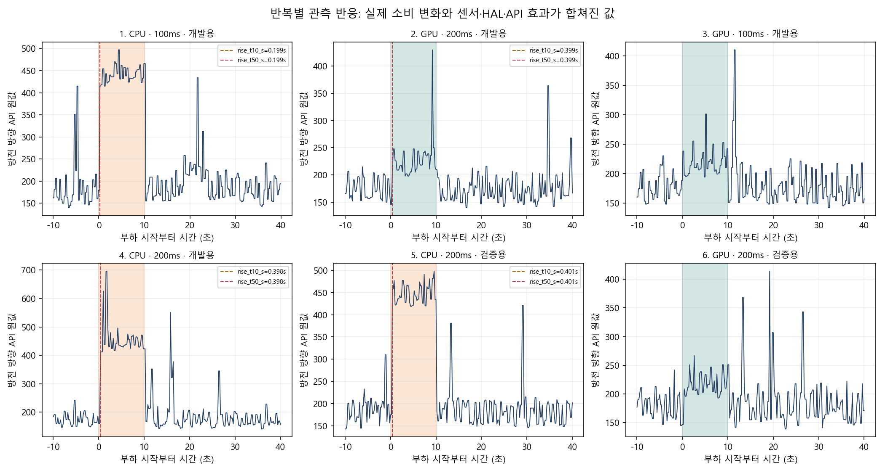

# A24 부하 시작 → 전류 API 반응 진단

2026-10-15. **CPU 합성 부하 시작 뒤 약0.2~0.4초의 API 전류 반응 시간차를 관측했다. 순수 센서 지연을 분리·확정한 결과는 아니다.** GPU는3반복 중1개에서만 사전 규칙을 충족하는 반응을 검출했다. 하나의 지연값으로 기존 전류 기록을 옮길 근거는 부족하며 시간 보정은0이다.

[오프라인 결과 화면](index.html) · [반복별 수치](pulses.csv) · [유휴 조회 비교](idle_controls.csv) · [계산 결과](analysis.json) · [원자료 ZIP](original_current_response_raw.zip) · [원자료 SHA](RAW_EVIDENCE.json) · [사전 계획·계산식](../../../team/a24-measurement-revision02-20261015/current_response_diag_20261015/README.md)



## 실제 수행과 결과

기존 CONFIRM의 혼합BASE를 끝내고 활성APP0의 경계에서 중지한 뒤, 별도 패키지에서1APP·6합성부하 반복을 수행했다. 전체543.475초, 전류 조회3,246개, 누락·충전 표본0이다. 기존 확인81슬롯 중 소비는0이며 별도 진단APP1회를 추가 실행 수에 명시한다. 이 진단의 신경망 추론·정식CONFIRM START/claim은0,실제ADB명령은62회다. 원CONFIRM 앱은 설치 전·회수 후 같은SHA임을 확인했고, 진단 프로세스 종료를 확인한 뒤 남은 실측으로 복귀했다.

| 반복 | 합성 부하·조회 간격 | 자료구분 | 상승50% 반응 | 하강50% 반응 | 사전 검출 규칙 |
| --- | --- | --- | ---: | ---: | --- |
| 1 | CPU·100ms | 개발 | 0.199초 | 0.299초 | 충족 |
| 2 | GPU·200ms | 개발 | 0.399초 | 0.402초 | 충족 |
| 3 | GPU·100ms | 개발 | 미판정 | 미판정 | 상승량43,전대기MAD15:3배45 미충족 |
| 4 | CPU·200ms | 개발 | 0.398초 | 0.395초 | 충족 |
| 5 | CPU·200ms | 검증용 | 0.401초 | 0.195초 | 충족 |
| 6 | GPU·200ms | 검증용 | 미판정 | 미판정 | 상승량29,전대기MAD18:3배54 미충족 |

표의 상승량·MAD는 미검증 API 원값의 방전 방향 수치다. mA 또는 보정된 소비 전류로 승격하지 않는다. 상승10%와50%는 이번 검출 반복에서 같은 첫 조회로 기록됐다. 조회 간격보다 세밀한 반응 곡선을 얻었다는 뜻이 아니다. 검증용 반복2개는 개발4개와 분리해 표시했지만 같은 APP 세션 안의 반복이며 독립 세션 검증이 아니다.

GPU 셰이더는 각각993/1,025/1,004batch가 `glFinish`까지 반환했고 실제 부하 구간은10.002~10.008초였다. 따라서 검출 미충족을 GPU 작업 미실행으로 해석하지 않는다. 작은 전류 변화가 배경 변동에 비해 약해 사전 규칙을 통과하지 못한 것이다. 육안상 상승이 보여도 결과를 본 뒤 MAD 기준을 완화하지 않았다.

## 무엇을 확인했고 무엇이 남았는가

- 확인: 앱의 부하 실행 경계와 API 전류 반응 사이에 시간차가 관측됐다. CPU200ms의 개발0.398초와 검증용0.401초는 이 세션에서 비슷했다.
- 미확정: 실제 전력 상승·하강의 물리 시각, 센서 취득·필터·Health HAL의 개별 지연, 펌웨어 전류 단위, 절대J 정확도다. CPU/GPU의 자연적인 전력 상태 변화와 API 반응을 분리하지 못했다.
- 조회 간격 영향: CPU100ms에서0.199초,200ms에서약0.4초로 검출됐으므로 단일한 센서 지연 상수로 단정하지 않는다. 전대기를 정수초로 구성하고 각 반복의 조회 일정을 다시 시작해 조회 격자에 대한 부하 시작 위상이 비슷해질 수 있다. 후속으로 센서 지연을 더 식별하려면 연속 조회를 유지하고 비정수초 시작 위상을 사전 고정한 반복과 실제 추론 부하 검증이 필요하다.
- API 호출 자체의 벽시계 소요는 중앙값7.527ms,최대18.494ms였다. 이는 센서 지연이나 에너지 측정 오차가 아니다. 실제 센서 취득 시각은 제공받지 못했다.
- 유휴20초씩의 원전류 중앙값은900ms조회162/163.5,200ms176/168,100ms176/169였다. 잦은 조회에서 높은 값이 관측됐지만 한 세션의 순차 구간이므로 수집 부하와 배경 소비 변화의 인과 분리는 불충분하다. 기록한 조회 함수 스레드CPU시간은 JSON·flush를 제외한다.

**이번 진단으로 기존 에너지 비교가 잘못됐다고 확정하거나, 현재 에너지 차이가 센서 지연 때문이라고 확정하지 않는다.** 합성 부하 반응을 개별 모델 추론의 전력 지연으로 전용하지 않는다. 기존180초 공통창·원자료·조건부J·공식J null을 그대로 사용한다. 진단 뒤 원27.9℃ 시작 기준과 기존 앱을 재확인해 미실시CONFIRM을 이어갔다.

## 증거와 재현

별도 진단APK SHA-256 `147aec8101394f6e6574df874bfb69ad1fe0ab06e766b9d7d93245e50c5f9db6`, 기존CONFIRM APK `6fbe5c0812e3d123259be5004d37c6a4d6e9a2b750df2ac4ae5460b01f0bfd8b`. 진단 호스트SHA는 [회수 증거](RAW_EVIDENCE.json)의 원본ZIP `HOST_RECOVERY.json`에 있고, 소스 전체는 [PC 검증 SHA](../../../team/a24-measurement-revision02-20261015/current_response_diag_20261015/PC_VERIFICATION.json)에 고정했다. 코드 기준은 HEAD `25361be`+미커밋 신규 소스이며 동결179파일은 바이트 불변이다.

원물ZIP에는 `events.jsonl`·`summary.json`·`journal_closed.json`·`HOST_RECOVERY.json`4개가 원래 바이트 그대로 들어 있다. 모든 ZIP멤버SHA를 재검산했다. 개인정보가 포함될 수 있는 기기identity·전체private설정은 로컬에 보존하고 배포하지 않는다. 모델·이미지·키·APK를 공유 ZIP에 넣지 않았다.

```powershell
$env:PYTHONPATH='tools'
python -B -m unittest test_d1_a24_current_response -v
# 공개 원물ZIP을 새 폴더에 해제한 뒤 PC 분석만 재현한다.
Copy-Item <THIS_RESULT/analysis_schedule.json> <EXTRACTED_RAW/config.json>
python -B tools/d1_a24_current_response_analysis.py <EXTRACTED_RAW> <NEW_ANALYSIS_OUTPUT>
python -B tools/d1_a24_current_response_plot.py <EXTRACTED_RAW> <NEW_ANALYSIS_OUTPUT> <NEW_FIGURE_OUTPUT>
```

공개 [analysis_schedule.json](analysis_schedule.json)은 원래private설정에서 실제 분석이 사용하는 일정5필드만 정확히 투영한 파생본이다. 분석용해제폴더의`config.json`으로복사한다. 식별용fingerprint·APK·종료시각은 분석 함수가 사용하지 않는다. 원시개인설정을 복원한 것이라고 표시하지 않는다. 원기기 실행 명령은 과거ID·시간창으로 재실행하지 않는다.
