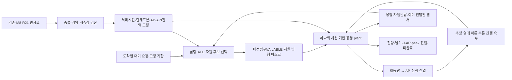

# 공통 엔진 구조

물리 plant는 분류 CPU/GPU/NPU와 탐지 CPU의 추론/공유 단계/점유를 공통 규칙으로 계산한다. 정책별 절감 상수를 사용하지 않는다. `SIM002_G001`의 base plant와 계수는 `SIM001_G001`과 같고 자원 선택 인터페이스만 추가했다.

추론은 `.005s` 이내 간격으로 진행하고 온도/병행 연관 회귀의 duration과 whole-vector 잔차로 진행률을 갱신한다. 사건은 요청 enqueue, 단계 전환, AVAILABLE, 센서 생성/전달, WAIT 종료다. AP는 두 지수 상태와 초기 이력 항, API 전력은 양의 Gamma-history 회귀다. 비용 적분은 `.025s`, 저장 곡선은 `.5s`다. 시간 간격 절반 P0 4쌍을 비교했다.

현재 비추론 GAP/ADMISSION/RETURN_GAP/POST는 과거 whole-vector의 무조건 전이다. 조건부 단계 보완104fit는 아직 채택 전이다. 열→속도 연관은 관측 자료의 준정상 전이 가정이며 인과적 DVFS 법칙 식별이 아니다. 센서 주기2.3초/전달 지연0.2초도 가정이다.

초기 상태 3블록과 처리시간8표본은 별도 모형이 아니다. 같은 모형에 다른 초기 이력/잠재표본을 넣은 조건이다. 평균 입력 한 번으로 뭉개지 않고 각 실행 결과를 같은 비중으로 집계한다. 평균 곡선과 실제 한 번의 자원 점유 궤적을 구분한다.
