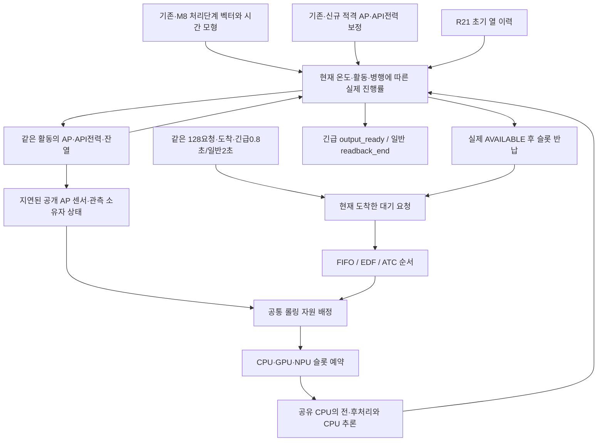

# 하나의 S26 다중자원 예측 엔진

기존 실측으로 만든 시간·열·전력 모형에 새 실측을 연결하고, 자원 슬롯·공유 CPU·열에 따른 진행률을 같은 사건 루프 안에서 계산한다. 실험별로 서로 다른 물리를 붙여 비교하지 않는다. `experiments/multiresource_v1/`에 실행 소스·봉인 입력·사용 원장·계수·감사 계보가 있다. 최신 완료 여부는 `MULTIRESOURCE_PROGRESS_20261017.md`와 실제 결과 파일에서 확인한다.

## 실측이 직접 제공하는 것

- 처리단계 원벡터, backend 경로, 응답·해제 시각과 초기 센서 이력. 같은 요청의 단계 간 상관을 유지해 표본을 추출한다.
- 기존·신규228세션 검토 후 적격 AP210·전력209세션의 사용 원장. R21 단위 비적격2건의 전력 제외와 AP 보존을 구분한다.
- AP/전력에 대한56개 전체·블록 제외 fit. 보정계수는 정책 결과를 목표로 맞춘 값이 아니다.

## 모형이 추정하는 것

- backend·온도·기존 병행 관측에 조건부인 처리시간. 선택한 작업의 실제 진행률은 열 상태와 함께 변한다.
- 양의 활동 가열항·초기 이력항을 갖는 AP 예측, 비음수 가산 API 전력 예측. wall-phase 대리변수는 칩별 전력 분해가 아니다.
- 공개된 도착 요청과 과거 관측만으로 계산하는 명목 잔여 시간·기한 가능성·경로 비용. 정책은 실제 미래 응답·추출 잔차를 보지 않는다.

## 새 병행에 필요한 전이 가정

분류 GPU+NPU 및3자원 병행의 실기기 직접 검증은 없다. 분류 CPU와 탐지 CPU는 같은 슬롯을 쓰며, GPU/NPU도 각각 하나의 슬롯이다. CPU의 서비스 prefix와 passive residual 분리, 새 pair/triple 간섭, 센서 지연·주기와 대기 중 비용은 구조 가정이다. LOW/CENTRAL/HIGH를 함께 보고 실제 물리 상·하한으로 부르지 않는다. 탐지 GPU/NPU는 현재 엔진에 통합하지 않았다.

## 결과를 읽을 때

이번 세 정책은 자원 범위뿐 아니라 롤링 배정기도 공유한다. 따라서 전체 롤링 제어기의 기여가 아니라 그 위의 **순서 규칙 기여**를 비교한다. MIX 부하의 작업 종류와 우선순위 결합도 결과 해석 범위다. 특정 정책을 좋게 만들려고 물리계수·기한·분모를 바꾸지 않는다.

원장·바이트·진행률·저장 활동·비용의 전수 검산과 실기기 정확도 검증은 다르다. 같은 모형 안에서 정책 차이를 재현해도 실제 기기 절감이 인증되는 것은 아니다. 이미 본 개발 모집단의 블록 제외 AP 오차 약1.10℃, 전력 관측구간 면적 상대오차 중앙값 약14.6%도 함께 판단한다. 납기·완료를 희생한 에너지 감소는 목표 달성으로 인정하지 않는다.
